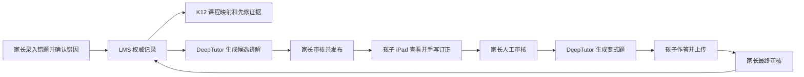
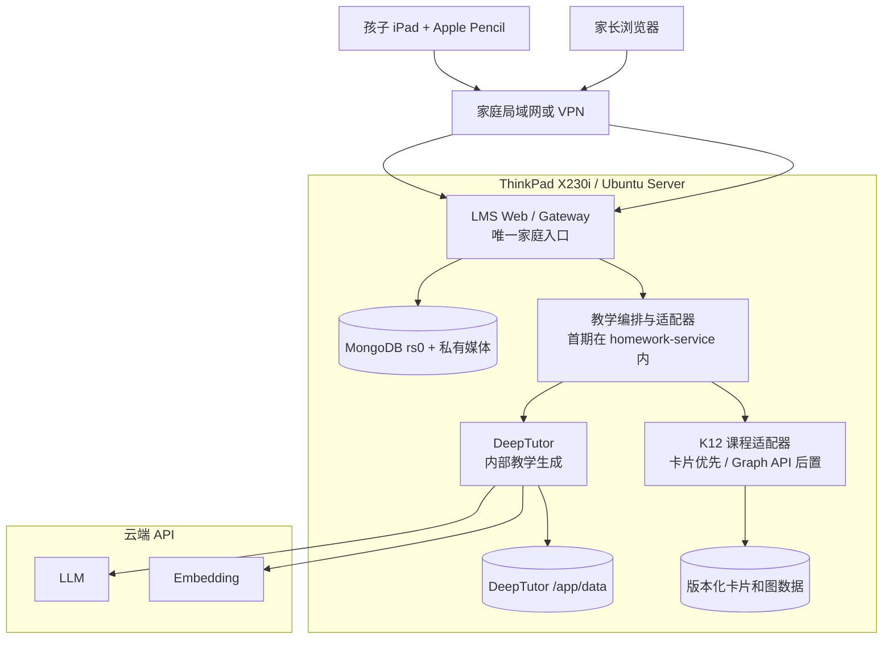

# 功能、硬件与系统架构

[返回总目录](00_总目录与实施路线.md)

## 1. 系统定位

家庭 AI 学习平台由现有 LMS 主系统和两个可选扩展组成。它们不能交换数据所有权：

| 组件 | 定位 | 可以做 | 不可以做 |
| --- | --- | --- | --- |
| LMS | 权威业务与学习档案中心 | 身份、任务、错题、附件、审核、掌握证据、周报、提醒 | 把判定责任交给模型或让孩子绕过权限访问内部服务 |
| DeepTutor | 受 LMS 调度的教学生成器 | 讲解、例题、提示、变式题、结构化家长判定要点 | 直接写错题状态、掌握度、家长审核结果 |
| K12-KGraph | 版本化只读课程结构库 | 课程节点、教材位置、先修关系、证据、相关练习 | 保存孩子个人数据或把图谱关系当成掌握事实 |

当前可发布基线是 LMS；其余组件由 feature flag 分阶段接入。完整业务与数据设计见
[家庭 AI 学习管理平台完整设计](../architecture/family-ai-learning-platform-design.md)。

## 2. 家庭学习闭环

人工审核是正式流程节点，而不是 OCR 失败后的临时补丁：



手写图片始终作为 LMS 私有媒体保存。第一阶段不要求 OCR，家长选择标准错因、确认课程
节点并判断“通过/重做”；AI 只在明确授权的生成节点工作。

## 3. DeepTutor 能力边界

DeepTutor 适合承担：

- 分层讲解和苏格拉底式提示；
- 例题、变式练习和答案解析；
- 根据课程证据生成结构化教学内容；
- 小型知识库的 RAG 检索；
- 独立管理员验证阶段的会话和资料管理；
- LLM 与 embedding 分离配置。

官方容器把 Next.js 前端（默认 `3782`）和 FastAPI 后端（默认 `8001`）放在同一个
容器中。单容器 Web 验证只需将 `3782` 绑定到主机回环地址，前端会在容器内代理
`/api/*` 和 `/ws/*`。只有 LMS 适配器做直接 API 调试时才需要把 `8001` 绑定到
`127.0.0.1`；正式集成优先让两个容器通过内部 Docker 网络通信。

DeepTutor 的本地会话和 memory 只用于生成诊断与续接，不是孩子学习档案。LMS 必须把
已采用的讲解和练习保存为带模型、prompt、schema、输入摘要与结果哈希的教学制品快照。

## 4. K12-KGraph 能力边界

K12-KGraph 当前主要覆盖人教版数学、物理、化学和生物，包含七类节点：`Book`、
`Chapter`、`Section`、`Concept`、`Skill`、`Experiment`、`Exercise`，以及课程从属、
先修、相关、实验验证、练习测概念等关系。

对家庭平台最有价值的是：

- 将家长录入的错题映射到明确的教材节点；
- 查询前置知识，帮助确定讲解顺序；
- 返回教材位置和 evidence，约束模型不混教材、不虚构引用；
- 用稳定 `nodeId + datasetVersion` 连接错题、知识点和后续复习。

K12-Bench 用于离线评测模型；K12-Train 用于研究和训练数据准备。二者都不应导入孩子
业务数据库，也不需要在 X230i 上常驻。K12 数据许可证为 CC BY-NC-SA 4.0，家庭非商业
使用仍需保留署名、版本和来源；未来商业化前必须重新做许可证评估。

## 5. X230i 硬件评估

### 5.1 适合承担

- Ubuntu Server、Docker Engine 和家庭 LMS；
- 低并发的 DeepTutor 容器，建议按需启动或限制运行时段；
- 小范围 K12 JSON/SQLite/Markdown 课程数据；
- 小型只读 NetworkX 图或课程卡片；
- 私有媒体、MongoDB 数据和 Restic 备份暂存；
- 云端 LLM、云端 embedding 的网络客户端；
- 单用户或少于 10 名孩子的家庭流量。

### 5.2 不适合承担

- 本地 7B/14B LLM、vLLM、大型 embedding；
- 重型 OCR 常驻服务和多本教材并行 MinerU；
- K12 全量图谱重建、SFT/LoRA、Bench 批量评测与正式服务并行；
- Neo4j、Elasticsearch、独立向量数据库集群；
- ClamAV `secure-production` 叠加层与 AI 栈同时常驻；
- 公网高并发、多租户生产服务。

### 5.3 8 GB 内存运行档位

| 档位 | 常驻组件 | 建议用途 |
| --- | --- | --- |
| A：稳定基线 | Ubuntu Server + LMS 最小栈 | 日常正式使用，优先保证孩子任务与数据可用 |
| B：AI 生成窗口 | LMS + DeepTutor；暂停 K12 抽取和其他重任务 | 家长集中生成讲解/练习，必须观察内存和 swap |
| C：数据维护 | LMS 保留或进入维护窗口；停止 DeepTutor；运行单章节转换 | 课程卡片、索引重建、备份和升级 |

初始预算只用于观测，不是保证值：

| 组件 | 预算 |
| --- | ---: |
| Ubuntu Server 基础 | 0.8～1.5 GB |
| 当前 LMS 最小栈 | 以 `docker stats` 实测为准，预留至少 3 GB |
| DeepTutor | 上限先设 2.5～3 GB |
| 轻量课程适配器 | 0.3～0.8 GB |
| 系统页缓存、Docker、日志和安全余量 | 至少 1～1.5 GB |

若 `MemAvailable` 长期低于 1 GB、swap 持续增长或出现 OOM，应停止 DeepTutor，而不是
继续压低 MongoDB 或 LMS 的可靠性。8 GB 机器不建议把所有组件全天同时常驻；若实际
家庭流程需要全天 AI 可用，升级到 16 GB 或把 DeepTutor 迁到云端会更稳妥。

### 5.4 磁盘预算

| 用途 | 建议空间 |
| --- | ---: |
| Ubuntu、系统更新和恢复余量 | 35～50 GB |
| Docker 镜像、构建缓存和日志 | 25～45 GB |
| LMS MongoDB 和私有媒体 | 30～80 GB，按家庭图片增长监控 |
| DeepTutor `/app/data` | 10～30 GB |
| K12 版本化课程数据与卡片 | 5～20 GB |
| 本机临时备份空间 | 15～30 GB |

250 GB 足够小规模使用，但原始教材 PDF、MinerU 中间产物和历史备份不应长期堆在 SSD。
把加密备份、合法取得的教材原件和可归档中间产物放到家庭 NAS，并设置磁盘水位告警。

## 6. 推荐运行时架构



信任边界：

- 只有 LMS Gateway 面向家庭客户端；
- DeepTutor 和 K12 没有孩子公开路由；
- LMS 只调用持久化 Adapter；`operationId` 在 LMS/Adapter 内幂等并映射 DeepTutor
  `sessionId/turnId`，不能假设 DeepTutor 原生支持该字段；
- DeepTutor 启用认证并使用非管理员服务用户，原生 grant 与 Adapter 路由/capability/KB/tool
  白名单共同限制能力；
- 云端上下文不含真实姓名、学校、联系方式、原始手写图或完整学习历史；
- DeepTutor/K12 不持有可用于绕过 LMS 权限的家长或孩子 token。

## 7. 推荐目录结构

LMS 继续使用仓库现有目录和 Compose；不要为了扩展而移动 MongoDB 或媒体数据。教育 AI
扩展使用独立目录：

```text
/srv/edu-stack/
├── compose.yaml                 # 仅 DeepTutor/K12 扩展；固定镜像版本
├── deeptutor/
│   └── data/                    # 映射到 /app/data
├── k12/
│   ├── repo/                    # 固定 commit 的 K12-KGraph 源码
│   ├── input/                   # 合法取得的 PDF/Markdown，不默认进 Git
│   ├── workspace/               # 可重建中间产物
│   ├── data/                    # 固定版本的发布数据
│   ├── cards/                   # 进入课程适配器的知识卡片
│   └── configs/                 # 无真实 API Key 的配置
├── graph-api/                   # 阶段 5 才启用
├── manifests/                   # 镜像、commit、数据和 schema 版本清单
└── ops/                         # 脱敏的运维脚本和恢复说明
```

## 8. 设计与上线边界

- 新设计中的 `TutorLearningCycle`、`TutorCycleAttempt`、`TutorGenerationInput`、
  `TutorGenerationJob`、`TutorArtifact` 和相关 API 都是
  草案；代码和测试完成前不能写成“已提供”。
- 第一阶段不增加独立教学微服务；先在 `homework-service` 内部实现编排模块。
- K12 先转为小范围课程卡片；多跳查询证明有价值后再部署只读 Graph API。
- 不做 DeepTutor 与 LMS 账号同步或 SSO；孩子永远使用 LMS 身份。
- 不把 DeepTutor memory 当成可恢复的学习档案。
- 手写识别不进入关键路径；家长人工审核是权威判定。
- 任何公网暴露、外部通知写入、真实数据迁移或权限变化都必须单独评审并保留回滚。
