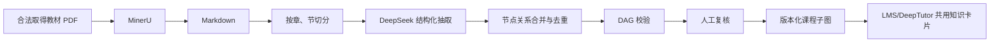

# K12 数据部署及其他教材扩展

[返回总目录](00_总目录与实施路线.md)

## 1. K12-KGraph 的组成

仓库包含：

```text
K12-Dataset/
├── src/
│   ├── kg/          # 知识图谱构建
│   ├── benchmark/   # K12-Bench 生成
│   ├── sft_qa/      # K12-Train 生成
│   └── utils/       # 配置、LLM、IO
├── eval/            # 模型评测
├── config/          # 默认配置
├── demo/            # 精简样例
├── books.yaml       # 教材注册表
└── requirements.txt
```

发布资产包括：

- K12-KGraph；
- K12-Bench；
- K12-Train。

家庭平台的正式运行路径只使用经过版本固定和人工抽检的 **K12-KGraph 课程子集**：

- K12-Bench 只用于离线比较模型，不进入孩子业务数据；
- K12-Train 只用于研究/训练准备，本方案不在 X230i 上训练或微调；
- `src/kg` 的全量构建流水线只在离线维护窗口或其他机器运行；
- LMS 保存的是 `CurriculumRef` 和 evidence 快照，不直接依赖 Hugging Face 在线可用性。

## 2. 适合的学科

当前最适合：

- 数学；
- 物理；
- 化学；
- 生物。

原因是这些学科具有：

- 清晰的概念定义；
- 前置关系；
- 公式；
- 技能；
- 实验；
- 练习题；
- 比较明确的章节结构。

可以扩展但需要修改 schema 或抽取提示词：

- 地理：地点、过程、区域关系；
- 信息技术：操作、算法、工具、实践任务；
- 科学综合课程：概念和实验；
- 历史：事件、时间、人物、因果关系；
- 语文：篇目、作者、体裁、修辞、知识点；
- 英语：词汇、语法、主题、技能。

语文、英语、历史等学科不能只照搬 STEM 的 Concept/Experiment/Formula 结构，最好增加新的节点和关系类型。

## 3. Python 环境

Ubuntu 26.04 的系统 Python 可能比较新。所有 K12 包应安装在虚拟环境中，不要直接修改系统 Python。
本手册在 2026-08-25 评审并锁定：

```text
K12 Git commit: 8716b6a80850790f509c01286f43e5bfe6858f49
requirements.txt SHA-256: 2c62bda639afa971e160914febe789f588ca1ccb0c85460d2e0b72f98d5215a0
Hugging Face dataset revision: d8522c2b336ee435aa51daa39ca0dd736f56fa53
```

版本升级必须先更新这三个值、检查 diff/许可证、用虚构数据重跑本章验收，不能直接安装默认
分支。先检出审核提交，再创建环境和安装依赖：

```bash
cd /srv/edu-stack/k12

export K12_COMMIT=8716b6a80850790f509c01286f43e5bfe6858f49
export K12_REQUIREMENTS_SHA256=2c62bda639afa971e160914febe789f588ca1ccb0c85460d2e0b72f98d5215a0

git clone https://github.com/haolpku/K12-KGraph.git repo
cd repo
git fetch --tags --force
git checkout --detach "$K12_COMMIT"

test "$(git rev-parse HEAD)" = "$K12_COMMIT"
test -z "$(git status --short)"
test "$(sha256sum requirements.txt | cut -d' ' -f1)" = "$K12_REQUIREMENTS_SHA256"

python3 -m venv .venv
source .venv/bin/activate

python -m pip install --upgrade pip
python -m pip install -r requirements.txt
python -m pip install datasets

mkdir -p /srv/edu-stack/manifests
python --version > /srv/edu-stack/manifests/k12-python.txt
python -m pip --version >> /srv/edu-stack/manifests/k12-python.txt
python -m pip freeze > /srv/edu-stack/manifests/k12-pip-freeze.txt
git rev-parse HEAD > /srv/edu-stack/manifests/k12-git-commit.txt
sha256sum requirements.txt > /srv/edu-stack/manifests/k12-requirements.sha256
```

当前仓库依赖包括：

```text
openai>=1.0.0
pyyaml
numpy
fastembed
```

README 的数据加载示例还使用 `datasets`，因此需要额外安装。

验证：

```bash
python -c "import openai, yaml, numpy; print('K12 base dependencies OK')"
python -c "import datasets; print(datasets.__version__)"
```

## 4. 先使用 demo

第一次不要直接下载和转换完整数据。

```bash
cd /srv/edu-stack/k12/repo
find demo -maxdepth 2 -type f
```

用 demo 完成：

1. 查看节点字段；
2. 查看边字段；
3. 编写知识卡片转换；
4. 生成 10～50 个 Markdown；
5. 用虚构数据在 DeepTutor 管理验证环境中检索；
6. 生成 LMS 可保存的 `nodeId + datasetVersion` 课程引用；
7. 人工验证教材位置、关系方向和 evidence。

## 5. 加载发布数据

在虚拟环境中：

```bash
source /srv/edu-stack/k12/repo/.venv/bin/activate
python
```

示例：

```python
from datasets import load_dataset

kg = load_dataset(
    "lhpku20010120/K12-KGraph",
    split="train",
    revision="d8522c2b336ee435aa51daa39ca0dd736f56fa53",
)

bench = load_dataset(
    "lhpku20010120/K12-KGraph",
    name="bench",
    split="test",
    revision="d8522c2b336ee435aa51daa39ca0dd736f56fa53",
)

train = load_dataset(
    "lhpku20010120/K12-KGraph",
    name="train",
    split="train",
    revision="d8522c2b336ee435aa51daa39ca0dd736f56fa53",
)

print(kg)
print(bench)
print(train)
```

正式试点只需加载 `kg`。只有明确执行离线评测时才加载 `bench`，本方案不加载
`train` 到家庭运行环境。首次成功下载后对实际缓存文件运行 `sha256sum`，把清单保存到
`/srv/edu-stack/manifests/k12-dataset-files.sha256`。本试点的不可变 `datasetVersion` 采用：

```text
git:8716b6a80850790f509c01286f43e5bfe6858f49+hf:d8522c2b336ee435aa51daa39ca0dd736f56fa53
```

代码 commit、数据 revision 或任一文件哈希变化都创建新的 datasetVersion，不能覆盖已有
`CurriculumRef` 快照。

截至 2026-08-25，Hugging Face 网页预览器仍显示字段不一致的 `CastError`。这证明
网页预览不可作为发布可用性检查；如果实际 `load_dataset` 也失败：

1. 先使用仓库 `demo/`；
2. 查看 Hugging Face 的 Files 页面；
3. 下载明确的 JSON/JSONL/Parquet 文件；
4. 查看仓库 Issue；
5. 固定可用的数据版本；
6. 不要反复执行完整下载。

发布页面：

https://huggingface.co/datasets/lhpku20010120/K12-KGraph

## 6. K12 到 DeepTutor 的知识卡片

不建议把一个巨大的图谱 JSON 原样上传到 DeepTutor。

推荐按：

```text
出版社 / 学段 / 年级 / 册次 / 章节 / 小节
```

生成 Markdown。

卡片同时是 LMS 课程适配器第一阶段的数据源。不要只把它们视为 DeepTutor 私有知识库；
每张卡片都应能稳定解析出 `CurriculumRef`，供错题、知识点和教学制品共同引用。

### 6.1 概念知识卡片模板

```markdown
# 勾股定理

稳定 ID：concept_xxx
教材：人教版数学八年级下册
位置：第十七章 第一节
类型：Concept

## 定义

直角三角形两条直角边的平方和等于斜边的平方。

## 公式

a² + b² = c²

## 前置知识

- 平方与平方根
- 三角形
- 直角三角形

## 相关知识

- 勾股定理逆定理
- 两点之间的距离

## 相关技能

- 判断直角三角形
- 计算未知边

## 教材证据

……

## 练习

……
```

### 6.2 文件粒度

可选：

- 一个概念一个文件；
- 一个小节一个文件；
- 一个章节一个文件。

推荐初期：

- 小节级文件；
- 重要概念有独立卡片；
- 文件名包含年级和章节；
- 每个文件保留稳定 ID；
- 避免一个文件过大。
- 额外生成机器可读 manifest，记录卡片路径、`nodeId`、`datasetVersion` 和内容哈希。

### 6.3 去重原则

- 同名概念不能直接认为相同；
- 必须考虑学段、年级、出版社和定义；
- 同一概念在不同年级可能有不同深度；
- 同一名称可能属于不同学科；
- 关系中的证据不能在合并时丢失；
- aliases 只用于召回，不替代正式名称。

## 7. 扩展其他出版社

`books.yaml` 已包含：

- `book_prefix`
- `source_pdf`
- `source_md`
- `subject`
- `stage`
- `grade`
- `publisher`

因此结构上可以增加：

- 北师大版；
- 苏教版；
- 沪教版；
- 浙教版；
- 教科版；
- 外研版等。

示例：

```yaml
books:
  - book_prefix: math_7a_bsd
    source_pdf: /srv/edu-stack/k12/input/math_7a_bsd.pdf
    source_md: ""
    subject: 数学
    stage: 初中
    grade: 七年级上册
    publisher: 北师大版
```

建议前缀：

```text
学科_年级册次_出版社缩写
```

例如：

```text
math_7a_bsd
physics_8a_sjb
chemistry_9a_hjb
biology_7a_bsd
```

## 8. 新教材扩展流程



### 8.1 最小试点

第一次只选择：

- 一本教材；
- 一个章节；
- 或 20～50 页。

验证：

1. 目录识别；
2. 公式识别；
3. 章节切分；
4. 节点类型；
5. 前置关系；
6. 教材证据；
7. 去重；
8. API 成本；
9. 人工准确率。

## 9. X230i 专用 K12 配置

以下命令用于离线维护，不作为 LMS 常驻服务启动项。运行前先完成 LMS/NAS 备份，并选择
孩子不使用系统的时间窗口；内存紧张时停止 DeepTutor，但不要删除 LMS 数据卷。

复制配置：

```bash
cd /srv/edu-stack/k12/repo
cp config/default.yaml /srv/edu-stack/k12/configs/x230.yaml
```

示例：

```yaml
paths:
  books_yaml: /srv/edu-stack/k12/repo/books.yaml
  input_dir: /srv/edu-stack/k12/input
  workspace_dir: /srv/edu-stack/k12/workspace
  output_dir: /srv/edu-stack/k12/data

mineru:
  command: mineru

llm:
  provider: openai
  model: deepseek-v4-flash
  base_url: https://api.deepseek.com
  api_key: ${DEEPSEEK_API_KEY}
  max_concurrency: 1
  temperature: 0.0

merge:
  normalize: nfkc_lower
  dedup_labels:
    - Concept
    - Skill
    - Experiment
    - Exercise
```

K12 当前配置使用 OpenAI SDK 风格并允许自定义 `base_url`。使用 DeepSeek 时保留：

```yaml
provider: openai
```

再修改模型、地址和 Key。

设置环境变量：

```bash
export DEEPSEEK_API_KEY='你的密钥'
```

不要把真实 Key 写进仓库或提交到 Git。

## 10. 运行一本教材

```bash
cd /srv/edu-stack/k12/repo
source .venv/bin/activate

python src/kg/run_pipeline.py \
  --config /srv/edu-stack/k12/configs/x230.yaml \
  --filter-prefix math_7a_bsd
```

运行前：

```bash
free -h
df -h /srv
docker stats --no-stream
```

如果需要运行 MinerU：

```bash
cd /srv/edu-stack
docker compose stop deeptutor
```

完成后：

```bash
docker compose start deeptutor
```

若即使停止 DeepTutor 后 `MemAvailable` 仍不足，或 LMS 正在被孩子使用，应把 MinerU、
全量抽取和 Bench 迁移到另一台电脑/临时云主机，只把审核后的 Markdown、课程子图和
manifest 复制回 X230i。

## 11. MinerU 策略

README 和默认配置中可能出现不同 CLI 名称。安装后检查：

```bash
mineru --help
magic-pdf --help
```

把实际可用命令写入配置。

X230i 上的推荐优先级：

1. 在新电脑或云端执行 PDF → Markdown；
2. 将 Markdown 复制到 ThinkPad；
3. ThinkPad 串行调用 DeepSeek 抽取；
4. ThinkPad 完成合并和校验。

如果 Ubuntu 26.04 系统 Python 与 MinerU 不兼容：

- 不要替换系统 Python；
- 使用独立 Python 3.12 环境；
- 或将 MinerU 放到另一台机器；
- `source_md` 指向已经生成的 Markdown。

## 12. 质量检查

每本教材至少检查：

- 章节数量；
- 小节顺序；
- 公式；
- 概念定义；
- 前置关系方向；
- 同名概念；
- 实验步骤；
- 练习与概念的对应关系；
- evidence 是否能回溯教材；
- `is_a` 和 `prerequisites_for` 是否有环；
- 是否混入其他出版社内容。
- `nodeId + datasetVersion` 是否唯一且可复现；
- 卡片 manifest 的内容哈希是否与发布文件一致；
- LMS 保存的 evidence snapshot 是否仍能追溯到当前数据版本。

自动抽取不能代替人工复核。尤其是前置关系，通常需要学科判断，不只是文本相似度。

## 13. 许可证与教材版权

K12-KGraph：

- 数据集：CC BY-NC-SA 4.0；
- 代码：MIT。

扩展新教材时还必须考虑出版社版权。技术上可以转换，不代表有权：

- 分发教材 PDF；
- 公开教材全文；
- 商业使用教材衍生数据；
- 把受版权保护内容打包进收费产品。

个人和家庭内部使用也应合法取得教材。公开分享前应单独进行版权评估。

## 14. 验收标准

- [ ] K12 仓库已克隆；
- [ ] 虚拟环境可用；
- [ ] demo 可以读取；
- [ ] 发布数据或明确的发布文件可以加载；
- [ ] 已固定 K12 Git commit、Hugging Face revision/文件哈希和许可证；
- [ ] 可以识别一个 Concept；
- [ ] 可以识别至少一种边；
- [ ] 能生成 Markdown 知识卡片；
- [ ] 卡片能生成稳定 `CurriculumRef` 和 manifest；
- [ ] DeepTutor 管理验证环境能检索知识卡片；
- [ ] 新教材前缀不会与人教版冲突；
- [ ] DeepSeek 抽取并发为 1；
- [ ] 抽样结果经过人工复核；
- [ ] 原始教材和输出数据有备份。
- [ ] Bench/Train 未进入孩子业务数据库或常驻运行路径；
- [ ] 一个章节经家庭试点证明价值后才扩大范围。

## 15. 项目资料

- 仓库：https://github.com/haolpku/K12-Dataset
- 中文 README：https://github.com/haolpku/K12-Dataset/blob/main/README_zh.md
- 教材注册表：https://github.com/haolpku/K12-Dataset/blob/main/books.yaml
- 默认配置：https://github.com/haolpku/K12-Dataset/blob/main/config/default.yaml
- 数据集：https://huggingface.co/datasets/lhpku20010120/K12-KGraph
