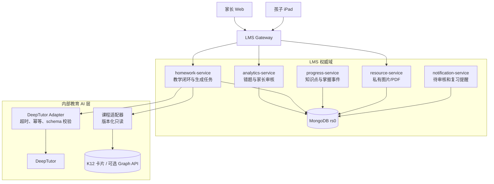
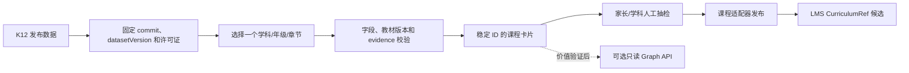
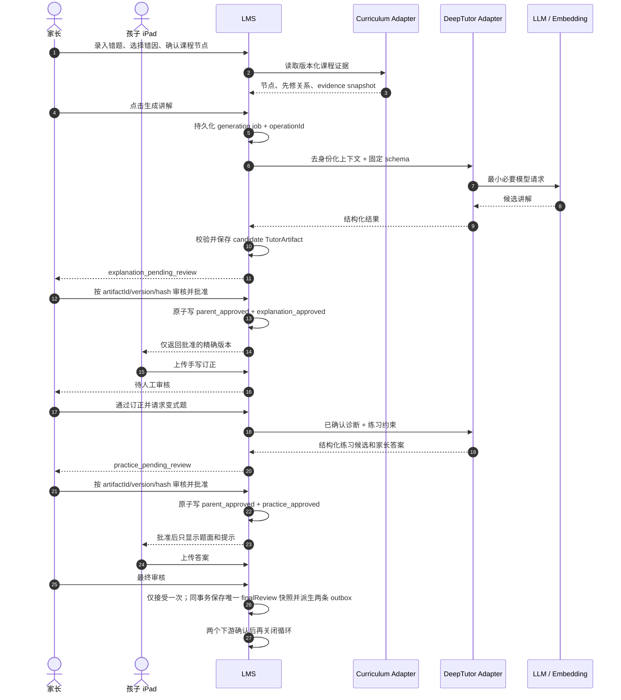

# LMS、DeepTutor 与 K12 集成设计

[返回总目录](00_总目录与实施路线.md)

> 本文只说明 X230i 部署所需的集成边界和落地顺序。数据模型、状态机、API 草案、权限矩阵、
> 时序图、测试和回滚的权威设计见
> [家庭 AI 学习管理平台完整设计](../architecture/family-ai-learning-platform-design.md)。
> 本文所有集成能力均为 **拟议扩展**，不属于当前已实现 API。

跨文档字段以 [`docs/contracts`](../contracts/) 中的 JSON 契约为准；本手册只引用，不定义
第二套 `CurriculumRef`、错因、Artifact 或状态枚举。

## 1. 集成目标

目标不是让孩子直接与一个通用 AI 聊天，而是把家长确认的错题转化为可追溯的家庭学习闭环：

```text
家长录入错题和原题图片
  → 家长选择标准错因并确认课程节点
  → LMS 查询 K12 课程证据和先修关系
  → LMS 请求 DeepTutor 生成结构化候选讲解
  → 家长审核并发布
  → 孩子在 LMS iPad 页面学习、手写订正并上传
  → 家长人工判断通过或重做
  → LMS 请求 DeepTutor 生成变式练习
  → 孩子作答，家长最终审核
  → LMS 保存错题、题目、两轮手写证据和掌握事件
```

这个流程明确接受人工介入。OCR、自动判题和模型掌握度估计都不在第一阶段关键路径中。
MVP 的每个教学闭环必须从一条已确认归属的错题发起，同时绑定该错题映射的知识点；
GrowthTask 只作为可选的孩子端展示入口，不作为另一种业务来源。

## 2. 数据权威与写入边界

| 数据 | 唯一权威方 | 其他组件权限 |
| --- | --- | --- |
| Family、家长、孩子、PIN | LMS `user-service` | DeepTutor/K12 不持有账号映射 |
| GrowthTask、教学闭环和生成任务 | LMS `homework-service` | DeepTutor 只返回候选制品 |
| FamilyMistake、错因和审核事件 | LMS `analytics-service` | 模型不得直接改变状态 |
| KnowledgePoint、掌握事件 | LMS `progress-service` | 只有家长确认后由 LMS 写入 |
| 原题、手写订正、练习答案 | LMS `resource-service` | 不把原始图片发送给云端模型 |
| 课程节点、关系和 evidence | K12 版本化数据 | LMS 只读并保存引用快照 |
| 讲解、例题、练习候选 | DeepTutor 生成，LMS 校验后持久化 | DeepTutor memory 不作为档案恢复依据 |

所有孩子级业务请求仍受 `familyId + childId` 服务端归属校验。任何内部适配接口都使用
独立服务凭据，不能接受浏览器携带的伪造身份头。

## 3. 集成阶段

### 阶段 1：课程卡片和管理员独立验证

目标是用虚构数据验证“课程约束是否让讲解更可靠”，暂不修改 LMS 代码：

1. 从 K12 发布数据中选一个章节；
2. 生成包含稳定 ID、教材位置、定义、先修关系和 evidence 的 Markdown 卡片；
3. 导入 DeepTutor 小型知识库；
4. 用虚构错题测试讲解和变式题；
5. 记录模型、prompt、embedding、K12 commit 和数据版本；
6. 家长人工评价是否明显优于无课程约束的普通模型调用。

这一阶段 DeepTutor Web 只供家长/管理员通过 SSH Tunnel 访问，不录入真实孩子姓名、学校、
手写图片或完整学习历史。

### 阶段 2：LMS 课程映射和家长确认

先做不依赖模型的最小闭环：

- 家长在现有错题上补充科目、年级、教材版本、章节和标准错因；
- LMS 课程适配器返回 3～5 个候选 `CurriculumRef`；
- 家长确认或手动修正；
- LMS 保存 `nodeId + datasetVersion + evidence snapshot`；
- 映射失败不阻止错题保存和人工订正。

这一步可以独立验证数据模型、权限、iPad 表单和 K12 实际价值，不需要先部署 Graph API。

### 阶段 3：LMS 调度 DeepTutor 生成讲解

教学编排第一版放在 `homework-service` 内部模块，不新增常驻微服务：

1. 家长点击“生成讲解”；
2. LMS 先创建 `TutorGenerationJob`，写入稳定 `operationId`；
3. 课程适配器读取确认过的课程证据；
4. LMS 组装去身份化、最小必要上下文；
5. 内部调用 DeepTutor；
6. DeepTutor 返回固定 JSON schema；
7. LMS 校验字段、长度、引用和禁止内容；
8. 通过后保存不可变 `TutorArtifact` 候选；
9. 家长审核后才进入孩子 LMS 页面。

生成失败只把 job 设为失败并允许家长重试，不改变原错题、任务或掌握状态。

### 阶段 4：订正、练习和掌握证据

- 孩子使用 Apple Pencil 在 iPad 上完成订正并上传图片/PDF；
- 家长选择“通过”“需要重做”或“补充说明”；
- 只有“订正通过”后才允许请求变式练习；
- DeepTutor 生成题面、提示、答案和家长判定要点，孩子端不显示答案；
- 家长最终审核后，LMS 追加不可变掌握证据事件；
- 原题、讲解、订正、变式题和答案组成可打印复习包。

## 4. 运行时架构



DeepTutor 和课程适配器只连接 Docker 内部网络。孩子端和家长日常端没有它们的直接 URL。
独立管理员验证时可临时保留回环 `3782`，但不做路由器端口转发。

## 5. 课程数据准备



课程引用完整保存为
[`CurriculumRef v1`](../contracts/curriculum-ref.schema.json)：

```json
{
  "schemaVersion": "curriculum-ref-v1",
  "source": "k12-kgraph",
  "datasetVersion": "git:8716b6a80850790f509c01286f43e5bfe6858f49+hf:d8522c2b336ee435aa51daa39ca0dd736f56fa53",
  "nodeId": "concept_xxx",
  "nodeType": "Concept",
  "displayName": "勾股定理",
  "mappingStatus": "confirmed",
  "mappingSource": "k12_search",
  "reviewedByParentId": "parent_xxx",
  "reviewedAt": "2026-08-25T10:00:00.000Z",
  "textbookScope": {
    "publisher": "人教版",
    "subject": "数学",
    "stage": "初中",
    "grade": "八年级",
    "volume": "下册",
    "bookId": "book_xxx",
    "chapterId": "chapter_xxx",
    "sectionId": "section_xxx"
  },
  "evidenceSnapshot": {
    "evidenceHash": "sha256:0123456789abcdef0123456789abcdef0123456789abcdef0123456789abcdef",
    "capturedAt": "2026-08-25T10:00:00.000Z",
    "sourceUri": null
  }
}
```

不要只保存名称，也不要再使用 `provider`、扁平教材字段或顶层 `evidenceHash` 的旧草案结构。
展示卡片如需扁平字段，应命名为 `CurriculumCardProjection`，不能冒充持久化
`CurriculumRef`。没有 `datasetVersion` 的节点 ID 在数据升级后无法可靠复现。

## 6. DeepTutor 输入边界

允许发送：

- 学科、年级、教材版本和确认过的课程节点；
- 家长人工输入或选择的题干摘要、错因和学习目标；
- 3～6 个最相关的课程卡片与必要 evidence；
- 去身份化的掌握摘要，例如“最近两次分数运算需提示”；
- 生成类型、难度、题量和固定输出 schema。

禁止发送：

- 孩子真实姓名、学校、班级、学号、联系方式；
- 原始 Apple Pencil 手写图、完整成绩单或全部历史；
- LMS token、家长 token、媒体签名 URL 或底层存储路径；
- 整本教材、完整图谱或与当前问题无关的邻居；
- 未经家长确认的 OCR 结果作为事实。

建议输入摘要：

```json
{
  "task": "generate_explanation",
  "learner": {
    "grade": "八年级",
    "locale": "zh-CN"
  },
  "curriculum": {
    "nodeId": "concept_xxx",
    "datasetVersion": "fixed-version"
  },
  "diagnosis": {
    "schemaVersion": "error-classification-v1",
    "diagnosisStatus": "parent_confirmed",
    "primaryReasonCode": "formula_selection",
    "secondaryReasonCodes": ["condition_omitted"],
    "source": "parent_review"
  },
  "constraints": {
    "avoidFinalAnswerFirst": true,
    "maxPracticeCount": 3
  }
}
```

`operationId` 属于 LMS → Adapter 命令信封，不放进发给模型的教学正文，也不假设 DeepTutor
原生识别该字段。错因完整结构以
[`ErrorClassification v1`](../contracts/error-classification.schema.json)为准；Adapter 只向模型
发送最小必要子集，不发送家长/孩子内部 ID。真实接口字段以完整设计和后续实现契约为准。

## 7. DeepTutor 输出与校验

DeepTutor 必须返回结构化候选制品，而不是一段不可控 Markdown。讲解至少包含：

- `schemaVersion`；
- `title`、`learningGoal`；
- 分步讲解和例题；
- 苏格拉底式检查问题；
- 使用过的 `CurriculumRef`；
- 给家长的判定要点；
- 模型和 prompt 版本元数据。

练习至少包含：

- 题面、难度、目标节点；
- 孩子可见提示；
- 家长可见答案、解析和判定标准；
- 明确题量上限；
- 与原错题不同但考查同一目标的说明。

LMS 在保存前执行：JSON schema、字段长度、危险链接、HTML/脚本、课程引用、题目数量和
答案分离检查。输出不合格时 job 失败，不把半成品发布给孩子。

## 8. 核心时序



## 9. iPad 和手写策略

孩子端只需提供：

- “听/看讲解”“我已理解”“开始订正”几个大按钮；
- 适合触控的题面、步骤折叠和进度条；
- 从文件、相册或扫描文稿上传图片/PDF；
- 上传预览、重拍、补充一张和提交；
- 网络中断后的明确重试，不重复创建业务记录。

第一阶段不在浏览器中自行实现完整画板，也不依赖手写 OCR。孩子可在系统备忘录、
Freeform 或支持 Apple Pencil 的应用中书写，再通过分享/文件上传到 LMS；也可以直接拍纸质
作业。家长审核结果以结构化按钮保存，图片作为复习证据长期保留。

## 10. 错因记录方式

错题录入分三层：

1. **原始证据**：题目图片/PDF、孩子原答案、来源和发生日期；
2. **结构化诊断**：家长选择一个主要错因和可选次要错因；
3. **课程映射**：一个主要课程节点和必要的先修节点。

标准 code 不在本手册另建枚举，使用
[`ErrorClassification v1`](../contracts/error-classification.schema.json)中的
`primaryReasonCode + secondaryReasonCodes[]`。当前代码包括概念缺口、公式选择、条件遗漏、
计算、单位换算、方法过程、应用迁移、阅读审题、粗心和未知。中文标签由界面映射；家长可
补充短说明，但不要求录入长篇分析。

模型可给出候选错因，界面必须标注“AI 建议”，只有家长确认后才进入后续 prompt、周报和
掌握统计。

## 11. 轻量 Graph API 的启用条件

第一版课程适配器可直接读取预生成卡片/JSON。只有同时满足以下条件才增加独立服务：

- 家庭试点经常需要两跳以上先修路径；
- 文本卡片无法稳定返回关系方向；
- 节点映射和 evidence 查询有可测的准确率收益；
- X230i 仍有至少 1 GB 安全余量；
- 已定义健康检查、超时、缓存、数据版本和降级方式。

Graph API 必须只读、单 worker、只监听内部网络。不可用时 LMS 回退到已保存课程快照或
人工选择，不阻止错题和订正流程。

## 12. 故障和降级

| 故障 | 降级行为 |
| --- | --- |
| LLM/DeepTutor 不可用 | 保留 generation job；家长可手工写讲解或稍后重试 |
| 已知 DeepTutor turn 中断 | Adapter 按 turnId/事件游标恢复，不创建第二个 turn |
| 未取得 turnId 的未知结果 | 进入 `uncertain_manual_reconcile`，等待家长/管理员处置 |
| Embedding 不可用 | 使用人工确认的课程节点和固定卡片；不做语义扩召回 |
| K12 适配器不可用 | 使用错题中已保存的课程快照或允许家长手工选择 |
| 输出 schema 不合格 | 标记生成失败；不发布部分结果 |
| iPad 上传中断 | 重试同一上传/操作 ID；不得重复创建错题、Attempt 或审核结果 |

## 13. 集成验收

- [ ] 孩子和家长日常路径只进入 LMS；
- [ ] DeepTutor、Graph API 没有公网或孩子直接入口；
- [ ] K12 引用包含稳定 `nodeId + datasetVersion`；
- [ ] 每个 Cycle 恰好绑定一条同家庭、同孩子的 source mistake 和其确认知识点；
- [ ] 非终态 Cycle 写入 `activeSourceMistakeKey` 并受部分唯一索引保护；两个不同 operationId
  并发创建时恰好一个成功，另一个返回 `409 ACTIVE_TUTOR_CYCLE_EXISTS`；
- [ ] 完整 Cycle 文档通过 `tutor-learning-cycle-v1`；终态释放活动键，Artifact 三元组、
  Attempt 当前指针、finalReview、closedAt/cancelledFromStatus/cancelledAt 与状态一致；未来阶段
  字段不能提前出现，生命周期内家庭和来源字段不可改写；
- [ ] 每次订正/练习提交创建符合
  [`TutorCycleAttempt v1`](../contracts/tutor-cycle-attempt.schema.json) 的独立版本；提交字段不可改写，
  家长 review 只追加一次，退回 comment 与对应媒体长期保持关联；
- [ ] 家长可以修正错误课程映射和 AI 候选错因；
- [ ] 原始手写图没有发送给云端模型；
- [ ] 讲解和练习通过固定 schema 与安全校验；调用模型前的 generationInput 先通过
  [`TutorGenerationInput v1`](../contracts/tutor-generation-input.schema.json) 嵌套白名单和上限校验，
  即使 requestHash 正确也拒绝姓名、Token、Cookie、媒体路径和错误结构；
- [ ] candidate/rejected 制品对孩子返回 `404`，未批准时不能开始订正或练习；
- [ ] 讲解批准、练习批准、订正通过和最终掌握都需要家长明确动作；
- [ ] 订正审核遵守 `approve|revise` 请求契约；最终审核遵守 `mastered|revise` 请求契约，
  revise 不创建 finalReview 或 outbox；
- [ ] Artifact 审核同时校验 expectedArtifactReviewVersion 和 Cycle expectedStateVersion；任一过期
  均整体拒绝，取消后的 Cycle 不能被旧审核页面重新推进；
- [ ] Artifact 的 `contentHash` 按 RFC 8785 JCS(content) 重新计算；正文和数据库/请求 hash
  同时被篡改时也会拒绝；对象键顺序变化不误报；
- [ ] MVP 不替换 `parent_approved` Artifact；发现错误时取消 Cycle 并从同一错题新建一轮，
  rejected candidate 仍可生成受 `unique(cycleId, kind, version)` 保护的更高版本；
- [ ] 最终审核在一个事务中写入两条 outbox 命令，部分失败可独立收敛；
- [ ] 两条 outbox 命令只能从同一个不可变 finalReview 快照派生；决定、哈希、审核人与错题
  任一不一致都不能关闭 Cycle；
- [ ] finalReview 必须固化精确的练习 `attemptId + attemptVersion + reviewOperationId`，并与 Cycle
  当前指针、TutorCycleAttempt review 及两条 outbox payload 逐字段一致；
- [ ] mastered 事务创建的两条 outbox 都通过正式 TutorFinalizationCommand Schema，以完整
  pending 状态、零次尝试、空租约/响应/错误字段和稳定 target operationId 落库；
- [ ] 保存、派生、发送和关闭前都按契约重新计算 `finalReviewHash` 与 `payloadHash`，同步篡改
  正文和任意格式正确的 hash 也会被拒绝；
- [ ] 最终审核成功后不可通过 `/final-review` 修改；相同幂等重放在重新授权后从权威记录
  重建语义等价结果，其他请求
  返回 `409 FINAL_REVIEW_ALREADY_ACCEPTED`；
- [ ] 公共请求 requestPayloadHash 按 RFC 8785 规范绑定 endpointOperation、服务端提取的 URL
  cycleId 和请求正文；JSON 键顺序、operationId 和运行时租约不会误改业务 hash，跨 Cycle 重放
  必须冲突；生成 requestHash 继续绑定完整 generationInput；
- [ ] 幂等门禁分别覆盖 execute、replay 和 `409 IDEMPOTENCY_KEY_REUSED`；resource.cycleId 必须
  等于服务端 matchedPathParams.cycleId，不同 endpointOperation 复用同一客户端 key 可独立执行；
- [ ] 幂等身份只使用 `{ familyId, endpointOperation, operationId }` 三字段元组；数据库
  查询、唯一索引和应用比较不持久化、不拼接 scopeKey，operationId 包含冒号仍无碰撞；
- [ ] 每次 replay 前重新验证当前账号、Family 成员关系、endpoint 角色和 Cycle familyId/childId；
  兄弟姐妹、跨家庭、已失权家长、禁用用户和已删除资源在幂等 lookup 前统一拒绝；
- [ ] TutorIdempotencyRecord 只保存 hash 和最小 responseReference，不保存答案、审核正文、
  Artifact、媒体 URL、凭据或完整响应；重放从权威实体重建并重新应用当前字段过滤；
- [ ] publicMutations 逐路由固定 allowedActorRoles 和 responseVariants（含条件 HTTP 状态与资源类型）；
  final-review revise 返回 200 + 当前 Practice Attempt，mastered 返回 202 + FinalReview；创建记录时
  校验 createdBy.role/响应变体，replay 时按原请求分支重读引用实体并校验 resourceId、familyId、childId、
  cycleId；引用不存在或归属不符时返回 404 且 `reexecute=false`；
- [ ] 公开 Tutor 写接口的业务实体/Cycle CAS/本地 Job 或 outbox 与
  `outcome=succeeded` 幂等记录在同一 MongoDB 事务提交；duplicate-key/write-conflict loser
  整个事务回滚后先重读 winner，不保留第二个 Attempt、状态转换或 outbox；
- [ ] 公开接口本地事务提交前不调用 DeepTutor/下游写接口；媒体 prepare 必须幂等可回滚，
  media commit 在本地提交后收敛，失败不得重建 Attempt；
- [ ] record-commit 门禁验证 createdBy 等于首次 actor，family/child/cycle/hash/operationId 来自
  实际授权请求；同一事务的 committedEntity、actualResult 与 responseReference 逐字段一致，submission
  的 Attempt ID 可由请求直接推导；responseId 按 RFC 8785 + SHA-256 确定性计算，不允许同步篡改后
  指向同 Cycle 历史结果；correction-review/final-review revise 还要求 committed Attempt ID/version
  等于同事务 Cycle 当前指针，reviewOperationId 等于本次请求，且此当前指针条件不应用于 replay；
  final-review revise/mastered 分别要求 0/2 条 finalization outbox；
- [ ] 家庭 MVP 不为幂等 tombstone 设置 TTL；孩子/家庭删除时清理记录，Cycle 单独删除时保留
  tombstone 防止旧 operation 重新执行；MongoDB 备份恢复验证三字段复合索引与引用归属；
- [ ] TutorCycleAttempt 的提交和审核 operation 唯一索引均包含 stage，使 correction/practice
  保持独立作用域，同时阻止同一 stage 内重复写入；
- [ ] 公开 Tutor POST 路由全部出现在 `tutor-cycle-state-machine.json.publicMutations`；生成任务、
  开始/取消和订正/练习提交分别通过共享请求 Schema；讲解与练习 Artifact 审核使用独立 operation，
  每个 `route + endpointOperation` 都有 discriminator 与 requestPayloadHash 正反 fixtures；
- [ ] DeepTutor 认证、非管理员 grant、Adapter 路由/capability/KB/tool 白名单及拒绝路径通过；
- [ ] 取得 turnId 前的未知结果不会自动重建或宣称 exactly-once；
- [ ] 模型失败不改变权威业务状态；
- [ ] 所采用的教学制品保留模型、prompt、schema 和结果哈希；
- [ ] 一个章节试点通过后才扩大 K12 数据范围；
- [ ] 8 GB 主机在生成窗口没有 OOM，LMS 仍可正常使用；
- [ ] LMS、DeepTutor、K12 和私有媒体完成联合恢复演练；
- [ ] feature flag 关闭后，现有家庭成长 MVP 仍可独立工作。
