# 家庭 AI 学习管理平台完整设计

- **Document status:** DRAFT FOR REVIEW
- **Version:** 1.11
- **Updated:** 2026-08-26
- **Scope:** LMS + DeepTutor + K12-KGraph
- **Target users:** 单个家庭、少于 10 名孩子、孩子主要使用 iPad + Apple Pencil
- **Target host:** ThinkPad X230i，8 GB RAM，250 GB SATA SSD，Ubuntu Server；云端提供 LLM 与 embedding

相关现有文档：

- [家庭自主学习理论与总体方案](../research/family-self-directed-learning-theory-and-program.md)
- [家庭自主学习系统设计](family-self-directed-learning-system-design.md)
- [家庭成长跟踪架构设计](family-learning-tracker-architecture.md)
- [家庭成长跟踪 API](../api/family-learning-tracker-api.md)
- [家庭成长跟踪跨服务时序图](sequence-diagrams.md)
- [ThinkPad DeepTutor + K12 部署手册](../ThinkPad_DeepTutor_K12_部署手册/00_总目录与实施路线.md)
- [本地 Ubuntu 服务器部署指南](../deployment/local-ubuntu-deployment.md)

---

## 1. 决策摘要

本方案不把 DeepTutor 改造成新的 LMS，也不把 K12-KGraph 当成学生数据库。三者职责固定如下：

1. **LMS 是唯一业务、权限和学习档案中心。** 家庭、孩子、任务、错题、手写附件、审核、掌握度、周报和提醒全部以 LMS 为准。
2. **K12-KGraph 是只读、版本化的课程结构库。** 它只提供课程节点、教材位置、先修关系、相关概念、实验、练习和证据。
3. **DeepTutor 是受 LMS 调度的教学内容生成器。** 它负责讲解、例题、苏格拉底式提示、变式题和家长判定要点，不直接修改任何 LMS 业务数据。
4. **家长是教学状态的最终确认者。** 手写订正和练习结果由家长审核；AI/OCR 只能给建议，不能自动把错题设为已掌握。
5. **孩子只进入 LMS。** iPad 不直接访问 DeepTutor 管理界面或 K12 Graph API；孩子使用一个稳定、简单、触控友好的学习任务界面。
6. **X230i 只运行应用和数据。** LLM 与 embedding 使用云端 API；不在本机运行本地大模型、重型 OCR、Neo4j 或大规模教材抽取。
7. **第一阶段不新增 LMS 常驻微服务。** 教学编排先作为 `homework-service` 内部模块落地；K12 先使用小范围知识卡片，验证价值后再启用独立只读 Graph API。

一句话目标：

> 把“家长确认的错题”转换为“可追溯的讲解、订正、变式练习和复习任务”，并把最终证据沉淀回 LMS，而不是沉淀在 AI 会话里。

---

## 2. 背景与问题定义

### 2.1 当前家庭学习痛点

- 孩子主要使用 iPad 和 Apple Pencil，没有固定电脑。
- 手写识别和自动判题不够可靠，容易卡住完整自动化流程。
- 家长愿意审核，但不希望反复手工整理错题、知识点、前置关系和下一轮练习。
- AI 擅长讲解、生成题目、组织教材资料，但不适合作为权威判定者。
- 学习数据需要长期保存，支持周报、复习计划和期末错题打印。
- 家庭服务器资源有限，必须控制常驻服务、内存占用和云端调用成本。

### 2.2 设计目标

- 在现有 LMS 基础上完成一个人工可控的学习闭环。
- 支持数学、物理、化学、生物的课程图谱映射，并保留扩展其他学科的接口。
- 让 DeepTutor 的生成结果变成可审核、可版本化、可打印的 LMS 资产。
- 保留 `familyId + childId` 的家庭隔离、私有媒体和服务数据所有权。
- AI 调用失败、服务器重启或外部服务不可用时，已录入错题和人工流程仍可使用。
- 在 X230i 上以低资源方式运行，默认服务对象少于 10 人。

### 2.3 非目标

第一阶段不实现：

- 自动手写识别后直接判题；
- AI 自动修改掌握度或自动关闭错题；
- 孩子自由使用 DeepTutor 全功能聊天、联网搜索、代码执行或任意技能；
- 本地 LLM、vLLM、LoRA/SFT 或 K12-Train 训练；
- 完整教材 OCR 与图谱重建常驻运行；
- Neo4j、Elasticsearch、独立向量数据库集群；
- 学校、班级、教师、考试排课等学校级功能；
- DeepTutor 与 LMS 的账号同步或 SSO；

---

## 3. 设计原则

### 3.1 权威数据与生成数据分离

- LMS 保存权威业务状态。
- DeepTutor 输出属于“候选教学内容”，进入 LMS 后必须保留生成来源和版本。
- K12-KGraph 关系是课程证据，不等于某个孩子的掌握状态。
- DeepTutor `session_id` 只用于诊断和续接，不能替代 LMS 中的学习包快照。

### 3.2 人工审核是流程节点，不是异常

家长审核被建模为正式状态和审计事件。系统应围绕人工审核提供按钮、待办、提醒和证据，而不是尝试绕过人工步骤。

### 3.3 最小披露

发送给云端模型的上下文只包含：

- 学科、年级、教材范围；
- 家长确认的目标知识点和错因；
- 必要的课程证据；
- 去身份化的历史学习摘要；
- 当前生成任务所需的最少文本。

第一阶段不把孩子真实姓名、学校、班级、联系方式、原始手写图片或完整学习档案发送给模型。

### 3.4 失败可恢复

- 所有模型生成任务先持久化，再执行。
- 每次外部调用都有 `operationId`、超时、重试上限和结果哈希。
- 生成失败不改变错题、任务或掌握度。
- 模型不可用时，家长仍可手工创建任务和上传订正。

### 3.5 渐进增强

先验证一个学科、一个年级、一个章节的真实家庭价值，再扩大数据和功能范围。

---

## 4. 当前 LMS 基线与适配差距

| 现有模块 | 已有能力 | 可直接复用 | 需要适配 |
| --- | --- | --- | --- |
| `user-service` | Family、家长、孩子、PIN、第二家长治理 | 身份、家庭隔离和孩子登录 | 不新增 DeepTutor 账号映射；只给内部调用提供已验证身份上下文 |
| `gateway` | JWT、签名身份信封、家庭公开路由 | 所有家长/孩子请求统一入口 | 新增课程映射和教学闭环公开路由；禁止代理 DeepTutor 管理接口 |
| `homework-service` | `GrowthTask`、任务附件、完成和家长确认 | 今日任务和学习任务入口 | 新增 `TutorLearningCycle`、`TutorCycleAttempt`、`TutorGenerationJob`、教学制品和 DeepTutor 适配模块 |
| `progress-service` | `KnowledgePoint`、掌握度、不可变掌握事件 | 保存孩子知识点和最终掌握证据 | 增加课程图谱引用、规范键和证据来源 |
| `analytics-service` | `FamilyMistake`、错题附件、状态事件、周报 | 错题主记录和家长审核 | 增加标准错因、课程映射快照、诊断确认来源和教学闭环关联 |
| `resource-service` | 私有图片/PDF、引用绑定、签名访问 | 原题、手写订正、练习答案和打印素材 | 增加教学制品引用用途时复用现有引用协议；不增加公开静态目录 |
| `notification-service` | 读取时派生提醒和家庭设置 | 待复习、未完成、周报提醒 | 后期增加待审核、生成完成、需要重做、复习到期来源 |
| 前端 | Parent Web、Child Web、家庭路由 | 家长/孩子会话与媒体能力 | 增加家长审核台、孩子学习包、iPad 交互和打印入口 |

当前 LMS 不需要改变以下基础边界：

- 服务之间不共享可写 Mongoose 模型；
- `familyId + childId` 是业务资源隔离键；
- 普通用户不能访问内部命令接口；
- 私有媒体不进入公开静态目录；
- 周报读取其他服务数据时只使用受控、最小化只读投影。

---

## 5. 总体架构

### 5.1 业务架构图

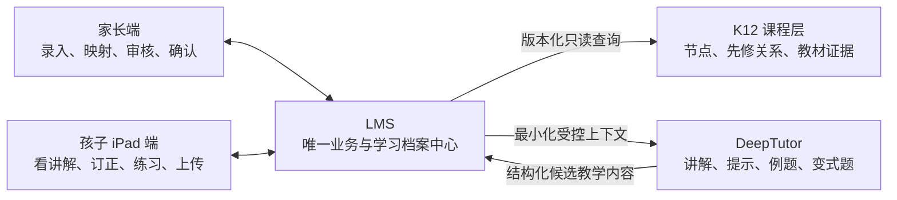

### 5.2 逻辑组件架构图

```mermaid
flowchart TB
  subgraph Clients["家庭客户端"]
    ParentWeb["Parent Web<br/>错题与教学审核台"]
    ChildWeb["Child Web / iPad<br/>今日任务与学习包"]
  end

  Gateway["API Gateway<br/>JWT + 签名身份信封"]

  subgraph LMS["现有 LMS 域服务"]
    User["user-service<br/>Family / User / PIN"]
    Homework["homework-service<br/>GrowthTask<br/>TutorLearningCycle / Attempt / GenerationJob"]
    Progress["progress-service<br/>KnowledgePoint / MasteryEvent"]
    Analytics["analytics-service<br/>FamilyMistake / WeeklyReport"]
    Resource["resource-service<br/>MediaAsset / MediaReference"]
    Notify["notification-service<br/>派生提醒"]
  end

  subgraph EducationAI["教育 AI 扩展层"]
    Orchestrator["Tutor Orchestration<br/>homework-service 内部模块"]
    CurriculumClient["Curriculum Client<br/>版本和范围约束"]
    DeepTutorClient["DeepTutor Client<br/>输出校验与熔断"]
    GraphAdapter["K12 Adapter<br/>知识卡片或只读 Graph API"]
    DeepTutor["DeepTutor 私有服务<br/>受限模型、KB 和工具"]
  end

  subgraph Cloud["云端模型服务"]
    LLM["LLM API"]
    Embedding["Embedding API"]
  end

  Mongo[("MongoDB rs0")]
  PrivateMedia[("私有媒体目录")]
  CurriculumData[("K12 JSON / SQLite / Cards")]

  ParentWeb --> Gateway
  ChildWeb --> Gateway
  Gateway --> User
  Gateway --> Homework
  Gateway --> Progress
  Gateway --> Analytics
  Gateway --> Resource
  Gateway --> Notify

  Homework --> Orchestrator
  Orchestrator --> CurriculumClient
  Orchestrator --> DeepTutorClient
  CurriculumClient --> GraphAdapter
  DeepTutorClient --> DeepTutor
  GraphAdapter --> CurriculumData
  DeepTutor --> LLM
  DeepTutor --> Embedding

  User --> Mongo
  Homework --> Mongo
  Progress --> Mongo
  Analytics --> Mongo
  Resource --> Mongo
  Notify --> Mongo
  Resource --> PrivateMedia
```

### 5.3 信任边界与数据流

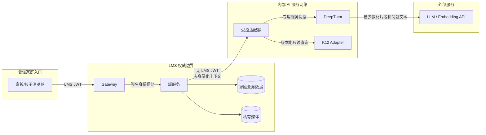

硬性规则：

- LMS JWT、孩子 PIN、Gateway 身份密钥不得传给 DeepTutor。
- DeepTutor 端口不通过 Gateway 原样暴露给孩子。
- K12 Adapter 不接受家庭数据写入。
- 模型输出视为不可信输入，必须通过 schema、大小、Markdown 和业务规则校验。

---

## 6. 组件职责与数据所有权

| 组件 | 独占写入 | 可以读取/调用 | 禁止事项 |
| --- | --- | --- | --- |
| `user-service` | Family、User、PIN、家庭成员关系 | 私有头像引用协议 | 不存 DeepTutor 密钥或 AI 会话 |
| `homework-service` | GrowthTask、TutorLearningCycle、TutorCycleAttempt、TutorGenerationJob、TutorArtifact | progress/analytics 的受控内部读取、K12 Adapter、DeepTutor | 不直接改 KnowledgePoint 或 FamilyMistake |
| `progress-service` | KnowledgePoint、KnowledgePointMasteryEvent | 家庭和孩子授权信息 | 不接受 DeepTutor 直接写入 |
| `analytics-service` | FamilyMistake、状态事件、WeeklyReport | 任务/进度/教学闭环的最小只读投影 | 不用 AI 输出覆盖家长确认字段 |
| `resource-service` | MediaAsset、MediaReference、私有对象 | 家庭/孩子授权 | 不将手写图片直接公开或默认发给模型 |
| `notification-service` | ReminderSettings | 各来源的超时只读投影 | 不保存任务/错题/教学闭环副本 |
| K12 Adapter | 只读课程数据，不写家庭数据 | K12 发布数据与本地索引 | 不保存孩子身份、错题或掌握度 |
| DeepTutor | 自身配置、知识库、诊断会话 | 云端模型和获准 KB | 不连接 LMS MongoDB，不成为学习档案权威源 |

### 6.1 为什么教学编排先放在 homework-service

`TutorLearningCycle` 表示一轮具有明确开始、提交、审核和关闭状态的学习任务，与 `GrowthTask` 生命周期最接近。MVP 将编排模块放入 `homework-service` 可以：

- 复用家庭任务授权和孩子任务入口；
- 避免 X230i 新增一个常驻 Node 微服务；
- 保留未来拆出 `tutor-service` 的清晰接口；
- 不污染 `analytics-service` 的确定性分析职责。

当出现独立扩容、多个 AI 引擎或跨产品复用需求时，再把该模块拆成服务。拆分前公共 API 和持久化契约保持不变。

---

## 7. 核心数据模型

本章的示例用于解释语义，机器可读契约是唯一字段真相：

- [`CurriculumRef v1`](../contracts/curriculum-ref.schema.json)
- [`CurriculumRefSnapshot v1`](../contracts/curriculum-ref-snapshot.schema.json)
- [`ErrorClassification v1`](../contracts/error-classification.schema.json)
- [`ExplanationContent v1`](../contracts/explanation-content.schema.json)
- [`PracticeContent v1`](../contracts/practice-content.schema.json)
- [`TutorArtifact v1`](../contracts/tutor-artifact.schema.json)
- [`TutorGenerationInput v1`](../contracts/tutor-generation-input.schema.json)
- [`TutorCycleAttempt v1`](../contracts/tutor-cycle-attempt.schema.json)
- [`TutorArtifactReviewRequest v1`](../contracts/tutor-artifact-review-request.schema.json)
- [`TutorCorrectionReviewRequest v1`](../contracts/tutor-correction-review-request.schema.json)
- [`TutorCycleCreateRequest v1`](../contracts/tutor-cycle-create-request.schema.json)
- [`TutorGenerationJobRequest v1`](../contracts/tutor-generation-job-request.schema.json)
- [`TutorStageActionRequest v1`](../contracts/tutor-stage-action-request.schema.json)
- [`TutorStageSubmissionRequest v1`](../contracts/tutor-stage-submission-request.schema.json)
- [`TutorLearningCycle 状态机 v1`](../contracts/tutor-cycle-state-machine.json)
- [`TutorLearningCycle v1`](../contracts/tutor-learning-cycle.schema.json)
- [`TutorFinalReviewRequest v1`](../contracts/tutor-final-review-request.schema.json)
- [`TutorFinalReviewSnapshot v1`](../contracts/tutor-final-review-snapshot.schema.json)
- [`TutorFinalizationCommand v1`](../contracts/tutor-finalization-command.schema.json)
- [`MasteryEvidenceCommandPayload v1`](../contracts/mastery-evidence-command-payload.schema.json)
- [`MistakeReviewCommandPayload v1`](../contracts/mistake-review-command-payload.schema.json)

实现、API 示例、DeepTutor Adapter 和 ThinkPad 手册都必须引用这些文件，不再复制另一套
同名结构。契约发生不兼容变化时创建 `v2`，不能静默改写已经保存的快照。

### 7.1 实体关系图

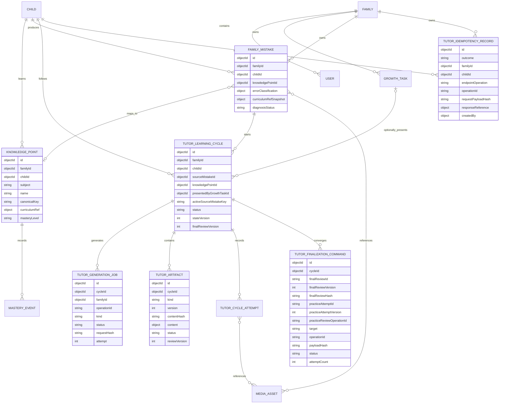

图中的 `CHILD` 是 `User` 的孩子角色投影，不新增一张重复用户表。

### 7.2 CurriculumRef

`CurriculumRef` 是嵌入式、可选、版本化引用，字段以
[`curriculum-ref.schema.json`](../contracts/curriculum-ref.schema.json)为准：

```json
{
  "schemaVersion": "curriculum-ref-v1",
  "source": "k12-kgraph",
  "datasetVersion": "git:8716b6a80850790f509c01286f43e5bfe6858f49+hf:d8522c2b336ee435aa51daa39ca0dd736f56fa53",
  "nodeId": "concept_xxx",
  "nodeType": "Concept",
  "displayName": "勾股定理",
  "mappingStatus": "confirmed",
  "mappingSource": "k12_search",
  "reviewedByParentId": "parent_xxx",
  "reviewedAt": "2026-08-25T10:00:00.000Z",
  "textbookScope": {
    "publisher": "人教版",
    "subject": "数学",
    "stage": "初中",
    "grade": "八年级",
    "volume": "下册",
    "bookId": "book_xxx",
    "chapterId": "chapter_xxx",
    "sectionId": "section_xxx"
  },
  "evidenceSnapshot": {
    "evidenceHash": "sha256:0123456789abcdef0123456789abcdef0123456789abcdef0123456789abcdef",
    "capturedAt": "2026-08-25T10:00:00.000Z",
    "sourceUri": null
  }
}
```

约束：

- `suggested` 不得驱动掌握度或自动创建复习路径。
- 只有家长可以把状态改为 `confirmed` 或 `rejected`。
- `suggested` 的 `reviewedByParentId/reviewedAt` 必须为空；`confirmed/rejected` 两种家长决定
  都必须保存审核人和时间。`mappingSource` 只描述候选来源，导入结果仍先进入 `suggested`。
- `datasetVersion + nodeId` 必须一起解释节点，不能只存名称。
- `provider`、扁平教材字段和孤立的 `evidenceHash` 不是 `CurriculumRef` 的别名；展示卡片如需
  扁平字段，应使用单独的 projection 名称。
- 展示名称可以更新，稳定引用不可静默替换。
- 使用某个引用生成学习包时，复制为 `curriculumRefSnapshot`，保证历史可追溯。

### 7.3 KnowledgePoint 适配

`progress-service` 的 `KnowledgePoint` 增加：

| 字段 | 类型 | 说明 |
| --- | --- | --- |
| `canonicalKey` | String，可选 | `k12-kgraph:<version>:<nodeId>` 或本地生成键 |
| `curriculumRef` | Object，可选 | 当前家长确认的课程映射 |
| `curriculumMappingVersion` | Integer，默认 0 | 乐观并发控制和变更审计 |

迁移策略：

1. 第一阶段不立即替换现有名称唯一索引，只允许一个现有知识点确认一个图谱节点。
2. 观察同名、跨年级、跨教材冲突后，再建立稀疏 `canonicalKey` 唯一索引。
3. 索引迁移必须先 dry-run，输出冲突清单；有冲突时不执行 apply。
4. 回滚时保留 `curriculumRef` 数据，但业务接口停止使用 `canonicalKey`，不删除现有知识点。

### 7.4 FamilyMistake 适配

`analytics-service` 的 `FamilyMistake` 增加：

| 字段 | 类型 | 说明 |
| --- | --- | --- |
| `mistakeOrigin` | Enum | `parent_manual`、`child_manual`、`tutor_exercise`、`imported` |
| `originLearningCycleId` | ObjectId，可选 | 由 AI 练习产生时关联教学闭环 |
| `errorClassification` | Object | 符合 `error-classification-v1`；一个主因和最多四个次因 |
| `curriculumRefSnapshot` | Object，可选 | 生成或确认时的版本化课程节点 |

标准错因代码第一版固定为：

- `concept_gap`
- `formula_selection`
- `condition_omitted`
- `calculation`
- `unit_conversion`
- `method_or_process`
- `application`
- `reading_or_interpretation`
- `careless`
- `unknown`

持久化结构以 [`error-classification.schema.json`](../contracts/error-classification.schema.json)
为准：`primaryReasonCode` 用于聚合，`secondaryReasonCodes[]` 保留复合错因，中文标签由界面
映射。AI 只能写 `ai_suggested` 候选；只有家长能写 `parent_confirmed`。现有 `reason` 字段
继续保留作为兼容文本，不强行批量转换历史数据。

状态组合采用互斥契约：`unreviewed` 不得含错因、置信度或家长审计；`ai_suggested` 必须有
AI confidence 且不得含家长审计；`parent_confirmed` 必须有主因和家长审计，AI confidence
归档到候选快照而不冒充家长置信度。主因不能再次出现在次因数组，此动态约束由服务验证器
和契约 fixtures 检查。

### 7.5 TutorLearningCycle

`homework-service` 新增 `TutorLearningCycle`：

| 字段组 | 关键字段 |
| --- | --- |
| 归属 | `familyId`、`childId`、`createdByParentId` |
| 必填来源 | `sourceMistakeId`、`knowledgePointId`；必须指向同一家庭、同一孩子且彼此映射一致 |
| 可选入口 | `presentedByGrowthTaskId`；只表示孩子端展示任务，不是教学闭环业务来源 |
| 活动唯一键 | 非终态保存 `activeSourceMistakeKey=<familyId>:<sourceMistakeId>`；终态原子移除 |
| 状态 | `status`、`stateVersion`、`lastTransitionAt` |
| 讲解 | 已批准制品的 `explanationArtifactId + version + contentHash` 精确三元组 |
| 订正投影 | `currentCorrectionAttemptId + currentCorrectionAttemptVersion`；不在 Cycle 覆盖提交内容 |
| 练习 | 已批准制品的 `practiceArtifactId + version + contentHash`，以及当前练习 Attempt 指针 |
| 最终审核 | 不可变 `finalReview` 快照：`finalReviewId`、`finalReviewVersion`、`finalReviewHash`、精确练习 Attempt 与审核 operation 引用、`decision`、审核人与时间 |
| 取消 | `cancelledFromStatus + cancelledAt`，保留取消前已经合法形成的阶段投影 |
| 审计 | `createdAt`、`updatedAt`、`closedAt` |

完整实体字段及状态—字段组合以
[`tutor-learning-cycle.schema.json`](../contracts/tutor-learning-cycle.schema.json)为准，状态可达性以
[`tutor-cycle-state-machine.json`](../contracts/tutor-cycle-state-machine.json)为准。Schema 不仅要求
“到达阶段后字段完整”，也禁止讲解、订正、练习和 finalReview 的未来阶段投影提前出现。
`correction_in_progress` 和 `practice_in_progress` 既可能是首次进入，也可能是 revise 后重做，
因此服务转换验证器还必须区分：首次进入不得凭空写 Attempt 指针，重做时保留上一次指针，
只有 `*_in_progress -> *_submitted` 才能把指针推进到严格递增的新 Attempt。

取消事务写入 `cancelledFromStatus=before.status`，原子移除活动键，并逐字段保留取消前已有的
Artifact/Attempt 投影；不得在取消时补写未来阶段数据。生命周期转换不得改写 `cycleId`、家庭、
孩子、来源错题、知识点、创建家长或创建时间。服务验证器额外保证活动键和 finalReview 的家庭、
孩子、来源错题、知识点与 Cycle 一致。

MVP 每个 Cycle 恰好来源于一条 `FamilyMistake`，一条错题可以保留多个历史 Cycle，但同一时间
最多一个非终态 Cycle。暂不支持“没有错题、直接从知识点发起”的教学闭环；否则 Analytics
命令集合和关闭条件都需要重新设计。

上述活动唯一性不能依赖“插入前查询数量为 0”。`homework-service` 必须在所有非终态 Cycle
上保存 `activeSourceMistakeKey=<familyId>:<sourceMistakeId>`，并建立以下 MongoDB 部分唯一索引：

```javascript
db.tutorLearningCycles.createIndex(
  { activeSourceMistakeKey: 1 },
  {
    name: "uniq_active_tutor_cycle_per_source_mistake",
    unique: true,
    partialFilterExpression: {
      activeSourceMistakeKey: { $type: "string" }
    }
  }
)
```

创建前查询只用于返回友好提示，不能作为并发保护。两个不同 `operationId` 并发创建时，唯一
索引必须保证恰好一个成功；duplicate key 统一映射为
`409 ACTIVE_TUTOR_CYCLE_EXISTS`。Cycle 进入 `closed` 或 `cancelled` 时，在同一原子更新或事务
中移除 `activeSourceMistakeKey`；不得使用 `unique(familyId, sourceMistakeId, status)`，以免阻止
保存多个历史终态 Cycle。实现验收必须包含一次双请求并发集成测试。

该字段和索引随新教学功能首次上线，不迁移现有家庭成长数据。启用 feature flag 前先扫描是否
已有重复非终态 Cycle；发现冲突就停止上线并人工处理，不自动删除或合并儿童学习记录。回滚时
先关闭教学 Cycle 新建入口，再回滚应用；只有确认没有旧实例写入后才允许移除新索引。

`status` 的合法值和转换以
[`tutor-cycle-state-machine.json`](../contracts/tutor-cycle-state-machine.json)为准。批准
制品时必须在同一 `homework-service` 事务内同时更新 Artifact、绑定的 ID/版本、循环状态和
`stateVersion`；Artifact 自身的并发审核使用其 `reviewVersion`。孩子开始订正或练习时再次在服务端验证该精确版本仍为
`parent_approved`。

### 7.5.1 TutorCycleAttempt

每次孩子提交订正或练习答案时创建一条符合
[`tutor-cycle-attempt.schema.json`](../contracts/tutor-cycle-attempt.schema.json) 的独立 Attempt，
不覆盖上一版媒体、反馈或审核时间。Attempt 保存 `familyId + childId + cycleId`、阶段、严格递增
版本、有序 `mediaIds[]`、提交 operationId/时间，以及显式的 `review=null`。

家长审核时只允许以 CAS 条件 `review == null` 追加一次 review；提交字段和已存在 review 永远
不能原地改写。订正 review 的决定为 `approve|revise`；练习 review 为 `mastered|revise`。
两类 revise 都必须永久保存 comment，mastered 必须保存 evidenceSummary。审核、Cycle 状态转换
以及 mastered 时的 finalReview/outbox 在同一个 `homework-service` 事务中完成。

数据库至少建立：

```javascript
db.tutorCycleAttempts.createIndex(
  { cycleId: 1, stage: 1, attemptVersion: 1 },
  { name: "uniq_tutor_attempt_version", unique: true }
)
db.tutorCycleAttempts.createIndex(
  { familyId: 1, stage: 1, submissionOperationId: 1 },
  { name: "uniq_tutor_attempt_submission_operation", unique: true }
)
db.tutorCycleAttempts.createIndex(
  { familyId: 1, stage: 1, "review.reviewOperationId": 1 },
  {
    name: "uniq_tutor_attempt_review_operation",
    unique: true,
    partialFilterExpression: { "review.reviewOperationId": { $type: "string" } }
  }
)
```

`stage` 在 v1 中稳定映射公开 operation：订正和练习提交分别对应 `correction-submit`、
`practice-submit`，两类审核分别对应 `correction-review`、`final-review`。因此相同客户端
`operationId` 可以在不同 endpointOperation 下独立使用；同一家庭、同一 stage、同一 operationId
仍由唯一索引阻止重复 Attempt 或重复审核。若未来一个 stage 出现多个同类 endpoint，再显式保存
endpointOperation 并升级索引；MVP 不增加冗余字段。

所有 Attempt 媒体继续使用 resource-service 的 prepare / commit / unbind 协议。新提交只新增
引用，不解除历史 Attempt 的媒体引用；只有按家庭数据删除或整轮 Cycle 保留策略清理时才能
解绑。MVP 不再增加独立 `ReviewEvent` 集合，也不把无限增长的提交数组塞进 Cycle。

### 7.6 TutorGenerationJob

外部生成调用必须有持久化任务：

```json
{
  "operationId": "uuid",
  "familyId": "family_xxx",
  "childId": "child_xxx",
  "cycleId": "cycle_xxx",
  "kind": "practice",
  "status": "queued",
  "attempt": 0,
  "requestHash": "sha256:...",
  "promptVersion": "family-tutor-v1",
  "modelProfile": "default-low-cost",
  "curriculumDatasetVersion": "...",
  "externalSessionId": null,
  "externalTurnId": null,
  "externalLastEventSeq": 0,
  "recoveryStatus": "not_started",
  "failureCode": null,
  "queuedAt": "...",
  "startedAt": null,
  "finishedAt": null
}
```

`requestHash` 只绑定会影响模型输出的确定性 `generationInput`，定义为：

```text
SHA-256(UTF-8 RFC8785-JCS(generationInput))
```

`generationInput.schemaVersion=tutor-generation-input-v1`，且整个对象必须先符合
[`tutor-generation-input.schema.json`](../contracts/tutor-generation-input.schema.json)，再计算 hash。
其顶层只包含：`cycleId`、`kind`、最小化 `sourceMistakeSnapshot`、家长确认错因的最小投影、
课程节点最小快照、有限先修快照、`promptVersion`、`modelProfile`、`outputSchemaVersion` 和
`generationPolicy`。所有嵌套对象都使用 `additionalProperties=false`，题目/答案/备注有长度上限，
先修节点和练习数量有数量上限；姓名、家庭成员、Token、Cookie、媒体 URL、存储路径、原始 OCR
结果和完整 ErrorClassification 审计对象无法通过契约。

处理顺序固定为：构造白名单输入 → Schema 和跨字段语义校验 → 计算 RFC 8785 requestHash →
持久化 GenerationJob → 发送 Adapter。`operationId`、重试次数、租约、时间戳、worker、外部
session/turn ID 和运行状态不得进入 `generationInput`。因此相同输入使用不同 operationId 时
requestHash 不变；教材版本、prompt、模型、输出 Schema、错题快照或练习策略任一变化时 hash
必须变化。结构非法的输入即使携带与正文匹配的正确 hash，也必须在调用 Adapter 前拒绝。

`cycleId` 和 `sourceMistakeId` 只用于 LMS/Adapter 关联信封，不进入云端模型 prompt。Adapter
从已校验 generationInput 再构造仅含题目、必要答案、错因代码、课程证据和生成策略的
`modelInput`；不得把整个对象序列化进 prompt，也不得转发 LMS JWT 或内部凭据。

唯一性建议：

- `familyId + kind + operationId` 唯一；v1 中 kind 稳定映射 `explanation-job|practice-job`，与公开
  endpointOperation 作用域一致；
- `cycleId + kind + requestHash` 对非失败活跃任务唯一；
- 同一教学闭环同一类生成只允许一个 `queued|running` 任务。
- LMS 的客户端 `operationId` 不是 DeepTutor 原生字段；调用 Adapter 时使用由完整
  `familyId + endpointOperation + operationId` 作用域派生的内部不透明 operation key，不能把裸客户端
  key 当作 Adapter 全局键。只有持久化 Adapter 映射已经建立后，才允许把任务标记为可自动恢复。

### 7.7 TutorArtifact

讲解和练习包保存为 LMS 制品，而不是只保留 DeepTutor 会话：

| 字段 | 说明 |
| --- | --- |
| `kind` | MVP 仅 `explanation`、`practice`；复习打印包是派生视图，不另存 AI Artifact |
| `version` | 同一闭环内递增 |
| `content` | 按 kind 分别通过 `explanation-content-v1` 或 `practice-content-v1` |
| `contentHash` | `SHA-256(UTF-8 RFC8785-JCS(content))`；绑定精确教学正文 |
| `generator` | 必填：DeepTutor、模型档案、prompt、输出 schema 和生成时间 |
| `curriculumSources[]` | 必填且非空；每项符合不可变 `curriculum-ref-snapshot-v1` |
| `status` | MVP 仅 `candidate`、`parent_approved`、`rejected` |
| `reviewVersion` | 家长审核的乐观并发版本；候选初始为 0 |
| 审核字段 | `approvedByParentId/approvedAt` 或 `rejectedByParentId/rejectedAt` |
| `createdAt` | 生成时间 |

完整字段以 [`tutor-artifact.schema.json`](../contracts/tutor-artifact.schema.json)为准。制品一旦
被家长批准就不能原地改写或在同一 Cycle 中替换；候选被家长拒绝时标记 `rejected`，之后可
重新生成同 kind 的更高版本 candidate。数据库仍必须建立
`unique(cycleId, kind, version)`，防止被拒候选重新生成时出现重复版本。

状态字段按 `oneOf` 互斥：candidate 不含审核信息；parent_approved 只含批准信息；rejected
只含拒绝信息且必须填写原因。若家长在批准后发现内容错误，MVP 必须取消当前 Cycle，原
Artifact 作为审计历史保留，再从同一错题创建新 Cycle；不增加 replacement API、已消费判断或
新旧 Artifact 与 Cycle 的三重 CAS。替换已批准制品属于未来扩展，不进入 MVP。

`contentHash` 只计算 `content`，不包含 Artifact 元数据、审核字段或 hash 自身。DeepTutor 输出
保存前、家长读取候选和审核事务、孩子读取已批准制品以及 `start-correction`/
`start-practice` 都必须复用同一 RFC 8785 计算函数并重新比对；不能只比较请求与数据库中两个
可能同样错误的 hash。对象键顺序变化不改变 hash，题目、答案、rubric、课程节点或数组顺序
变化必须改变 hash。

### 7.8 TutorFinalizationCommand / Transactional Outbox

家长以 `mastered` 通过最终审核后的 Progress 与 Analytics 写回不得依靠进程内队列。
`homework-service` 在同一 MongoDB 事务中完成：

1. 保存符合 [`tutor-final-review-snapshot.schema.json`](../contracts/tutor-final-review-snapshot.schema.json)
   的唯一不可变 `finalReview`，固定 `finalReviewVersion=1`；
2. 把循环改为 `parent_verified`；
3. 只从已经持久化的同一个 `finalReview` 快照派生并插入面向 `progress-service` 和
   `analytics-service` 的两条 outbox 命令，不能分别使用请求参数拼装。

每条命令遵守
[`tutor-finalization-command.schema.json`](../contracts/tutor-finalization-command.schema.json)，
使用稳定键：

```text
<cycleId>:final-review:1:progress
<cycleId>:final-review:1:analytics
```

两条命令在 mastered 事务中必须以完整 `TutorFinalizationCommand` 形态插入，初始状态固定为
`pending`、`attemptCount=0`，所有租约、响应、重试时间和错误字段均为 null；顶层 Cycle、家庭、
孩子和 finalReview 三元组必须与 payload 内的完整快照一致。审核事务组合门禁会直接执行正式
Command Schema、自定义 finalReviewHash/payloadHash 校验和稳定 operationId 校验，不能用只有
`target + payload` 的简化对象冒充有效 outbox 记录。

`operationId` 和 `payloadHash` 组合保证同一审核版本只能产生同一业务效果。worker 使用
`leaseOwner + leaseExpiresAt` 原子领取命令，失败后更新 `attemptCount + nextAttemptAt`；达到
上限转入 `dead_letter` 并提醒管理员，不能假装 `closed`。两个目标命令都
`acknowledged`，具有非空稳定 `responseId`，且循环当前 `finalReviewVersion=1` 时，才通过
CAS 转为 `closed`。下游以
`operationId` 建唯一约束并返回稳定 `responseId`。

数据库必须建立 `unique(cycleId, finalReviewVersion, target)` 和 `unique(operationId)`。关闭查询必须
找到当前循环恰好一条 Progress 命令和一条 Analytics 命令，二者均为 `acknowledged`、
`responseId` 非空、`finalReviewVersion=1`。两条 payload 都携带完整 `finalReview` 快照，并且
`finalReviewId`、`finalReviewHash`、`decision`、家庭、孩子、循环、来源错题、知识点、
`practiceAttemptId + practiceAttemptVersion + practiceReviewOperationId`、审核人和审核时间必须与
Cycle 保存的快照逐字段一致；不能只按状态计数。不同 target 的 payload
分别由两个专用 Schema 校验，组合一致性由服务验证器和 batch fixtures 校验。

`finalReviewHash` 由服务端对以下顺序的 UTF-8 JSON 数组计算 SHA-256：
`[schemaVersion, finalReviewId, finalReviewVersion, cycleId, familyId, childId, sourceMistakeId,
knowledgePointId, practiceAttemptId, practiceAttemptVersion, practiceReviewOperationId, decision,
evidenceSummary, reviewedByParentId, reviewedAt]`。客户端不能提交或覆盖
该值。MVP 实现必须把同一个函数用于保存、派生命令和关闭前复核，避免对象键顺序导致哈希漂移。

`payloadHash` 也由服务端计算。MVP 的两个 payload 都只包含 `schemaVersion + finalReview`，
因此统一对 UTF-8 JSON 数组 `[payload.schemaVersion, payload.finalReview.finalReviewHash]` 计算
SHA-256。保存、worker 发送和下游幂等冲突检查必须复用同一个函数；仅检查
`sha256:<64 hex>` 格式或比较多个副本相等都不构成正文完整性校验。

MVP 的最终审核请求必须符合
[`tutor-final-review-request.schema.json`](../contracts/tutor-final-review-request.schema.json)，且只允许
从 `practice_submitted` 调用：

- `decision=revise` 必须有 `comment`，仅进入 `practice_needs_revision`，不创建 finalReview 或 outbox；
- `decision=mastered` 必须有 `evidenceSummary`，才保存唯一不可变 finalReview、进入
  `parent_verified` 并创建两条 outbox；v1 快照中的 `decision` 固定为 `mastered`；
- `finalReviewId`、版本、hash、审核人、审核时间、家庭、孩子、Cycle、来源错题和知识点均由
  服务端从已授权上下文和持久化记录生成，客户端不能提交。

`mastered` 事务一旦提交即不可修改：

- 相同 `operationId + 服务端计算的请求 payload hash` 在重新授权后，从权威记录重建与首次调用
  语义等价、且符合当前角色字段过滤的结果；
- 相同 operationId、不同 payload 返回 `409 IDEMPOTENCY_KEY_REUSED`；
- `parent_verified` 或 `closed` 下的其他请求返回 `409 FINAL_REVIEW_ALREADY_ACCEPTED`。

如未来需要纠错，另行设计补偿事件 API，不能用现有 `/final-review` 改写不可变 MasteryEvent；
纠错流程不属于 MVP。

### 7.8.1 TutorIdempotencyRecord

公开 Tutor 写接口的幂等记录符合
[`tutor-idempotency-record.schema.json`](../contracts/tutor-idempotency-record.schema.json)。MVP 只保存
`outcome=succeeded`、`familyId + childId + endpointOperation + operationId`、服务端资源引用、
requestPayloadHash、最小 responseReference、创建者审计和时间戳，不保存完整请求或响应正文。
`createdBy` 只能用于审计，
不能继承当时的授权；每次重放仍须重新验证当前 actor 和资源权限。

幂等身份只由数据库复合字段元组 `{ familyId, endpointOperation, operationId }` 表示，不持久化、
不传输 `familyId:endpointOperation:operationId` 形式的拼接 `scopeKey`。`operationId` 允许包含冒号等
普通字符；查询、唯一索引和应用层比较必须逐字段使用同一个元组，不能把无转义字符串拼接结果
当作身份。

数据库建立：

```javascript
db.tutorIdempotencyRecords.createIndex(
  { familyId: 1, endpointOperation: 1, operationId: 1 },
  { name: "uniq_tutor_idempotency_scope", unique: true }
)
db.tutorIdempotencyRecords.createIndex(
  { familyId: 1, childId: 1 },
  { name: "idx_tutor_idempotency_family_child" }
)
```

`responseReference` 只含有限 HTTP 成功状态、权威资源类型、resourceId 和确定性 responseId。重放时从
权威实体重新构造当前响应并再次应用角色字段过滤；禁止保存 JWT、Cookie、API Key、请求头、
孩子答案正文、原始图片、完整 Artifact/generationInput/modelInput/prompt、媒体路径或签名 URL、
finalReview/evidenceSummary 副本以及 DeepTutor 完整响应。

`responseId` 不能由调用方提交，也不能使用任意随机字符串；服务端固定计算：

```text
sha256(RFC8785-JCS({
  schemaVersion: "tutor-idempotency-response-v1",
  familyId,
  childId,
  endpointOperation,
  operationId,
  resource: { cycleId },
  httpStatus,
  resourceType,
  resourceId
}))
```

这样 responseId 可从首次请求身份和实际结果的最小引用重复计算，任一 operation、Cycle、HTTP 状态、
资源类型或 resourceId 改变都会产生不同 ID，不依赖额外的响应快照表。

`tutor-cycle-state-machine.json.publicMutations` 同时固定可创建记录的角色，以及由请求 discriminator
选出的 HTTP 状态和权威响应资源。无条件操作也统一使用单元素 `responseVariants`，避免状态码只存在
于说明文字中：

| endpointOperation | allowedActorRoles | when | httpStatus | responseResourceType |
| --- | --- | --- | ---: | --- |
| `cycle-create` | parent | 固定 | 200 | `TutorLearningCycle` |
| `explanation-job` / `practice-job` | parent | 固定 | 202 | `TutorGenerationJob` |
| `explanation-artifact-review` / `practice-artifact-review` | parent | 固定 | 200 | `TutorArtifact` |
| `correction-start` / `practice-start` | parent, child | 固定 | 200 | `TutorLearningCycle` |
| `correction-submit` / `practice-submit` | parent, child | 固定 | 200 | `TutorCycleAttempt` |
| `correction-review` | parent | 固定 | 200 | `TutorCycleAttempt` |
| `final-review` | parent | `decision=revise` | 200 | `TutorCycleAttempt` |
| `final-review` | parent | `decision=mastered` | 202 | `TutorFinalReview` |
| `cycle-cancel` | parent | 固定 | 200 | `TutorLearningCycle` |

创建记录时必须验证 `createdBy.role` 属于 `allowedActorRoles`，且 `httpStatus + resourceType` 属于该
endpoint 的允许变体；同一次首次提交和重放还必须根据已通过 Schema 的原请求精确解析唯一变体。
`final-review revise` 引用同一事务审核后的当前 Practice Attempt，不创建 FinalReview 或 finalization
outbox；`mastered` 引用同一事务创建的唯一 FinalReview，并创建恰好两条 outbox。重放不能只验证请求目标 Cycle：按
`resourceType + resourceId` 加载权威实体后，还必须验证实体存在且其 `familyId`、`childId` 与记录及
当前授权资源一致。`TutorGenerationJob`、`TutorArtifact`、`TutorCycleAttempt` 和
`TutorFinalReview` 的 `cycleId` 必须等于记录的 `resource.cycleId`；`TutorLearningCycle` 的
`cycleId` 还必须等于 `responseReference.resourceId`。

`cycle-create` 是唯一特殊情况：请求资源的 `cycleId` 固定为 null，授权对象是服务端加载的错题等
创建来源；重放加载新建的 `TutorLearningCycle`，验证其 `cycleId == responseReference.resourceId`
以及 familyId/childId 归属。引用实体不存在、类型错误或归属不一致时统一返回
`404 RESOURCE_NOT_FOUND`，记录运维告警并保留 tombstone，禁止退回 execute 或重新产生副作用。

### 7.8.2 首次执行、并发与提交绑定

家庭 MVP 的公共 Tutor 写接口不使用 `processing` 占位记录。`TutorIdempotencyRecord v1` 只表示已经
成功提交的终态结果，因此 `outcome` 固定为 `succeeded`，`responseReference` 必填。全部公开写接口
的权威本地副作用都必须留在 `homework-service` MongoDB：Cycle/Artifact/Attempt/FinalReview、
本地 GenerationJob、outbox 和最终幂等记录在一个事务中提交或一起回滚。

首次执行固定规则：

1. 事务外完成认证、实时 Family/child 授权、请求 Schema 和 requestPayloadHash；事务内仍通过
   Cycle CAS、Artifact/Attempt 唯一索引等条件确认本次业务前置状态。
2. 开始 MongoDB 事务，执行权威业务写入；从同一 transaction/session 的实际插入或更新结果形成
   `committedEntity`，再由它构造最小 responseReference，不能由控制器自由拼一个 `actualResult`。
3. 在同一事务中插入 `outcome=succeeded` 的 TutorIdempotencyRecord；禁止先提交业务实体再补写记录，
   也禁止先提交空记录再执行业务。
4. 两个并发首次请求都读到“不存在”时，三字段唯一索引只允许一个事务提交；duplicate-key 或
   write-conflict loser 的整个事务必须回滚，不能保留 Attempt、状态转换、outbox 或媒体绑定副作用。
5. loser 或事务重试回调必须先在新事务中重新按三字段元组读取 winner，不能直接重跑业务写入：
   hash 相同则按当前授权重放；hash 不同则返回
   `409 IDEMPOTENCY_KEY_REUSED`。
6. 事务提交前崩溃表示本地业务和幂等记录都未发生，可重试完整事务；事务已提交但响应丢失时必须
   replay，不能再次执行。MongoDB `UnknownTransactionCommitResult` 只重试 commit，
   `TransientTransactionError` 才以同一输入重跑整个事务。

公共请求事务提交前禁止产生不可逆或非幂等的跨服务副作用。`explanation-job`/`practice-job` 只在
事务内创建本地 queued GenerationJob，DeepTutor 调用由事务后的 worker 执行；`final-review` 只写
本地 outbox。媒体 `prepare` 可以作为按 operationId 幂等且可回滚的预留，但媒体 `commit` 在本地
事务成功后执行，失败使用现有 prepare/commit/unbind 收敛，不能重建 TutorCycleAttempt。

因此公共 API 层不需要 `processing/uncertain/failed-safe-to-retry` 状态、租约或接管任务。真正的跨服务
未知窗口仍由 GenerationJob、FinalizationCommand 和 DeepTutor Adapter 现有的
`uncertain_manual_reconcile` 处理；不能把这些 worker 状态写进 TutorIdempotencyRecord。

首次成功记录必须通过 `tutor-idempotency-record-commit-v1` 组合契约，将 actor、incoming request、
authorizedResource、同一事务读取的 committedEntity、actualResult、persistedRecord 和 transactionId
逐字段绑定。尤其要求 createdBy 等于实际首个 actor、requestPayloadHash 等于本次规范化请求、
responseReference 等于 committedEntity 的实际结果投影。submission 的 Attempt ID 必须由
`<cycleId>:<stage>:<attemptVersion>` 直接推导；Artifact 审核绑定请求中的精确 artifactId；start/cancel
绑定当前 Cycle；两类审核分别绑定事务更新的当前 Attempt 或新建 FinalReview。`correction-review` 和
`final-review revise` 的 committedEntity 还必须从同一事务实际读取的 Attempt 与 Cycle CAS 结果提取
`stage + attemptVersion + reviewOperationId + cycleCurrentAttemptId + cycleCurrentAttemptVersion`，并满足：

```text
committedEntity.resourceId == cycleCurrentAttemptId
attemptVersion == cycleCurrentAttemptVersion
reviewOperationId == incoming.request.operationId
```

这些字段是事务结果投影，不接受客户端提交。这样即使同步篡改 actualResult 与 persistedRecord，也不能
把本次审核指向同 Cycle、同 stage 的历史 Attempt。当前指针约束只在首次提交事务中执行；幂等 replay
允许原 Attempt 已成为历史记录，只按持久化引用、当前授权和 family/child/cycle 归属重建响应。

家庭自用 MVP 不设置 TTL：最小记录本身就是 operation tombstone，至少保留到孩子或家庭被明确
删除。Cycle 单独归档或删除时不删除 tombstone；引用目标已不存在时按当前资源策略返回 404，
绝不把旧 operation 当作新请求重新执行。孩子或家庭删除作业同时删除对应幂等记录，且授权检查
始终先于幂等查询，因此删除后的旧 key 不能成为访问已删除数据的后门。

### 7.9 KnowledgePointMasteryEvent 证据扩展

现有不可变掌握事件增加可选来源：

```json
{
  "sourceType": "parent_reviewed_tutor_cycle",
  "sourceId": "cycle_xxx",
  "mistakeId": "mistake_xxx",
  "evidenceSummary": "家长确认：2 道同类题均独立完成",
  "reviewedByParentId": "parent_xxx"
}
```

DeepTutor 生成、孩子点击完成、孩子上传图片、OCR 结果或模型判分都不能单独产生掌握度事件。

---

## 8. 状态机

### 8.1 课程映射状态机

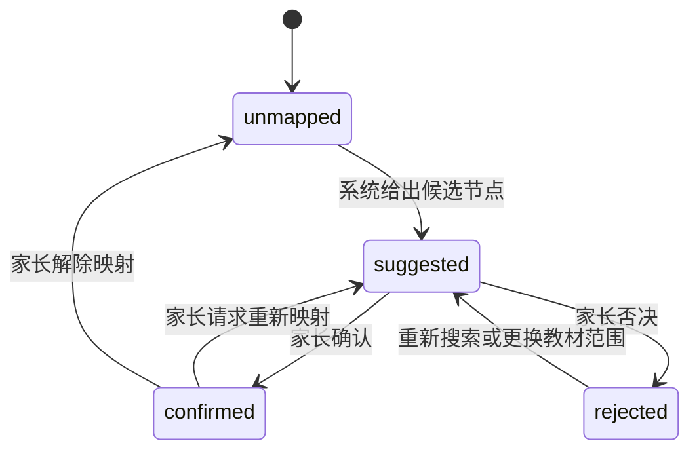

`confirmed` 到其他状态的变化必须记录旧快照、操作者和时间；已经生成的历史学习包继续引用旧快照。

### 8.2 教学闭环状态机

下图是 [`tutor-cycle-state-machine.json`](../contracts/tutor-cycle-state-machine.json) 的可视化。
`pending_review` 表示 AI 内容只对家长可见；`approved` 才是孩子流程的服务端前置条件。

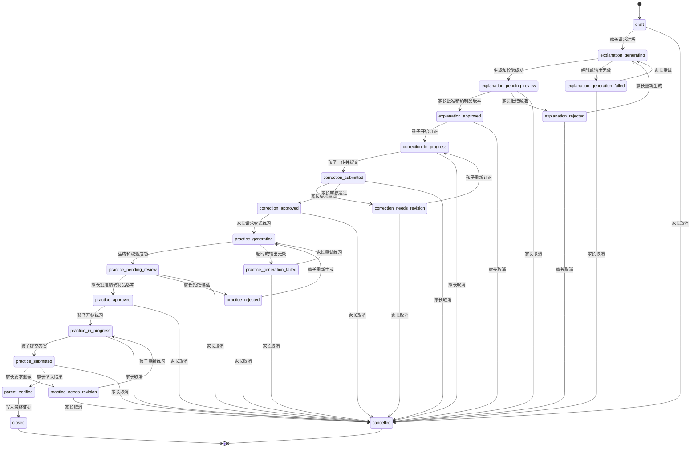

审核规则：

- `explanation-review` 和 `practice-review` 必须提交 `artifactId + artifactVersion +
  contentHash + expectedArtifactReviewVersion + expectedStateVersion + operationId`；目标不是当前
  candidate 精确版本时返回 `409`。
- 批准动作原子写入 `parent_approved`、审核人/时间、循环绑定版本和下一个状态；拒绝动作写入
  `rejected` 和拒绝原因，不能让孩子读取候选正文。
- 同一事务必须同时 CAS `Artifact.reviewVersion` 和 `Cycle.stateVersion`，并确认 Cycle 仍处于
  对应的 `explanation_pending_review` 或 `practice_pending_review`；任一条件不满足都整体返回
  `409`，Artifact 和 Cycle 都不更新。
- 孩子查询 Artifact、`start-correction`、`start-practice` 均在服务端验证家庭归属、孩子归属、
  制品种类、精确版本、重新计算的 contentHash 和 `parent_approved`，不能只相信前端按钮是否显示。
- 只有 rejected candidate 可以在当前 Cycle 重新生成更高版本；parent_approved 不允许替换，
  发现错误时取消 Cycle 并从原错题新建一轮。

### 8.3 生成任务状态机

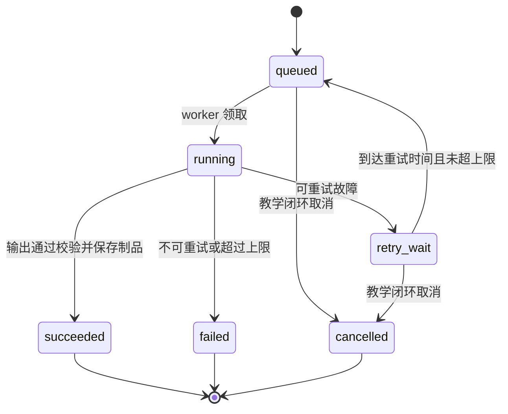

worker 重启后扫描超过租约时间的 `running` 任务。只有 Adapter 已经持久化
`operationId -> sessionId/turnId` 映射时，才查询或恢复原 turn；没有可证明映射的未知结果进入
`uncertain_manual_reconcile`，不盲目创建新任务。

---

## 9. 核心业务流程

### 9.1 完整人工审核学习闭环

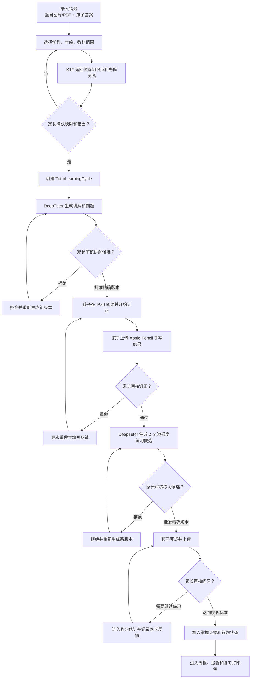

### 9.2 K12 数据准备流程

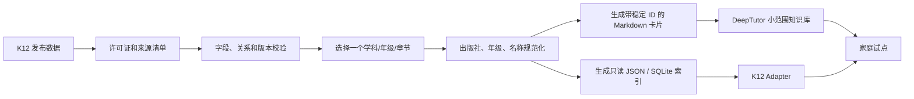

生产运行不需要 K12-Bench 或 K12-Train。Bench 用于模型评测，Train 用于训练研究，两者不属于孩子学习档案。

### 9.3 模型上下文组装流程

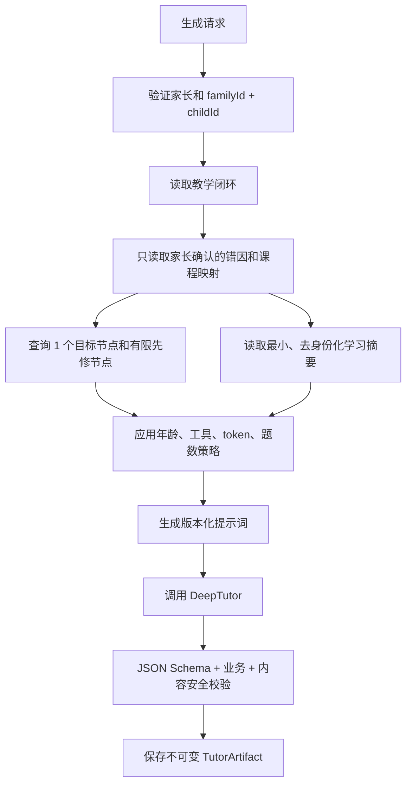

---

## 10. 核心时序图

### 10.1 错题录入与课程映射确认

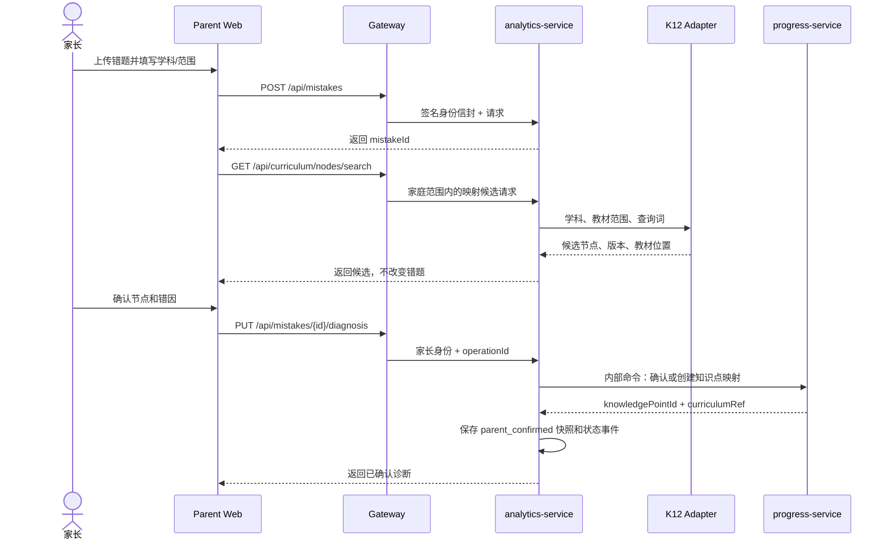

课程搜索可由 `analytics-service` 经内部 client 代理，公开 API 不应直接暴露 K12 Adapter 的内部地址。

### 10.2 生成讲解

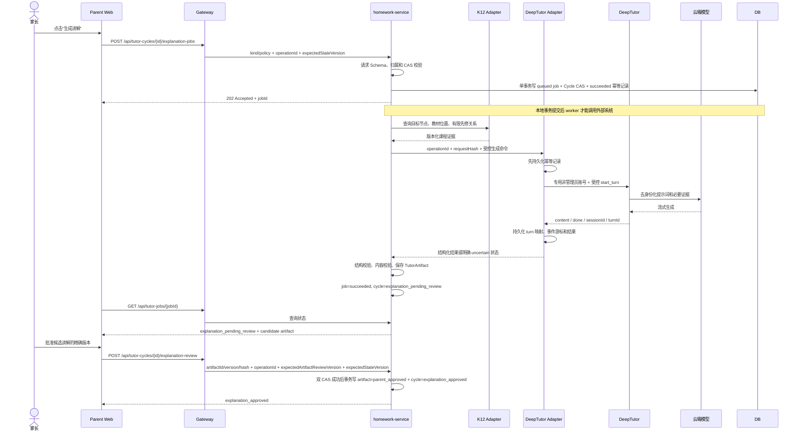

### 10.3 孩子订正、家长审核和练习生成

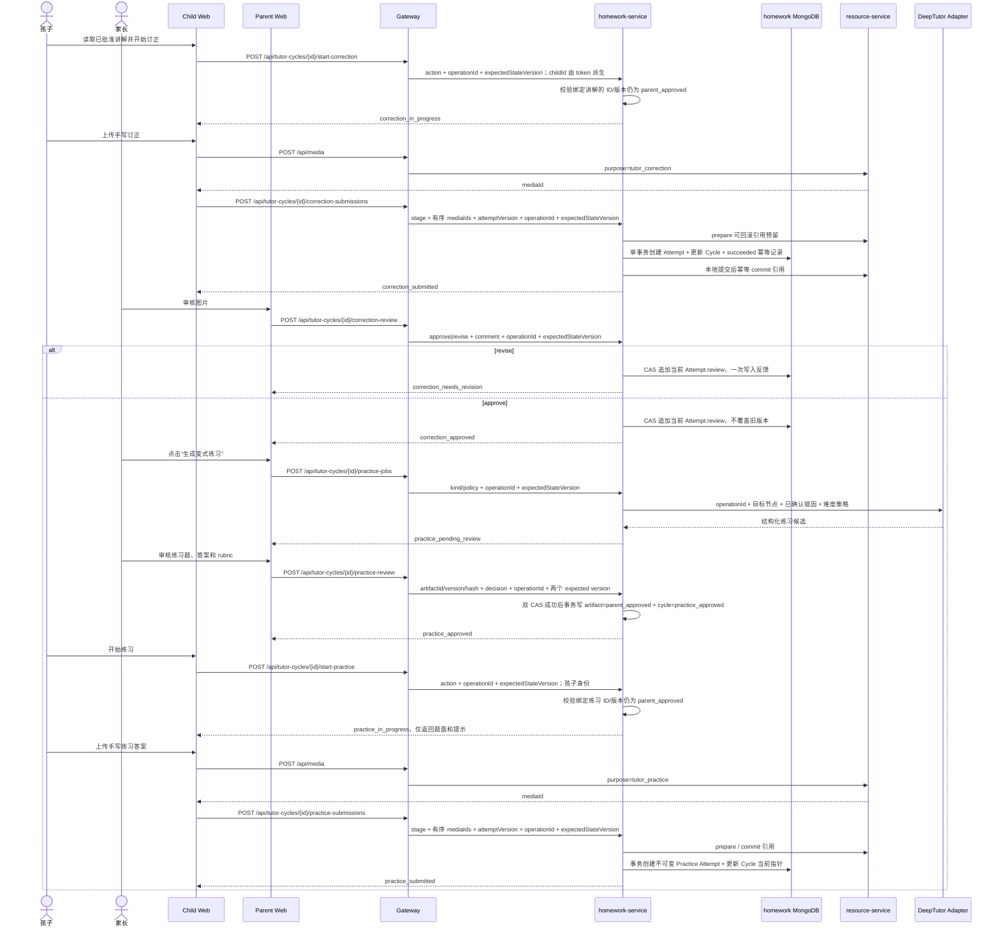

### 10.4 最终审核与掌握度证据

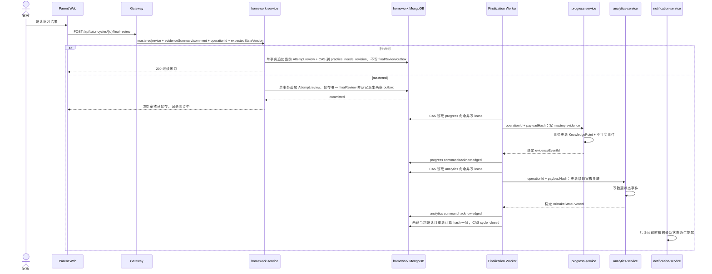

若任一命令失败，教学闭环保留 `parent_verified`，命令按 `nextAttemptAt` 独立重试；lease
过期后可由其他 worker 接管。达到上限进入 `dead_letter` 并提示管理员，不向家长谎报
`closed`。`mastered` 最终审核提交后不可修改；相同幂等请求在重新授权后从权威记录重建语义
等价结果，其他再次提交返回
`409 FINAL_REVIEW_ALREADY_ACCEPTED`。

### 10.5 生成任务超时恢复

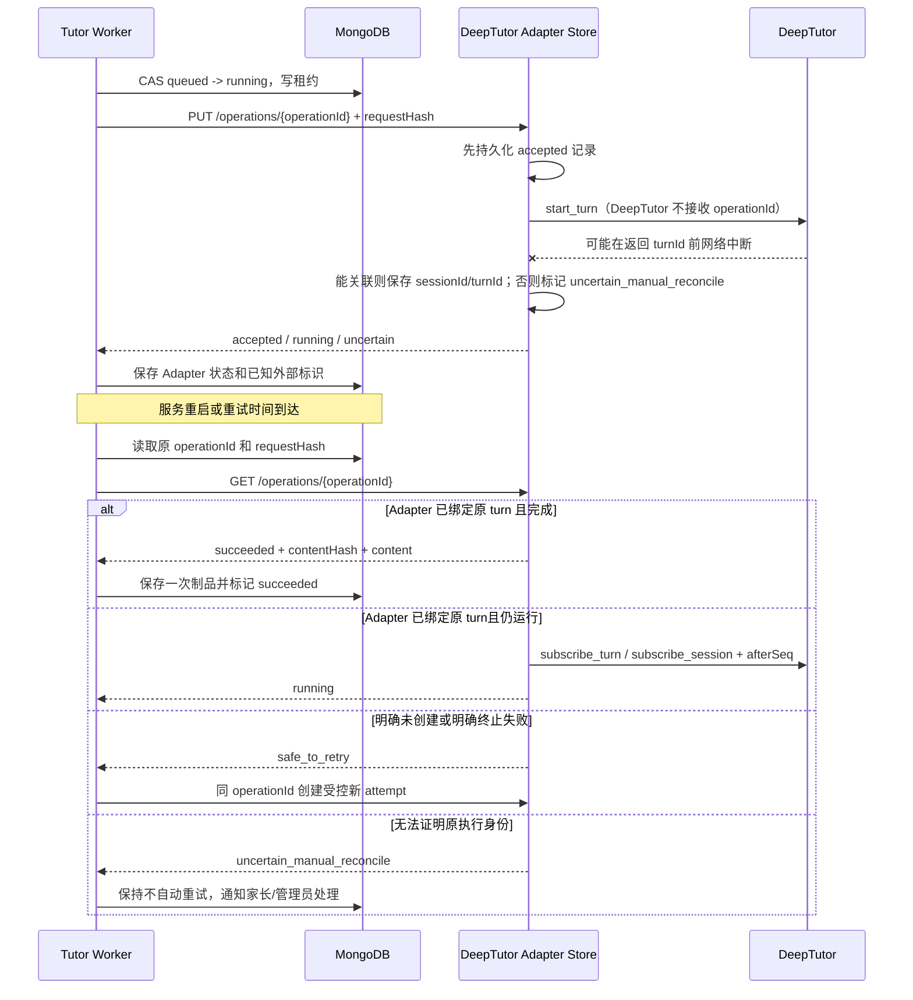

本方案不声称 DeepTutor 提供 exactly-once。LMS 只承诺：自身和 Adapter 的业务命令幂等、
已知 turn 可恢复、无法关联的未知窗口不会自动重复生成。固定镜像升级后必须重新执行所有
失败窗口契约测试。

---

## 11. API 设计草案

### 11.1 公开 LMS API

所有公开接口均通过 Gateway，使用现有家长/孩子授权规则。

#### 课程候选与诊断

```text
GET  /api/curriculum/nodes/search
GET  /api/curriculum/nodes/:nodeId
PUT  /api/mistakes/:mistakeId/diagnosis
GET  /api/mistakes/:mistakeId/diagnosis-history
```

搜索必须显式携带或从孩子档案/家长选择中得到：

```text
subject + publisher + stage + grade + volume + datasetVersion
```

不能只按一个无范围的中文名称跨所有教材搜索后自动确认。

#### 教学闭环

创建请求必须符合
[`tutor-cycle-create-request.schema.json`](../contracts/tutor-cycle-create-request.schema.json)：

```json
{
  "schemaVersion": "tutor-cycle-create-request-v1",
  "childId": "child_xxx",
  "sourceMistakeId": "mistake_xxx",
  "knowledgePointId": "knowledge_xxx",
  "presentedByGrowthTaskId": null,
  "operationId": "opaque-cycle-create-operation-id"
}
```

`familyId` 由家长身份和实时家庭成员关系派生，不接受客户端覆盖。服务端必须验证错题、知识点
和孩子属于同一家庭，且 `FamilyMistake.knowledgePointId` 与请求完全一致；`presentedByGrowthTaskId`
存在时也必须属于同一家庭和孩子。任一不一致返回 `404` 或统一的归属拒绝，不能创建部分 Cycle。

```text
POST /api/tutor-cycles
GET  /api/tutor-cycles/:cycleId
GET  /api/tutor-cycles?childId=...&status=...
POST /api/tutor-cycles/:cycleId/explanation-jobs
POST /api/tutor-cycles/:cycleId/explanation-review
POST /api/tutor-cycles/:cycleId/start-correction
POST /api/tutor-cycles/:cycleId/correction-submissions
POST /api/tutor-cycles/:cycleId/correction-review
POST /api/tutor-cycles/:cycleId/practice-jobs
POST /api/tutor-cycles/:cycleId/practice-review
POST /api/tutor-cycles/:cycleId/start-practice
POST /api/tutor-cycles/:cycleId/practice-submissions
POST /api/tutor-cycles/:cycleId/final-review
POST /api/tutor-cycles/:cycleId/cancel
GET  /api/tutor-jobs/:jobId
GET  /api/tutor-artifacts/:artifactId
```

全部公开 POST 路由及其 `endpointOperation -> requestSchemaId -> discriminator` 映射以
[`tutor-cycle-state-machine.json`](../contracts/tutor-cycle-state-machine.json) 的
`publicMutations` 清单为唯一机器真相。讲解与练习 Artifact 审核分别使用稳定的
`explanation-artifact-review` 和 `practice-artifact-review` operation，不能因复用同一请求 Schema
而合并。文档门禁必须按 `route + endpointOperation` 比较公开路由、清单、Schema 和
requestPayloadHash fixtures；新增写路由但漏掉任一契约时直接失败。

`explanation-jobs` 与 `practice-jobs` 复用
[`tutor-generation-job-request.schema.json`](../contracts/tutor-generation-job-request.schema.json)，
分别固定 `kind=explanation|practice`，并按 kind 约束生成策略。公开请求的 operationId 与
expectedStateVersion 用于状态转换和防重复计费；服务端随后构造的 generationInput/requestHash
用于确定模型输入，二者不能互相替代。

`start-correction`、`start-practice` 和 `cancel` 复用
[`tutor-stage-action-request.schema.json`](../contracts/tutor-stage-action-request.schema.json)：
两个 start 操作的 `comment` 必须显式为 null，cancel 必须填写原因。start 不接受客户端提交
Artifact ID/version/hash，服务端从 Cycle 绑定读取并重新计算 contentHash、核对归属、kind 和
`parent_approved` 状态后再推进。

`correction-submissions` 与 `practice-submissions` 复用
[`tutor-stage-submission-request.schema.json`](../contracts/tutor-stage-submission-request.schema.json)：
请求携带 stage、有序且不重复的 `mediaIds[]`、严格递增的 `attemptVersion`、operationId 和
expectedStateVersion。事务必须先验证媒体归属，再创建唯一 TutorCycleAttempt、更新 Cycle 当前
指针并推进状态；同一 operationId 重放时重新授权并从权威 Attempt 重建语义等价结果，不得创建
第二条 Attempt 或重复绑定媒体。

`explanation-review` 与 `practice-review` 仅允许家长调用，请求必须符合
[`tutor-artifact-review-request.schema.json`](../contracts/tutor-artifact-review-request.schema.json)：

```json
{
  "schemaVersion": "tutor-artifact-review-request-v1",
  "artifactId": "artifact_xxx",
  "artifactVersion": 3,
  "contentHash": "sha256:0123456789abcdef0123456789abcdef0123456789abcdef0123456789abcdef",
  "decision": "approve",
  "comment": "已核对题干、答案和难度",
  "operationId": "opaque-review-operation-id",
  "expectedArtifactReviewVersion": 2,
  "expectedStateVersion": 7
}
```

`decision` 仅允许 `approve|reject`。重复请求只有在 operationId 和 payload hash 都相同时返回
第一次结果；审核目标不是当前候选、版本或 hash 不匹配、任一期望版本过期时返回 `409`，
不能批准“当前最新内容”这种不确定引用。事务的查询条件必须同时包含：

```text
artifact.reviewVersion == expectedArtifactReviewVersion
artifact.status == candidate
cycle.stateVersion == expectedStateVersion
cycle.status == explanation_pending_review / practice_pending_review
artifact.cycleId == cycle.id
```

任何条件不满足都不得更新任一对象。`correction-review` 不修改 Artifact，请求必须符合
[`tutor-correction-review-request.schema.json`](../contracts/tutor-correction-review-request.schema.json)：
提交 `decision=approve|revise`、`comment`、`operationId` 和 `expectedStateVersion`，其中 revise
必须填写 comment。审核事务从 Cycle 当前指针取得精确 TutorCycleAttempt，以
`attempt.review == null` 和 Cycle expectedStateVersion 做 CAS；approve 进入
`correction_approved`，revise 追加永久反馈并进入 `correction_needs_revision`。

`final-review` 请求必须符合
[`tutor-final-review-request.schema.json`](../contracts/tutor-final-review-request.schema.json)：提交
`decision=mastered|revise`、`evidenceSummary`、`comment`、`operationId` 和
`expectedStateVersion`。mastered 必须填写 evidenceSummary；revise 必须填写 comment，且不得
提交最终 evidenceSummary。只有 mastered 创建不可变 finalReview 和 outbox；revise 只进入
`practice_needs_revision`。`finalReviewId`、`finalReviewVersion=1`、`finalReviewHash`、审核人、
审核时间和所有归属字段均由服务端产生。revise 和 mastered 都先把 review 追加到当前练习
Attempt；mastered 再把该 Attempt 的 `attemptId + attemptVersion + reviewOperationId` 固化进
finalReview，并由同一事务创建 outbox，不能把幂等记录当作学习反馈存储。审核事务必须同时
校验请求、Cycle 前后状态、Attempt 前后状态和派生命令，Attempt 中的 stateVersion 只能引用
同一事务实际读取和写入的 Cycle 版本。

写接口统一要求：

- 客户端生成 `operationId`；
- 状态转换请求携带 `expectedStateVersion` 或等价的 `If-Match`；Artifact 审核使用
  `expectedArtifactReviewVersion`；
- 孩子请求的 `childId` 从签名身份派生，不接受覆盖；
- 家长请求由服务端解析实时 Family 成员关系；
- 重复 operation 返回第一次成功结果，不重复调用模型或绑定媒体。
- 家长详情接口可读取本家庭的 `candidate/rejected/parent_approved`；孩子详情和 Artifact 接口
  只返回循环绑定的 `parent_approved` 精确版本，其他状态统一返回 `404`，避免泄露候选内容。
- `start-correction` 的前置状态只能是 `explanation_approved`；`start-practice` 的前置状态只能是
  `practice_approved`，并在服务端重新校验 Artifact 归属、kind、版本、hash 和批准状态。

### 11.2 内部 LMS 命令

```text
POST /api/internal/knowledge-points/resolve-curriculum
POST /api/internal/knowledge-points/mastery-evidence
POST /api/internal/mistakes/apply-tutor-review
GET  /api/internal/tutor-sources/:cycleId/summary
```

内部命令使用独立服务凭据，不经过公开 Gateway，必须验证：

- 调用方服务身份；
- `familyId + childId` 一致；
- source ID 存在且属于同一家庭；
- `operationId` 幂等；
- 输入字段白名单。

最终审核写回不是请求线程中的同步双写。上述两个写接口由
`TutorFinalizationCommand` worker 调用；目标服务对 `operationId` 建唯一约束，对相同键和不同
`payloadHash` 返回 `409`，成功重放返回原 `responseId`。

`final-review` 只接受 `practice_submitted`。revise 仅推进到 `practice_needs_revision`；mastered
事务提交后循环进入 `parent_verified`，MVP 不允许修改该审核。进入 `parent_verified` 或
`closed` 后再次提交，除完全相同的幂等重放外均返回
`409 FINAL_REVIEW_ALREADY_ACCEPTED`。

### 11.3 K12 Adapter 内部只读 API

第二阶段启用独立 Graph API 时提供：

```text
GET /health
GET /nodes/search
GET /nodes/:id
GET /nodes/:id/prerequisites
GET /nodes/:id/successors
GET /nodes/:id/neighbors
GET /nodes/:id/experiments
GET /nodes/:id/exercises
GET /nodes/:id/evidence
GET /path
GET /metadata/version
```

所有响应包含 `datasetVersion`；`/path` 限制最大深度、最大节点数和超时，防止无界图遍历。

### 11.4 DeepTutor 接口边界

适配器不依赖 DeepTutor Web 页面。启动部署实例后，从 `GET /openapi.json` 固定接口快照；生成主要使用统一 `WS /api/v1/ws`，并处理 `stage_start`、`tool_call`、`tool_result`、`content`、`done` 和错误事件。

LMS 不直接调用 DeepTutor。持久化 Adapter 对 LMS 暴露稳定的内部接口：

```text
PUT  /internal/deeptutor/operations/:operationId
GET  /internal/deeptutor/operations/:operationId
POST /internal/deeptutor/operations/:operationId/reconcile
```

`PUT` 必须先保存 `operationId + requestHash + acceptedAt`，其中 requestHash 严格使用 7.6 的
generationInput JCS 算法，再创建 DeepTutor turn；相同 operationId、不同 hash 返回 `409`。
`GET` 返回 Adapter 已持久化的 `sessionId/turnId/lastEventSeq/status/resultHash`，
不把 DeepTutor 内部会话当作 LMS 权威档案。`reconcile` 仅供家长/管理员处理
`uncertain_manual_reconcile`，不能由普通 worker 自动调用。

DeepTutor 内部调用要求：

- 使用独立服务账号或专用认证 token；
- 不转发 LMS JWT；
- `session_id` 由教学闭环映射表管理；
- LMS `operationId` 不进入 DeepTutor 原生协议；Adapter 维护到 `session_id/turn_id` 的映射；
- 新集成使用 `/api/v1/ws`，不使用 legacy `/api/v1/chat`；
- 只允许获批的 capability、KB 和工具；
- API 变更通过 OpenAPI 契约测试和固定镜像版本发现。
- Adapter 只允许统一 WebSocket、必要会话查询和健康检查；拒绝 settings、system、plugins、
  MCP、skills、subagents、partners、imports、attachments 等未批准路由。

---

## 12. DeepTutor 适配与输出契约

### 12.1 允许的能力

能力限制采用双层防护：DeepTutor 固定版本的非管理员用户 grant 限定模型、KB、工具、MCP 和
代码执行；Adapter 再校验 capability、KB、tool 和可访问路由。任一层拒绝即失败，不能因为
DeepTutor 与 LMS 在同一 Docker 网络就跳过鉴权。

MVP 只允许：

- 基于限定 KB 的教材讲解；
- `deep_solve` 或等价的受控解题能力；
- 生成少量梯度练习；
- 生成家长审核 rubric；
- 基于明确课程节点引用证据。

默认禁用：

- 任意代码执行；
- 任意联网搜索；
- 任意 MCP；
- 下载和执行第三方 skill；
- 子代理；
- 外部聊天渠道；
- 直接写 memory 作为 LMS 掌握度依据；
- 将孩子上传文件直接转交给模型。

MVP 的非管理员服务用户 grant 必须满足：只分配指定模型和教育 KB、`skills=[]`、
`partners=[]`、`enabled_tools` 仅列出实际需要的只读工具、`mcp_tools=[]`、
`exec_enabled=false`。capability 不属于该 grant 的完整控制面，由 Adapter 的固定 allowlist
补足。管理员凭据只用于部署配置，不能放入 LMS/Adapter 运行环境。

### 12.2 讲解制品 JSON

正文必须符合
[`explanation-content.schema.json`](../contracts/explanation-content.schema.json)：

```json
{
  "schemaVersion": "explanation-v1",
  "learningObjective": "理解勾股定理的适用条件",
  "targetCurriculumNodeIds": ["concept_xxx"],
  "prerequisites": [
    {
      "curriculumNodeId": "concept_yyy",
      "name": "平方与平方根",
      "whyNeeded": "需要完成平方运算并理解开方"
    }
  ],
  "explanation": {
    "summaryMarkdown": "……",
    "workedExampleMarkdown": "……",
    "commonPitfalls": ["没有先确认三角形是否为直角三角形"]
  },
  "correctionPrompt": "请先标出直角边和斜边，再重新列式。",
  "parentRubric": [
    "能否识别斜边",
    "是否在直角三角形条件下使用公式"
  ],
  "citations": [
    {
      "curriculumNodeId": "concept_xxx",
      "datasetVersion": "……"
    }
  ]
}
```

### 12.3 练习制品 JSON

正文必须符合 [`practice-content.schema.json`](../contracts/practice-content.schema.json)：

```json
{
  "schemaVersion": "practice-v1",
  "targetCurriculumNodeIds": ["concept_xxx"],
  "instructions": "独立完成，不使用计算器。",
  "exercises": [
    {
      "exerciseId": "ex-1",
      "difficulty": "easy",
      "questionMarkdown": "……",
      "targetNodeIds": ["concept_xxx"],
      "answerForParent": "……",
      "rubric": ["识别斜边", "公式正确", "计算正确"]
    }
  ],
  "generationPolicy": {
    "exerciseCount": 1,
    "difficultySequence": ["easy"]
  }
}
```

### 12.4 输出校验

适配器必须拒绝以下输出：

- JSON 不符合 schema；
- 缺少目标课程节点或引用了未授权教材范围；
- 题目数超过策略上限；
- 单项文本或总制品超过大小上限；
- 包含脚本、iframe、事件属性、远程可执行 HTML；
- target、prerequisite、citation 或 exercise target 未精确命中允许的课程快照；
- citation 的 `datasetVersion` 与相同节点的快照版本不同；
- 同一 `nodeId` 在一个 Artifact 中出现多个课程数据版本；
- 练习题目标不属于该练习包顶层目标集合；
- 要求孩子提供姓名、学校、联系方式等信息；
- 声称已自动判定掌握或替家长完成审核；
- 引用不存在的课程节点、数据版本或教材位置；
- 答案与题目结构不一致。

模型 citation 只提交 `curriculumNodeId + datasetVersion`，不提交自由文本教材位置。家长和孩子
界面中的出版社、年级、册、章、节全部从匹配的 `CurriculumRefSnapshot.textbookScope` 派生，
不能把模型生成字符串作为权威教材证据。

通过 schema 只代表结构合法，不代表教学正确。家长批准前制品状态为 `candidate`。

---

## 13. 前端与 iPad 体验

### 13.1 孩子端信息架构

孩子不进入 DeepTutor 全功能界面。LMS 的孩子端增加：

```text
今日
├── 普通成长任务
└── 学习任务
    ├── 目标与简短讲解
    ├── 例题
    ├── 开始订正
    ├── Apple Pencil 手写后上传
    ├── 提交家长审核
    ├── 变式练习
    └── 审核结果与下一步
```

### 13.2 家长端信息架构

```text
错题审核台
├── 原题图片/PDF
├── 孩子原答案与订正
├── 学科/教材范围
├── K12 候选知识点和先修链
├── 错因确认
├── 生成/批准讲解
├── 订正审核
├── 生成/批准练习
├── 最终审核与掌握度证据
└── 复习日期、打印包和历史版本
```

### 13.3 iPad 交互要求

- 主要按钮触控区域至少适合手指点击，不依赖 hover。
- 上传入口支持相册、相机、文件选择；保留多图顺序。
- 讲解和题目支持 Markdown、KaTeX 数学公式和可访问的图片替代文本。
- 长页面自动保存阅读/填写进度，但正式提交仍需明确按钮。
- 网络中断后保留本地待上传提示，重复提交由 operationId 幂等处理。
- “提交家长审核”后默认只读，家长退回才允许新一轮上传。
- 不在孩子端显示标准答案和家长 rubric，直到家长决定开放。

### 13.4 手写处理原则

第一阶段：

```text
手写图片/PDF → 私有上传 → 家长人工审核 → LMS 记录结果
```

以后增加 OCR 时：

- OCR 结果是可编辑草稿；
- 保留原图、OCR 文本、OCR 引擎版本和家长修订；
- OCR 不触发自动掌握度变化；
- 数学公式、图形题和多步骤推导默认需要人工复核。

### 13.5 期末复习与打印

打印包由 LMS 的结构化数据确定性生成，至少包含：

- 原题和教材位置；
- 孩子首次答案图片；
- 家长确认的错因；
- 订正图片；
- DeepTutor 讲解摘要；
- 变式题、孩子答案和家长审核；
- 最后一次掌握证据与复习日期。

打印包可以使用 HTML print CSS 或服务端 PDF；不依赖 DeepTutor 的 Office/代码执行能力。

---

## 14. 权限矩阵

| 操作 | 家庭 owner | 第二家长 | 孩子本人 | 其他孩子 | 跨家庭用户 | DeepTutor |
| --- | --- | --- | --- | --- | --- | --- |
| 录入孩子错题 | 允许 | 允许 | 允许录入本人有限字段 | 禁止 | 禁止 | 禁止 |
| 查看错题私有媒体 | 允许 | 允许 | 仅本人 | 禁止 | 禁止 | 默认禁止 |
| 确认课程映射 | 允许 | 允许 | 禁止 | 禁止 | 禁止 | 仅建议 |
| 确认错因 | 允许 | 允许 | 可写本人解释，不可最终确认 | 禁止 | 禁止 | 仅建议 |
| 请求生成讲解/练习 | 允许 | 允许 | 第一阶段禁止 | 禁止 | 禁止 | 被调用方 |
| 提交订正/练习 | 可代录 | 可代录 | 仅本人 | 禁止 | 禁止 | 禁止 |
| 家长审核 | 允许 | 允许 | 禁止 | 禁止 | 禁止 | 禁止 |
| 修改掌握度 | 允许 | 允许 | 禁止 | 禁止 | 禁止 | 禁止 |
| 配置模型、KB、工具 | 部署管理员 | 禁止或只读 | 禁止 | 禁止 | 禁止 | 自身管理接口 |

家长日常学习管理权限遵循当前第二家长平等共管规则；owner 特权仍只用于家庭成员治理。

---

## 15. 安全、隐私与 AI 风险控制

### 15.1 儿童数据保护

- 所有教学闭环、制品和媒体都携带 `familyId + childId`。
- 授权必须从实时 Family 关系解析，不信任客户端提交的 `familyId`。
- 孩子 token 只能访问本人数据，不能用 query/body 选择兄弟姐妹。
- 学习记录和媒体备份必须加密；恢复演练不得使用公开云盘临时分享。
- 日志不打印完整模型提示词、孩子回答、媒体 URL、JWT、Cookie 或 API Key。

### 15.2 模型数据最小化

调用 Adapter 前，`generationInput` 必须通过闭合字段 Schema、长度/数量和跨字段语义校验；
正确的 requestHash 不能使非法结构、额外身份字段或凭据获得放行资格。完整
ErrorClassification 审计对象、完整 CurriculumRefSnapshot、Cycle/错题内部 ID 和媒体定位信息
只留在 LMS/Adapter 信封中，云端模型只收到再次投影后的必要教学字段。

允许发送：

- 去身份化的年级、学科、教材范围；
- 目标课程节点和必要 evidence；
- 家长确认的错因代码和简短说明；
- 非身份化的掌握度摘要；
- 当前题目文本，仅在家长确认允许且有必要时。

默认不发送：

- 姓名、学校、班级、手机号、地址；
- 家庭成员信息；
- LMS token 和内部 ID 的原始值；
- 原始手写图片/PDF；
- 完整历史错题或完整周报；
- 无关教材片段。

内部可以将 ID 转换为本次调用不可反推的短期别名，如 `student-A`。

### 15.3 Prompt injection 与不可信内容

- 教材卡片和家长输入用明确分隔符标记为“数据”，不能覆盖系统策略。
- DeepTutor 工具采用 allowlist，MVP 不启用任意代码执行、联网和第三方技能。
- 返回 Markdown 禁止原始 HTML 或经过严格 sanitizer。
- 外部链接默认不自动加载，避免跟踪和内容替换。
- 课程节点和教材位置必须回到 K12 Adapter 复核，不能只相信模型文本。

### 15.4 密钥与网络

- LLM、embedding 和 DeepTutor 服务凭据使用独立密钥。
- 密钥存放在部署 secrets/受限配置中，不进入 Git、Markdown、模型提示词或普通日志。
- DeepTutor 和 K12 Adapter 只加入 Docker 内部网络；孩子端只访问 LMS Gateway。
- DeepTutor 必须启用自身认证。Adapter 使用 DeepTutor 非管理员服务用户，凭据从权限为
  `0600` 的 secret 文件读取并在内存中换取短期 Cookie/token；LMS JWT 永不转发。
- DeepTutor 只接受 Adapter 所在内部网络的连接，Adapter 只接受 `homework-service` 的 mTLS
  或独立服务凭据；管理验证 profile 与 LMS 集成 profile 不同时启用。
- DeepTutor 原生认证不能替代 Adapter 路由/capability 白名单；管理员管理面不暴露给 LMS。
- 家庭外访问使用 VPN/Tailscale 或统一 HTTPS 反向代理，不直接做路由器端口转发。
- DeepTutor 镜像使用固定版本或 digest，升级前备份并验证 OpenAPI 契约。

### 15.5 许可证边界

- DeepTutor 当前项目许可证为 Apache-2.0。
- K12-KGraph 代码当前为 MIT；发布图谱、benchmark 和训练数据当前为 CC BY-NC-SA 4.0。
- 文档契约 Gate 使用固定 `json-canonicalize@3.0.0` 实现 RFC 8785，许可证为 MIT；业务实现
  也必须使用兼容 RFC 8785 的同算法实现，不能自行改成普通 `JSON.stringify`。
- 数据导入时保存来源、许可证、版本和修改记录。
- 家庭非商业使用仍应保留署名与来源；未来公开分享派生数据或商业化前重新进行许可证评审。
- 不上传或分发未经授权的完整教材 PDF。

---

## 16. 可靠性、幂等与故障处理

### 16.1 故障分类

| 故障 | 系统行为 | 用户提示 |
| --- | --- | --- |
| K12 Adapter 不可用 | 不自动映射；保留手工知识点和错题流程 | “课程库暂不可用，可手工选择或稍后重试” |
| DeepTutor 不可用 | 生成任务进入 retry/failed；不改业务状态 | “讲解生成失败，错题已保存，可重试或手工填写” |
| LLM 超时，已知 turn | Adapter 按 turnId 和事件游标恢复 | “正在确认生成结果，请勿重复点击” |
| 在取得 turnId 前结果未知 | 转 `uncertain_manual_reconcile`，禁止自动重建 | “结果需要家长确认后处理” |
| 输出 schema 无效 | 不创建孩子可见制品；记录验证错误 | “生成内容未通过校验，请重新生成” |
| progress 写证据失败 | cycle 保留 `parent_verified`，后台重试 | “审核已保存，学习记录正在同步” |
| analytics 更新错题失败 | 不标记 cycle closed，使用同一操作重试 | “审核已保存，错题状态正在同步” |
| 媒体引用中断 | 复用现有 prepare/commit/unbind 恢复协议 | 不重复上传，显示处理中 |
| 服务器重启 | 扫描租约过期 job 和待收敛内部命令 | 自动恢复，必要时提示管理员 |

### 16.2 幂等要求

- 所有生成、提交、审核和跨服务命令都有客户端或服务端稳定 `operationId`。
- 公共写请求固定先完成认证和实时资源授权，再进入 Schema/hash/幂等处理：验证 Session/JWT →
  解析 actor 身份与状态 → 从 matchedPathParams 加载 Cycle/来源资源 → 校验实时 Family 成员关系、
  familyId、childId 和 endpoint 角色 → 授权通过后才校验请求并查询幂等记录。兄弟姐妹、跨家庭、
  已失权家长、禁用用户或已删除资源统一按现有防枚举策略返回 404，且不得读取或返回旧幂等响应。
- `tutor-cycle-state-machine.json.publicMutations` 枚举全部公开 Tutor POST 路由、稳定
  endpointOperation、请求 Schema、allowedActorRoles、responseVariants 和 kind/action/stage
  discriminator；路由、角色、条件 HTTP 状态/响应类型、Schema 或 hash fixtures 任一集合不一致时门禁失败。
- 公共写请求先通过对应 Schema，并按
  `SHA-256(UTF-8 RFC8785-JCS({schemaVersion, endpointOperation, resource:{cycleId}, request}))` 计算
  `requestPayloadHash`；其中 `request` 保留显式 null 和除 `operationId`、`schemaVersion` 外的
  所有 Schema 字段；schemaVersion 只在外层出现一次。request 包括 comment、Artifact 版本和 expected state/review
  version，不对原始 HTTP 字节计算 hash。`cycleId` 必须由服务端从匹配后的 URL 参数
  `matchedPathParams.cycleId` 提取，并验证与 hash 输入中的 `resource.cycleId` 相同；创建 Cycle 时
  两者固定为 null，客户端正文不能覆盖。
- 幂等记录以服务端派生的 `{ familyId, endpointOperation, operationId }` 三字段元组为作用域；
  MongoDB 查询、唯一索引和应用比较都逐字段执行，禁止存储或比较无转义冒号拼接 scopeKey。同一作用域和
  相同 requestPayloadHash 在实时授权后从最小 responseReference 重建语义等价结果，不同 hash
  返回 `409 IDEMPOTENCY_KEY_REUSED`。JSON 键
  顺序或 operationId 改变不影响 requestPayloadHash，但 operationId 改变会命中新的幂等记录；
  同一个 operationId 被复用于另一个 Cycle 时，因为 resource 不同而返回 409，不能跨 Cycle 重放成功。
- 授权通过后的幂等身份决策有三种：不存在相同字段元组时执行；相同元组但 hash 不同时返回
  `409 IDEMPOTENCY_KEY_REUSED`；相同元组且相同 requestPayloadHash 时进入引用解析。引用解析只有
  在权威实体的类型、resourceId、familyId、childId、cycleId 全部匹配后才重建当前授权响应；目标
  不存在或归属不一致时返回 404 并固定 `reexecute=false`。不得缓存完整儿童响应、覆盖旧记录、
  删除 tombstone 后重做操作或返回另一个 Cycle 的结果。该顺序和语义由
  `tutor-idempotency-decision-v1` fixtures 验证。
- 同一三字段元组的首次业务写入和 `outcome=succeeded` 幂等记录必须在同一 MongoDB 事务中提交。
  并发 duplicate-key/write-conflict loser 整体回滚后先读取 winner；相同 hash 重放，不同 hash
  返回 409。事务内
  禁止同步调用 DeepTutor、analytics/progress 或产生其他不可逆跨服务副作用；只允许写本地 Job/outbox。
- 首次提交使用 `tutor-idempotency-record-commit-v1` 把实际 actor、请求、授权资源、实际权威结果、
  确定性 responseId 和持久化记录逐字段绑定。审核 Attempt 的 ID/version 必须等于同事务 Cycle 当前
  指针，且持久化 reviewOperationId 必须等于本次请求 operationId；相同 family/child/cycle/stage 的
  历史资源也不能替代本次 actualResult。业务写入与记录的 transactionId 必须相同；该当前指针约束
  不用于后续 replay。
- `operationId` 只在 LMS 与 Adapter 契约中有效；不得假设 DeepTutor 原生支持该字段。
- 自动重试生成仅允许在 Adapter 能证明原 turn 已终止失败或根本未创建时发生；身份不明的
  执行必须人工 reconcile。
- 生成重试不覆盖旧制品，成功后只发布一个版本。
- 循环转换使用 `stateVersion`，Artifact 审核使用 Artifact `reviewVersion`，防止两位家长并发
  操作时后写静默覆盖前写；最终审核只允许成功一次。
- 提交请求中的有序 mediaIds、attemptVersion 和 expectedStateVersion 全部进入
  requestPayloadHash；成功提交创建新的 TutorCycleAttempt，重放不得覆盖旧 Attempt 或重复绑定媒体。
- 掌握事件和错题状态事件保持不可变；更正使用新事件。

### 16.2.1 授权与幂等固定顺序

```text
authenticate
  -> resolve actorUserId / actorRole / actorFamilyId / actorChildId
  -> load matched Cycle or create-source records
  -> authorize current account, Family membership, familyId, childId and endpoint role
  -> reject unauthorized request without idempotency lookup
  -> validate request Schema
  -> derive resource and requestPayloadHash
  -> load TutorIdempotencyRecord by the three-field tuple
  -> record exists: conflict / load referenced authoritative entity
  -> verify referenced type, id, familyId, childId and cycleId
  -> rebuild-authorized replay / 404 without reexecution
  -> record missing: begin local MongoDB transaction
  -> business write + Cycle CAS + local Job/outbox
  -> read committedEntity in the same transaction/session
  -> derive request-specific status/resource reference + succeeded record
  -> commit once / duplicate-key or write-conflict abort and reload winner
```

孩子调用必须满足 `cycle.familyId == actorFamilyId` 且 `cycle.childId == actorChildId`，并只允许孩子
可调用的开始/提交 operation；家长调用必须确认当前仍为该家庭有效家长。stored record 的
`createdBy`、幂等字段元组、hash 或 responseReference 都不能替代实时授权。重放时重新读取权威
记录，验证引用实体归属并按当前角色过滤字段，不能直接返回旧权限快照。`cycle-create` 在引用解析
时校验新建 Cycle，其他操作校验引用实体属于已授权的目标 Cycle。

首次并发的提交顺序如下：

```mermaid
sequenceDiagram
  participant A as Request A
  participant B as Request B
  participant DB as homework-service MongoDB
  A->>DB: begin txn; business write + succeeded record
  B->>DB: begin txn; business write + succeeded record
  A->>DB: commit unique tuple
  DB-->>A: committed
  B->>DB: commit same unique tuple
  DB-->>B: duplicate key/write conflict; whole txn aborted
  B->>DB: reload committed record after authorization
  alt same requestPayloadHash
    DB-->>B: replay reference
  else different requestPayloadHash
    DB-->>B: 409 IDEMPOTENCY_KEY_REUSED
  end
```

### 16.3 降级模式

系统有三档能力：

1. **LMS 基础模式：** 错题、附件、任务、人工审核、周报可用。
2. **K12 增强模式：** 增加课程映射和先修关系，但不生成 AI 内容。
3. **完整教学模式：** K12 + DeepTutor 生成讲解和练习。

任何外部依赖失败都只向较低档降级，不破坏已有权威数据。

---

## 17. 部署架构与 X230i 资源边界

### 17.1 推荐部署拓扑

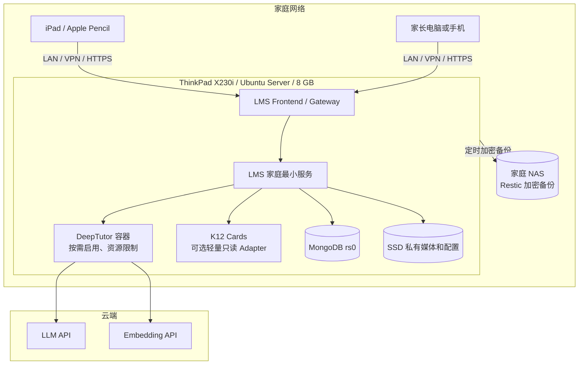

### 17.2 资源策略

- LMS 家庭最小服务优先，DeepTutor 作为可选 profile 启动。
- DeepTutor 初始内存上限 2–3 GB、CPU 上限约 1–1.5 核，实际以监控结果调整。
- K12 第一阶段用 Markdown 卡片和静态索引；独立 Graph API 使用单 worker，目标内存小于 512 MB。
- 不在运行高峰执行 MinerU、完整教材抽取或大量重建 embedding。
- 生成任务单并发；少于 10 人无需消息队列集群。
- 保留 zram/swap 作为短时 OOM 缓冲，但不能依赖持续 swap 运行。
- 若 LMS + DeepTutor 长期内存紧张，优先把 DeepTutor 迁移到更大服务器或云端，而不是削弱 MongoDB 和私有媒体可靠性。

### 17.3 网络暴露

- 家庭客户端只需要访问 LMS 的统一入口。
- DeepTutor 后端和 K12 Adapter 不发布公网端口。
- 管理员临时调试 DeepTutor Web 时使用 SSH Tunnel 或 VPN，并单独保护其前端和 API。
- Docker 服务发现使用内部服务名；生产配置不写死容器 IP。

---

## 18. 备份、恢复与数据保留

### 18.1 必须备份

- LMS MongoDB 一致性逻辑备份；
- MongoDB 中的 `TutorIdempotencyRecord` 最小 operation tombstone 与 scope 唯一索引；
- `resource-service` 私有媒体卷；
- DeepTutor `/app/data` 中实际使用的配置、KB、索引元数据和诊断会话；
- K12 卡片、规范化数据、版本清单和自定义映射；
- Compose、脱敏配置模板和当前镜像 digest；
- 生成 prompt/schema 版本文件；
- 部署版本和 Git revision。

### 18.2 可重建但应记录

- embedding 向量索引；
- K12 派生 SQLite/NetworkX 索引；
- 可从权威实体重新生成的复习打印包；
- 缓存和临时生成流事件。

### 18.3 恢复顺序

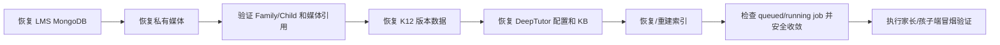

恢复验收不仅检查容器健康，还要实际读取一份历史错题图片、一个已批准学习包和一条掌握证据。
还要确认幂等三字段复合唯一索引存在，数据库查询和应用比较均使用同一字段元组；抽样验证业务
实体/Job/outbox 与 `outcome=succeeded` 记录同事务提交，不存在单边成功或 processing 占位；逐条验证
responseReference 的类型、resourceId、familyId、childId、cycleId 归属；相同元组/hash 仍不会
重新执行，相同元组/不同 hash 仍返回 409，确定性 responseId 可重新计算，且记录中不存在凭据、
答案正文或签名媒体 URL。

### 18.4 数据删除

孩子/家庭学习数据删除属于严格模式：

- 先列出教学闭环、制品、错题、掌握事件、媒体引用和 `TutorIdempotencyRecord` 影响范围；
- 孩子/家庭删除作业按 `familyId + childId` 清理对应幂等记录并保留审计计数；Cycle 单独归档或
  删除不移除最小 tombstone，旧 operation 的引用失效后返回当前资源 404，不能重新执行；
- DeepTutor 诊断会话删除与 LMS 删除分开审计；
- K12 公共课程数据不因家庭删除而删除；
- 删除后清理无引用私有媒体，遵循现有延迟清理策略；
- 备份保留期内的删除说明必须明确，不能声称即时从所有历史备份消失。
- 从备份恢复时必须重新应用删除清单；旧备份中的幂等记录不得绕过当前账号、Family 或 childId
  授权，也不得恢复已经删除的儿童响应正文。

---

## 19. 周报与提醒

### 19.1 周报扩展

周报仍由 `analytics-service` 确定性生成。后续可增加：

- 本周新录入错题数；
- 家长已确认错因分布；
- 已完成教学闭环数；
- 等待家长审核数；
- 需要复习的 K12 知识点；
- 具有家长证据的掌握度变化；
- AI 生成调用次数和失败数，只作为运维信息，不作为孩子表现指标。

历史周冻结规则继续适用；历史周不因后来的模型重新生成而改写。

### 19.2 提醒扩展

`notification-service` 后期增加读取时派生类型：

- `tutor_correction_waiting_parent_review`
- `tutor_explanation_pending_parent_review`
- `tutor_practice_pending_parent_review`
- `tutor_practice_waiting_parent_review`
- `tutor_revision_required`
- `knowledge_review_due`
- `generation_failed_parent_action_required`

提醒只反映权威状态，不从 DeepTutor 会话直接派生。

---

## 20. 数据迁移与回滚

### 20.1 迁移顺序

1. 发布只含可选字段、无行为变化的 schema。
2. 发布 curriculum read client 和 feature flag，默认关闭。
3. 导入小范围 K12 数据并固定版本。
4. 通过家长界面创建少量 `suggested/confirmed` 映射。
5. 发布 `TutorLearningCycle`、job、artifact，但不对孩子开放。
6. 开启家长生成和预览，验证输出契约和成本。
7. 对一个孩子开启订正和练习闭环。
8. 验证媒体、掌握事件、周报、提醒和备份。
9. 扩大到其他孩子/章节。

### 20.2 Feature flags

建议至少包含：

```text
FAMILY_CURRICULUM_MAPPING_ENABLED
FAMILY_TUTOR_GENERATION_ENABLED
FAMILY_TUTOR_CHILD_FLOW_ENABLED
FAMILY_TUTOR_MASTERY_WRITEBACK_ENABLED
FAMILY_TUTOR_NOTIFICATIONS_ENABLED
```

flags 按家庭或孩子灰度，不能只有全局开关。

### 20.3 回滚

- 关闭生成 flag 后，现有错题、任务和人工审核继续可用。
- 关闭课程映射 flag 后，保留引用字段但不展示或驱动推荐。
- 关闭掌握写回 flag 后，家长最终审核仍保存到 cycle，待恢复后幂等收敛。
- 旧 LMS 客户端忽略新增字段；公开现有错题/知识点字段不删除、不改语义。
- 不通过回滚脚本删除历史 TutorCycleAttempt、TutorArtifact、MasteryEvent 或媒体；回滚应用前
  先关闭新的提交入口，保留 Attempt 集合和唯一索引供前向恢复与审计。

---

## 21. 分阶段实施计划

### 21.0 与自主学习 T1～T9 的衔接（2026-10-26）

本节原阶段 0～6 是 AI 子域设计分解，不是当前 T1～T9 的任务编号或自动执行顺序。
最新最小交付路线见[自主学习开发计划 §9](../superpowers/plans/2026-10-21-family-self-directed-learning-mvp.md#9-deeptutor-与-k12-最小对接路线2026-10-26-补充)。
本次只纳入规划，未执行项目验证、对接或外部调用；既有机器契约和审核/隐私不变量不变。

| 最小任务 | 与本设计阶段对应 | 与基础 MVP 的边界 |
| --- | --- | --- |
| AI-0 | 阶段 1/2 之前的有限可行性验证 | 可提前用一个年级的一章、3 组输入验证讲解/变式题与 K12 覆盖，最多两轮提示调整；无 LMS 状态写入，不直接给孩子 |
| AI-1 | 阶段 2 的家长侧讲解最小切口 | 基于 T6/T7 的已验证错题来源及闭环，复用 T1/T2 媒体权限；仅 candidate、预览、拒绝/批准 |
| AI-2 | 阶段 3 的孩子学习与人工订正 | 复用 T2/T6 页面/记录基础，教学 Attempt/审核仍依本设计；不把普通任务确认等同最终教学审核 |
| AI-3 | 阶段 4 的少量练习与记录 | 订正审核后家长显式生成，批准后发布，最终审核后按既定契约记录；不附带打印/推荐系统 |
| K12-1 | 阶段 1 的单章节课程辅助 | 可按覆盖验证结果独立启动；优先静态卡片，必要才做只读 Adapter，不要求阶段 6 的 Graph API |

原“先课程映射再讲解”要求保留最少教材/章节信息及可追溯来源，不要求完整 K12 对接先完成。
K12 覆盖不足时用家长确认的资料和手工知识点信息；DeepTutor/K12 分别判定可行性，互不作为默认硬阻塞。
默认正式集成在 T9 基础验证后启动；T9 期间若备课已是实际瓶颈，可由用户另行授权，
孩子真实使用须先满足 T8，并区分基础与 AI 试点记录。AI-0 通过不等于内容可靠性或家庭效果已获证明。

沿用候选批准门禁、版本审核、受限调用、权限、已知/未知结果与幂等策略；外部调用费用上限及资料授权先确认。
只为所选任务实现必要差异，不重复基础媒体工程；不扩大到 PDF、打印包、阶段 5 周报/提醒或阶段 6 全量图谱。
后续原阶段中的这些能力仍为独立储备，不是 AI-1～AI-3 的一揽子验收要求。
T2-G 高级恢复/回收继续后置，AI 不自动处理 T3 求助，不引入 AutoClaw。
每项按“有限设计、实现/定向测试、聚焦评审、相关集成验收”交付；不加逐子步骤审批或新常驻微服务。

### 阶段 0：冻结现有 LMS 基线

交付：

- 当前家庭主流程、权限、私有媒体和回归 Gate 通过；
- 新方案不插入尚未完成的现有任务；
- 保存可恢复的本地部署备份。

### 阶段 1：课程映射最小闭环

范围：

- 一个学科、一个年级、一个章节；
- CurriculumRef 与错因分类；
- 家长搜索、建议、确认和解除映射；
- 不调用 DeepTutor。

成功标准：家长能在 1 分钟内把一条错题准确关联到课程节点，并查看有限先修关系和教材位置。

### 阶段 2：家长侧讲解生成

范围：

- TutorLearningCycle、TutorCycleAttempt、GenerationJob、Artifact；
- DeepTutor 内部调用；
- 家长生成、预览、批准讲解；
- 孩子端尚不开放。

成功标准：重复点击在 LMS/Adapter 内命中同一业务操作；已知 turn 可恢复，未知结果不会自动
重复生成；生成内容可追溯到课程版本、模型和 prompt。外部供应商计费只能通过调用记录和
预算告警核对，不承诺无法由外部契约证明的 exactly-once 计费。

### 阶段 3：孩子订正与家长审核

范围：

- iPad 学习包；
- 多图片/PDF 上传；
- 订正/练习按版本创建 Attempt，家长 review 只追加一次；
- 订正提交、退回和批准；
- 不做 OCR 自动判题。

成功标准：孩子可以只靠 iPad 完成订正；家长能在原题、原答案和订正之间清晰审核。

### 阶段 4：变式练习与掌握证据

范围：

- 2–3 道梯度练习；
- 练习提交与家长 rubric；
- 幂等写入 MasteryEvent 和错题状态；
- 复习日期和打印包。

成功标准：整个闭环在外部模型完成生成后，不需要家长再次复制粘贴题目或记录结果。

### 阶段 5：周报与提醒

范围：

- 教学闭环指标进入当前周报；
- LMS 内的待审核、生成失败和复习提醒。

成功标准：周报和提醒只从 LMS 权威状态确定性派生，失败不会改变学习档案。

### 阶段 6：轻量 Graph API 与教材扩展

只有第一至第五阶段证明有价值后才启用：

- SQLite/NetworkX 图查询；
- 多跳先修路径；
- 更多章节、学科和出版社；
- K12-Bench 对候选模型的离线评测。

---

## 22. 测试策略

### 22.1 单元测试

- CurriculumRef schema、范围和版本验证；
- 错因分类与兼容 `reason`；
- 教学闭环每个合法/非法状态转换；
- GenerationJob CAS、租约、重试和幂等；
- DeepTutor 输出 JSON Schema、大小和 sanitizer；
- Artifact 候选、批准、拒绝、JCS contentHash 和批准后不可替换；
- FinalizationCommand operationId、payloadHash、lease 和退避计算；
- prompt 数据最小化；
- generationInput 嵌套字段白名单、长度/数量上限和“hash 正确但结构非法”拒绝路径；
- TutorCycleAttempt 提交字段不可变、review 只追加一次、历史媒体和 revise 反馈保留；
- 掌握证据来源规则。

### 22.2 服务测试

- 家长、第二家长、孩子本人、兄弟姐妹、跨家庭和匿名权限；
- 孩子不能确认映射、错因或掌握度；
- DeepTutor 不能访问公开 Gateway 业务写接口；
- 孩子读取 candidate/rejected Artifact、未批准时启动订正/练习全部拒绝；
- 修改正文但保留旧 contentHash、请求与 Artifact 同时使用任意错误 hash、审核旧 Artifact
  版本、过期 `expectedArtifactReviewVersion` 或
  `expectedStateVersion` 全部返回冲突，且两个对象均不更新；
- 同一三字段元组和 hash 重放返回相同结果；同一元组跨 Cycle 或正文改变且正确重算 hash 时返回
  `409 IDEMPOTENCY_KEY_REUSED`；相同客户端 operationId 在不同 endpointOperation 下独立执行；
- 两组字段即使产生相同的冒号拼接文本，只要 familyId、endpointOperation、operationId 任一不同，
  就不是同一幂等身份；operationId 包含冒号仍可正常使用；
- 兄弟姐妹、跨家庭用户、已移出家庭的家长、禁用用户和错误角色即使持有完全相同 URL、正文、
  operationId 与 hash，也在幂等查询前统一拒绝；授权失败不能返回 stored responseReference；
- 两个相同元组的首次请求并发时只提交一个业务副作用和一个 succeeded 记录；duplicate-key 或
  write-conflict loser
  的业务写入、Cycle CAS、Job/outbox 全部回滚，随后同 hash replay、不同 hash 409；
- 事务提交前崩溃可安全重跑完整事务，提交后响应丢失只能 replay；业务实体成功但幂等记录失败、
  幂等记录成功但业务失败、提交前产生不可逆外部副作用都必须被测试拒绝；
- 两位家长并发审核触发 Artifact/Cycle 双 CAS 冲突；
- 部分内部命令失败后最终收敛；
- 两条 outbox 命令独立失败、lease 过期接管、dead letter、非 `finalReviewVersion=1` 或
  finalReview 快照不一致都不能关闭循环；
- 媒体 prepare/commit/unbind 中断恢复。

### 22.3 契约测试

- K12 Adapter 固定数据版本、节点和边字段；
- DeepTutor `/openapi.json` 与固定客户端快照兼容；
- `WS /api/v1/ws` 事件序列、取消、恢复和 done 元数据；
- `start_turn` 请求前断线、服务端接受但 Adapter 未取得 turnId、取得 turnId 后断线、流式中断、
  结果已持久化但 LMS 未确认等失败窗口；
- DeepTutor 认证开启、非管理员服务用户 grant 和 Adapter 路由/capability/KB/tool 负向白名单；
- RFC 8785 contentHash、公共 requestPayloadHash 和 generation requestHash 的键顺序与字段变更反例；
- 每个公开 Tutor mutation 的 `route + endpointOperation` 都有请求 Schema、allowedActorRoles、
  responseVariants（含 HTTP 状态）、discriminator 和
  requestPayloadHash fixture；`tutor-idempotency-decision-v1` 另行覆盖 execute、replay、跨 Cycle/
  正文冲突、审核路由独立作用域、字段元组碰撞、URL 参数派生、实时 actor/resource 授权、
  lookup-skipped 以及引用实体不存在/跨 Cycle/跨孩子且不得重新执行的反例；
- TutorIdempotencyRecord 只允许最小 responseReference，拒绝完整响应、签名 URL、expiresAt 和
  额外敏感字段及持久化 scopeKey；createdBy.role、responseVariants、三字段复合索引、child
  删除索引以及无 TTL tombstone 规则与 publicMutations/设计一致；
- `tutor-idempotency-first-write-v1` 覆盖同/不同 hash 并发、duplicate-key/write-conflict 全事务回滚、提交前/后
  崩溃和禁止提交前不可逆外部副作用；公共记录只允许 outcome=succeeded，不使用 processing；
- `tutor-idempotency-record-commit-v1` 逐字段绑定 actor、请求、授权资源、事务内 committedEntity、
  actualResult、确定性 responseId、persistedRecord 和 transactionId；覆盖 final-review revise/mastered
  的 200/202、Attempt/FinalReview 与 0/2 条 outbox；审核分支还绑定 Cycle 当前 Attempt ID/version 和
  本次 reviewOperationId，拒绝同步篡改后引用同 stage 历史 Attempt 或未实际写入本次 review；
- TutorLearningCycle 未来阶段字段禁止提前出现、取消来源/历史投影一致、首次进入与重做转换不同；
- LLM provider 被 stub 时仍验证 prompt 和 schema；
- 内部服务凭据拒绝普通 JWT。

### 22.4 集成与浏览器测试

关键真实流程：

1. 家长录入带图片错题；
2. 家长确认 K12 节点和错因；
3. 家长生成并批准讲解；
4. 孩子 PIN 登录并在 iPad 尺寸完成订正；
5. 家长退回一次，孩子重新提交；
6. 家长批准并生成练习；
7. 孩子提交练习；
8. 家长最终审核；
9. 掌握事件、错题状态、提醒和打印包一致；
10. 兄弟姐妹和跨家庭访问全部拒绝。

浏览器测试使用真实 Gateway 和服务 API；前端单元测试可以 mock 公开 API envelope，但不能用 mock 代替权限集成测试。

### 22.5 部署与恢复测试

- LMS 基础 profile 在 DeepTutor 未启动时健康；
- AI profile 启动后只有内部网络可达 DeepTutor/K12；
- 8 GB 主机单并发生成不发生 OOM；
- DeepTutor 重启后 job 能恢复或明确失败；
- 从 NAS 恢复后可以打开历史私有图片和已批准制品；
- 固定镜像升级前后 OpenAPI 契约、KB、会话和生成流程通过。

---

## 23. 可观测性与成本

### 23.1 指标

不使用孩子答案内容作为指标标签。记录：

- `tutor_generation_jobs_total{kind,status}`
- `tutor_generation_duration_seconds{kind}`
- `tutor_generation_retries_total{reason}`
- `tutor_artifact_validation_failures_total{rule}`
- `curriculum_mapping_total{status,subject}`
- `tutor_cycles_total{status}`
- `tutor_parent_review_wait_seconds`
- `tutor_external_tokens_total{model,input_or_output}`
- `tutor_external_cost_estimate{model}`
- K12 Adapter、DeepTutor、LLM 的 timeout/error rate

### 23.2 日志

允许记录：

- request/operation/job/cycle ID；
- family/child ID 的不可逆日志哈希；
- 状态转换、错误代码、耗时、版本；
- 模型和 prompt profile 名称；
- token 数和成本估算。

禁止记录：

- API Key、JWT、Cookie、PIN；
- 完整 prompt/response；
- 孩子姓名、作答文本、家长备注；
- 签名媒体 URL；
- 原始附件字节。

### 23.3 成本限额

- 默认每个教学闭环一次讲解、一次练习生成；
- 每次练习默认 2–3 题；
- 同一 requestHash 优先复用结果；
- 设置家庭日/月预算和管理员告警；
- 高成本模型必须由家长显式选择或在低成本模型失败后批准；
- embedding 模型和维度固定，变更时明确重建索引成本。

---

## 24. 验收标准

### 24.1 功能验收

- 家长可以录入含多图片/PDF 的错题。
- 系统返回限定教材范围的 K12 候选节点，且不会自动确认。
- 家长可以确认知识点和错因并查看历史。
- DeepTutor 生成讲解和 2–3 道练习，结果通过结构校验并保存到 LMS。
- 孩子只使用 iPad/LMS 完成阅读、订正、上传和练习。
- 家长可以批准、退回和最终确认。
- 最终确认写入不可变掌握证据和错题状态事件。
- 学习包可生成期末复习打印视图。

### 24.2 安全验收

- 孩子、兄弟姐妹、跨家庭用户和匿名访问均符合权限矩阵。
- DeepTutor 和 K12 Adapter 不向家庭网络或公网直接开放。
- 模型上下文不包含姓名、学校、PIN、JWT 或无关历史。
- 模型输出无法直接修改 LMS 数据。
- 日志、错误和指标中不存在敏感正文或密钥。

### 24.3 可靠性验收

- 重复点击命中同一 LMS/Adapter 操作，不主动创建第二个 DeepTutor turn；未知结果进入人工
  reconcile，外部账单通过调用审计核对。
- 模型超时、无效 JSON、外部服务中断均不破坏业务状态。
- 服务重启后 queued/running job 可以恢复、明确失败或明确进入人工 reconcile，不静默重建。
- 跨服务写回部分失败时能够使用同一 operationId 最终收敛。
- 从 NAS 恢复后，错题、媒体、制品和掌握事件关联一致。

### 24.4 家庭价值验收

试点至少覆盖 10 条真实错题，并由家长判断：

- 知识点映射和前置关系是否有帮助；
- AI 讲解是否适合孩子年级；
- 生成题目是否减少家长出题时间；
- 人工审核按钮是否自然衔接流程；
- 孩子是否能独立使用 iPad 完成任务；
- 周报和复习包是否比原始图片堆积更易使用。

只有家庭价值验收通过，才扩大 K12 数据范围或启用轻量 Graph API。

---

## 25. 主要风险与应对

| 风险 | 影响 | 应对 |
| --- | --- | --- |
| K12 数据与孩子实际教材不一致 | 错误前置关系或超纲 | 强制教材范围、版本化引用、家长确认 |
| AI 题目或答案错误 | 误导孩子 | candidate 状态、家长 rubric、保留引用、可拒绝版本 |
| 手写识别不稳定 | 自动闭环中断 | MVP 不依赖 OCR，家长人工审核 |
| DeepTutor API 快速变化 | 集成失效 | 固定镜像、OpenAPI 快照、契约测试、适配层隔离 |
| 8 GB 主机内存不足 | OOM、服务不可用 | AI profile、资源限制、单并发、云端模型、可迁移 DeepTutor |
| 两位家长并发审核 | 结果互相覆盖或取消后被旧页面重新推进 | Artifact reviewVersion + Cycle stateVersion 双 CAS、保留批准审计、409 冲突 |
| 模型调用泄露隐私 | 儿童数据风险 | 最小披露、去身份化、日志脱敏、provider 政策审查 |
| 多次提交覆盖历史 | 丢失家长反馈和手写证据关联 | 每次提交独立 TutorCycleAttempt，review CAS 只追加一次，Cycle 只保存当前指针 |
| 生成重试重复计费 | 成本不可控 | Adapter 持久映射、requestHash、已知 turn 恢复、未知结果人工 reconcile、预算限制 |
| 图谱许可证限制 | 后续公开/商业化受限 | 记录来源和许可，派生数据隔离，扩展前法律复核 |

---

## 26. 待用户评审的关键决策

以下决策已在本文采用，实施前如需变更，应先修改设计：

1. 教学编排 MVP 位于 `homework-service`，暂不新建 `tutor-service`。
2. 孩子不直接登录 DeepTutor；LMS 是唯一孩子入口。
3. 家长确认是课程映射、错因和掌握度更新的必要条件。
4. 第一阶段不把原始手写图片发送给云端模型。
5. K12 第一阶段只试点一个学科/年级/章节。
6. DeepTutor 第一阶段只生成讲解和练习，不开放任意聊天和工具。
7. LMS 基础功能在 DeepTutor/K12 全部不可用时仍必须独立工作。
8. MVP 只有 `mastered` 形成最终审核快照；`revise` 返回练习修订，不关闭教学闭环。
9. MVP 每次订正/练习提交创建独立 TutorCycleAttempt；不增加独立 ReviewEvent 集合或 Cycle 内无限事件数组。

---

## 27. 外部项目和许可证来源

- DeepTutor 项目与许可证：<https://github.com/HKUDS/DeepTutor>
- DeepTutor Server API：<https://docs.deeptutor.info/cli/server-api/>
- K12-KGraph 项目、schema、规模和许可证：<https://github.com/haolpku/K12-KGraph>
- K12-KGraph 数据集：<https://huggingface.co/datasets/lhpku20010120/K12-KGraph>

外部接口和模型能力会变化。实施时应再次核对固定版本的仓库、镜像、OpenAPI、模型名、价格和服务商数据政策；本文不把漂移信息写成不可变运行契约。
