# 家庭自主学习总体架构与成长跟踪基础

**Document status:** FGT BASELINE APPROVED / SELF-DIRECTED INCREMENT PLANNED
**Baseline candidate:** FGT-MVP-1.7
**Decision records:**

- [ADR-0001: 复用现有服务](decisions/0001-reuse-existing-services.md)
- [ADR-0002: 家庭数据隔离](decisions/0002-family-data-isolation.md)
- [ADR-0003: 家庭本地日期](decisions/0003-family-local-date.md)
- [ADR-0004: 单次成长任务](decisions/0004-single-occurrence-growth-tasks.md)
- [ADR-0005: 幂等星星流水](decisions/0005-idempotent-star-ledger.md)
- [ADR-0006: Gateway 签名身份信封](decisions/0006-signed-gateway-identity-envelope.md)
- [ADR-0007: 稳定的成长周报历史](decisions/0007-stable-weekly-report-history.md)
- [ADR-0008: 第二家长成员关系与治理](decisions/0008-co-parent-membership-governance.md)

Task 5~12 的详细设计由对应 spec 和 gate 承载；跨服务调用顺序见
[家庭成长跟踪跨服务时序图](sequence-diagrams.md)。

## 1. 架构目标

长期目标是家庭自主学习：孩子逐步承担计划、执行、自检、求助和复盘，家长提供适龄支持。
三层基线为已确认长期目标、FGT-MVP-1.7 已实现基础、SL-01 至 SL-07 PLANNED 增量；不新增服务或
扩大数学 MVP 范围。§2–§11 保留既有基础约束，§12 是当前待实现契约；实现/发布不能由文档状态代替。
家庭成长跟踪基础已将学校级 LMS 收敛为以下闭环：

```text
家长账号
  -> 家庭与孩子档案
  -> 德智体美劳成长任务
  -> 孩子完成和自评
  -> 家长确认和反馈
  -> 智育错题 / 成长过程记录
  -> 成长周报和提醒
```

第一阶段不新增微服务，不强化学校组织结构。系统继续复用现有服务目录，但把公开接口和前端入口收敛到家庭成长场景。

## 2. MVP 业务组件架构图

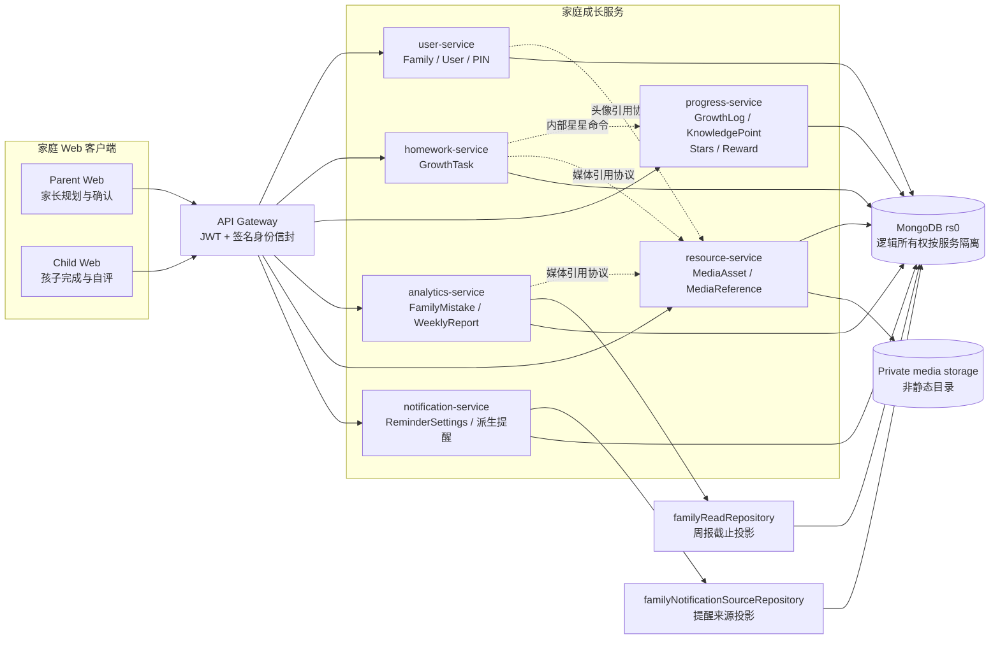

实线表示公开请求或持久化读取，点线表示带独立服务凭据的内部命令。MongoDB 在
MVP 部署中是同一副本集，但共享物理数据库不改变第 3 节的数据写入所有权。

## 3. 服务映射

| 现有服务 | 家庭成长版职责 | 第一阶段策略 |
| --- | --- | --- |
| `user-service` | 家庭、家长、孩子档案、孩子 PIN 登录 | 保留用户模型兼容字段，新增 `familyId`、`childProfile`、`parentProfile` |
| `homework-service` | 成长任务 `GrowthTask` | 保留旧 `Homework` 路由，新增 `/api/growth-tasks` |
| `progress-service` | 每日成长记录 `GrowthLog`、能力点、星星账户和奖励 | 保留旧进度模型，新增成长记录、能力点、积分流水和奖励路由 |
| `analytics-service` | 智育错题、固定模板成长周报、维度均衡统计 | 不做 AI 分析和复杂报表，先做确定性聚合 |
| `resource-service` | 任务附件、错题附件、成长过程图片 | 私有媒体规范化、授权、引用和显式安全配置 |
| `notification-service` | 今日任务、未完成、错题复习、锻炼、习惯、周报提醒 | 第一阶段按读取时派生提醒，不引入后台定时任务 |
| `interaction-service` | 亲子反馈和孩子自评的后续扩展 | 第一阶段暂停会议、公告、群聊和复杂消息 |
| `gateway` | 统一鉴权、路由代理、下游用户头传递 | 继续作为本地 Demo 统一入口 |

`interaction-service` 仍可能出现在 `docker-compose.yml`、`docker-compose.china.yml` 和 Kubernetes 清单中，这是为了保留旧学校版路由和回滚兼容性，不表示家庭 MVP 首轮依赖它。家庭成长主流程不得把会议、公告、群聊或复杂消息作为必需启动条件；本地或发布流水线需要最小家庭 Demo 时，可只验证第 9 节列出的必要组件。

### 3.1 跨服务读取与聚合策略

第一阶段继续使用同一个 MongoDB，但必须保留明确的数据所有权：

- `homework-service` 是成长任务的唯一写入方。
- `progress-service` 是成长记录、能力点、星星流水和奖励的唯一写入方。
- `analytics-service` 是错题和周报反馈的唯一写入方。
- `notification-service` 不持有任务、错题或周报副本，只派生查询结果。
- `analytics-service` 生成周报时调用 `backend/common/repositories/familyReadRepository.js`。该只读仓储通过显式集合名和最小字段投影读取 MongoDB，只暴露按 `familyId + childId + LocalDate + cutoff` 收敛的查询；它不注册写模型，也不允许写入其他服务集合。
- `notification-service` 通过 `familyNotificationSourceRepository.js` 适配同一个 `backend/common/repositories/familyReadRepository.js` 只读边界；适配器只组装 `familyId + childId + LocalDate + cutoff + timeout`，不得导入 homework/progress/analytics 的私有模型。任务、错题、记录和周报存在性均由共享仓储的显式集合、最小投影与 `maxTimeMS` 约束。
- 周报快照读取默认使用严格的 `< cutoff`，确保周界线时刻之后的数据不会进入历史快照；提醒属于请求时实时派生，适配器显式使用 `<= requestCutoff`，使同一时钟时刻已经提交的任务、记录或周报立即可见。
- 只读仓储的查询必须设置超时；任一数据源失败时，周报返回 `503 AGGREGATION_UNAVAILABLE`，提醒接口返回已有分区结果并在 `meta.partial=true` 中声明降级，禁止静默返回完整成功结果。

这个共享只读仓储及其服务内适配器都是迁移阶段的临时边界。未来服务独立数据库后，应替换为内部
HTTP API 或事件构建的读模型，业务接口不改变。

### 3.2 日期与时区规则

- `Family.timezone` 使用 IANA 时区名，默认 `Asia/Shanghai`。
- `dueDate`、`GrowthLog.date`、`reviewReminderDate` 和 `weekStart` 均为 `YYYY-MM-DD` 的 `LocalDate`，不携带 UTC 偏移。
- `today` 按家庭时区计算；周从周一开始，到周日结束，查询区间两端均包含。
- 时间戳字段继续使用 UTC ISO 8601，例如 `completedAt`。
- 第一阶段每条任务只代表一次发生，不实现重复任务规则。每日习惯通过每天一条任务表达；重复任务模板推迟到第二阶段，避免单一任务状态无法表示“本周完成 4/7 次”。

### 3.3 Gateway 到下游服务的信任边界

```text
client JWT
  -> gateway 删除客户端提供的 x-user-* 和内部认证头
  -> gateway 验证 JWT
  -> gateway 签名 method + normalizedPath + userId + role + timestamp + nonce
  -> 下游验证签名、5 分钟新鲜度和 nonce 未重放
  -> 业务路由校验 familyId + childId 资源归属
```

- 身份信封使用独立的服务密钥，禁止复用 `JWT_SECRET`。
- gateway 必须覆盖而不是透传客户端身份头，包括 `x-user-id`、`x-user-role`、`x-user-name`、签名、时间戳和 nonce。
- 下游 `authenticateGateway` 必须先验签再构造 `req.user`，不能仅凭 `x-user-*` 信任调用者。
- nonce 在签名有效期内只能使用一次；签名篡改、时间戳超过 5 分钟或 nonce 重放都返回 `401`。
- 内部命令接口使用独立服务凭据，不能接受普通家长或孩子 token。
- Task 5 星星发放接口使用至少 32 字节的独立共享服务令牌并做恒定时间比较；该接口不经过 gateway，令牌不得复用 JWT 或 gateway 身份密钥。
- 网络隔离是纵深防御，不能替代请求级服务认证；未来可以等价替换为 mTLS 或下游直接验证 JWT。

### 3.4 服务组件职责与接口边界

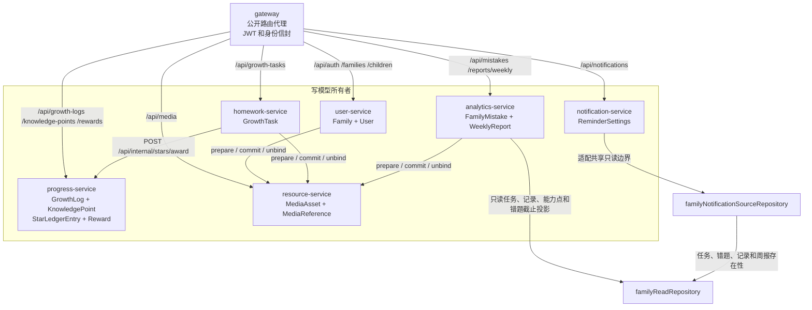

| 服务 | 独占写模型 | 跨域读取或调用 | 公开路由 | 内部接口 |
| --- | --- | --- | --- | --- |
| `gateway` | 无 | 验证 JWT，覆盖客户端身份头，签发下游身份信封 | 所有 `/api/*` 家庭入口 | 无；不得直接写域数据 |
| `user-service` | `Family`、家庭字段下的 `User` | 绑定孩子头像时调用媒体引用协议 | `/api/auth/*`、`/api/families*`、`/api/children*` | 媒体引用协议调用方 |
| `homework-service` | `GrowthTask` | 校验家庭/孩子；确认任务时调用星星命令；附件变更时调用媒体引用协议 | `/api/growth-tasks*` | 调用 `/api/internal/stars/award` 和媒体引用协议 |
| `progress-service` | `GrowthLog`、`KnowledgePoint`、掌握事件、`StarLedgerEntry`、`StarLedgerGuard`、`Reward` | 校验家庭/孩子；余额由不可变流水聚合 | `/api/growth-logs*`、`/api/knowledge-points*`、`/api/rewards*` | 提供 `POST /api/internal/stars/award` |
| `analytics-service` | `FamilyMistake`、错题状态事件、`WeeklyReport` | 经只读仓储读取任务、记录、能力点和错题截止快照；错题附件调用媒体协议 | `/api/mistakes*`、`/api/reports/weekly*` | 媒体引用协议调用方 |
| `resource-service` | `MediaAsset`、`MediaReference` | 校验家庭/孩子；规范化图片/PDF；按安全配置扫描；读写私有对象目录 | `/api/media*` | 提供 `/api/internal/media/references/{prepare,commit,unbind}` |
| `notification-service` | `ReminderSettings` | 由服务内来源适配器调用共享 `familyReadRepository`，并行读取任务、错题、记录和周报存在性 | `/api/notifications/family`、`/api/notifications/settings` | 无；读取失败以 `meta.partial` 暴露 |

服务之间不共享可写 Mongoose 模型。周报与提醒共同使用的公共只读仓储要求
`familyId + childId`、LocalDate/截止时间和超时参数，并只返回最小投影；任何新增
写路径都必须回到该模型的所有者服务。未来服务拆分数据库时，两者都要替换为内部
HTTP API 或事件读模型。

## 4. 核心域模型

### 4.1 Family

家庭是第一阶段的数据隔离边界。

关键字段：

- `familyId`
- `familyName`
- `timezone`
- `ownerParentId`
- `memberParentIds`
- `childIds`

| Field | Type | Required/default | Index and lifecycle |
| --- | --- | --- | --- |
| `_id` / `familyId` | ObjectId | required/generated | primary family boundary |
| `familyName` | String | required, trimmed, max 50 | mutable by family parent |
| `timezone` | String | required, default `Asia/Shanghai`, valid IANA name | mutable; new value affects future date interpretation only |
| `ownerParentId` | ObjectId | required | unique; one owned family per parent |
| `memberParentIds` | ObjectId[] | owner required; maximum two unique parents | multikey lookup index; must contain owner |
| `childIds` | ObjectId[] | default empty | multikey lookup index; child must also carry same familyId |

家庭不在 MVP 中物理删除。停用家庭版路由不会删除家庭数据。Task 12 允许两位家长
共管；`ownerParentId` 只增加邀请、移除和所有权转移等治理权限，不降低第二家长的
日常业务权限。

`Family.memberParentIds` 与 `Family.childIds` 是关系权威源。`User.familyId`、
`User.children` 和默认孩子是兼容投影；孩子或成员变化必须在同一事务中同步所有受影响
的活跃家长，任一投影写失败则整笔关系变更回滚。服务启动不执行全库关系扫描，历史
漂移由发布前修复与严格 `--check` 门禁处理。

#### FamilyParentInvitation

user-service 持有一次性家长邀请。邀请保存 `familyId`、`invitedByParentId`、唯一
`tokenDigest`、`status`、`expiresAt` 和接受/撤销时间。明文 token 为 32 字节随机值的
base64url 编码，只在创建响应中返回一次；数据库、日志和审计事件均不得保存明文。
同一家庭最多一个 `pending` 邀请，默认 72 小时后失效，历史行不通过 TTL 删除。

#### FamilyMembershipEvent

成员邀请、加入、退出、移除和所有权转移写入不可变事件。事件与 Family、User 和
邀请状态在同一 MongoDB 事务提交，不提供更新或删除 API。业务记录继续保存原创建者
和确认者 ID，成员退出不会删除或匿名化孩子历史。

#### 家长邀请状态机

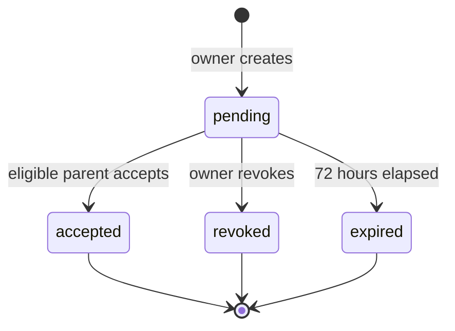

### 4.2 User

现有 `User` 模型继续保留 `parent` 和 `student` 角色。教师、管理员等旧角色不进入 MVP 导航，但为了减少迁移风险，第一阶段不删除旧枚举。

新增家庭字段：

- `familyId`
- `parentProfile.familyRole`
- `parentProfile.defaultChildId`
- `childProfile.nickname`
- `childProfile.school`
- `childProfile.grade`
- `childProfile.textbookVersion`
- `childProfile.interests`
- `childProfile.weakSubjects`
- `childProfile.sportsPreferences`
- `childProfile.artInterests`
- `childProfile.laborHabits`
- `childProfile.moralGoals`
- `childProfile.pinHash`
- `childProfile.tokenVersion`

| Field | Type | Required/default | Constraint |
| --- | --- | --- | --- |
| `familyId` | ObjectId | optional for legacy users, required for family parent/child | indexed with role |
| `childProfile.pinHash` | String | optional, `select: false` | bcrypt hash only; never returned |
| `childProfile.tokenVersion` | Number | required for family child, default `0` | incremented on PIN reset |
| `parentProfile.familyRole` | Enum | default `guardian` | `father|mother|guardian|other` |
| `parentProfile.defaultChildId` | ObjectId | optional | must reference same-family child |

旧教师、管理员和学生字段保留，但家庭版授权只使用 `familyId` 和资源归属，不使用 `class`、`parentId` 或旧 `children` 数组作为唯一依据。

### 4.3 GrowthTask

`GrowthTask` 是第一阶段替代学校作业的核心模型。每条任务必须属于一个成长维度。

维度枚举：

- `moral`：德育
- `academic`：智育
- `physical`：体育
- `artistic`：美育
- `labor`：劳育

关键字段：

- `taskId`
- `familyId`
- `childId`
- `dimension`
- `area`
- `subject`
- `title`
- `taskType`
- `description`
- `dueDate`
- `estimatedMinutes`
- `actualMinutes`
- `targetAmount`
- `actualAmount`
- `unit`
- `status`
- `difficulty`
- `needsHelp`
- `parentConfirmed`
- `childNote`
- `parentFeedback`
- `attachmentMediaIds`：有序私有图片/PDF 集合，最多 100 项
- `starAwardState: not_applicable|pending|awarded`

第一阶段不包含 `repeatRule`。重复任务进入第二阶段时，必须引入独立的任务模板和任务 occurrence，不能在单条任务上复用一个完成状态。

| Field | Type | Required/default | Constraint/index |
| --- | --- | --- | --- |
| `familyId` | ObjectId | required | compound indexes start with familyId |
| `childId` | ObjectId | required | must belong to familyId |
| `createdByParentId` | ObjectId | required | must be a parent in familyId |
| `dimension` | Enum | required | `moral|academic|physical|artistic|labor` |
| `dueDate` | String | required | `YYYY-MM-DD` LocalDate |
| `status` | Enum | default `pending` | `pending|completed|confirmed|cancelled|archived` |
| `starAwardState` | Enum | default `not_applicable` | `not_applicable|pending|awarded` |
| `completedAt`, `confirmedAt`, `cancelledAt` | Date | optional | UTC event timestamps |

Required indexes:

```text
{ familyId: 1, childId: 1, dueDate: 1 }
{ familyId: 1, childId: 1, dimension: 1, status: 1 }
```

#### GrowthTask 状态机

| Current | Command | Actor | Next/result |
| --- | --- | --- | --- |
| none | create | parent | `pending` |
| pending | edit | parent | `pending` |
| pending/completed | complete | parent or child self | `completed`; update completion evidence |
| completed | confirm | parent | `confirmed`; Task 5 adds idempotent star award |
| pending | delete | parent | `cancelled`; set `cancelledAt`, retain row for audit/report cutoff |
| completed/confirmed | delete | parent | `archived` |
| confirmed/cancelled/archived | complete or edit | any | `409 TASK_STATE_CONFLICT` |
| any | create/edit with repeatRule | parent | `400 REPEAT_RULE_NOT_SUPPORTED` |

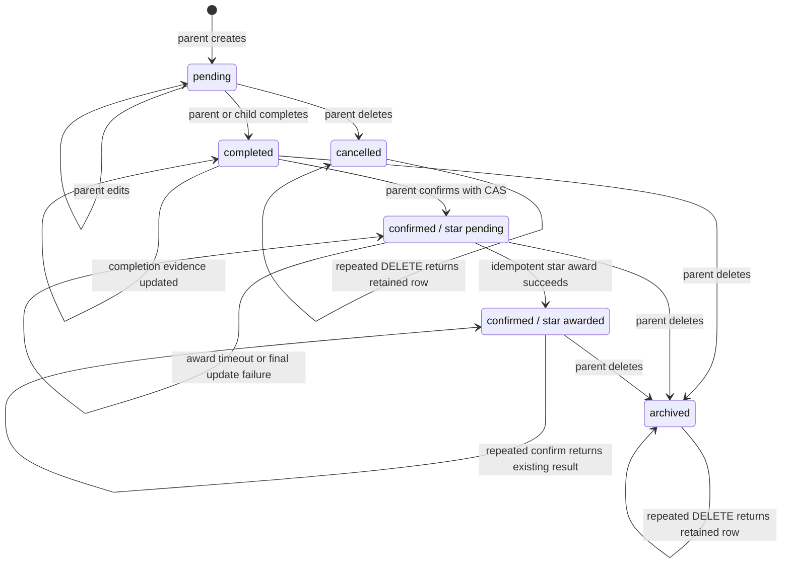

`ConfirmPending` 是可恢复状态而不是回滚点：星星流水可能已经成功写入但任务最终
更新失败。再次确认使用同一任务 ID 重放内部命令，读取原流水后收敛为图中的
`Confirmed` 状态，不会重复发放。当前删除路由也允许把 `ConfirmPending` 归档；
归档后公开 confirm 不再恢复发放，因此该分支必须保留为已知实现限制，不能描述为
已经收敛到 `awarded`。

### 4.4 GrowthLog

`GrowthLog` 记录每日成长过程。它不是只记录课内学习，也记录体育、艺术、劳动和习惯状态。

关键字段：

- `logId`
- `familyId`
- `childId`
- `date`
- `dimension`
- `area`
- `subject`
- `content`
- `durationMinutes`
- `amount`
- `unit`
- `completedTaskIds`
- `focusLevel`
- `difficulty`
- `physicalState`
- `mood`
- `childReflection`
- `parentNote`

### 4.5 KnowledgePoint

`KnowledgePoint` 在智育中表示知识点，在其他维度中表示能力点或习惯点。

示例：

- 智育：分数计算、英语单词、阅读理解。
- 体育：跳绳耐力、跑步配速、篮球运球。
- 美育：节奏练习、线条观察、色彩搭配。
- 劳育：整理房间、洗碗、照顾植物。
- 德育：按时睡觉、主动道歉、遵守约定。

### 4.6 FamilyMistake

错题属于智育专项能力，`dimension` 固定为 `academic`。错题不应成为整个系统的唯一中心。
`questionMediaIds` 和 `childAnswerMediaIds` 分别保存有序题目/答案附件，每组最多 10
个图片或 PDF；历史 `questionMediaId`、`childAnswerMediaId` 作为第一项兼容投影。
附件集合变化使用可恢复媒体引用协议；业务对象、非媒体字段和错题状态事件在本地
事务中一起发布，新增引用先绑定、移除引用后释放。

### 4.7 WeeklyReport

周报必须同时展示：

- 总记录天数。
- 总投入时长。
- 任务完成率。
- 德智体美劳任务分布。
- 德智体美劳投入时长分布。
- 智育错题和待复习知识点。
- 体育、美育、劳育、德育的完成情况。
- 家长反馈、孩子自评和下周建议。

周报查询是确定性、幂等的读取操作，缓存键为 `familyId + childId + weekStart`。当前周的统计是可失效缓存，源任务、记录或错题变化后重新计算；已结束自然周首次成功生成后冻结统计快照，后续只允许更新反馈字段。

统计边界统一换算为家庭时区中的 `[weekStart 00:00, weekEnd 23:59:59.999]`：

- `plannedTaskCount`：`dueDate` 在周内、创建时间不晚于周末，且未在周末前取消的任务数。周末后取消不改变历史分母。
- `completedTaskCount`：上述计划任务中 `completedAt` 不晚于周末的任务数。周末后的补完成不改变历史分子。
- `taskCompletionRate`：分母大于 0 时为两者相除，否则为 `null`。
- `totalDurationMinutes`、`dimensionDurations`、`subjectDurations`：只汇总周内 `GrowthLog.durationMinutes`；任务 `actualMinutes` 不参与时长合计，避免重复。
- 错题数按 `FamilyMistake.createdAt` 的家庭本地日期落周；待复习知识点按周末快照状态计算。

`cancelled` 和 `archived` 都保留原始 `dueDate`、`completedAt` 等证据，禁止物理删除家庭成长任务。

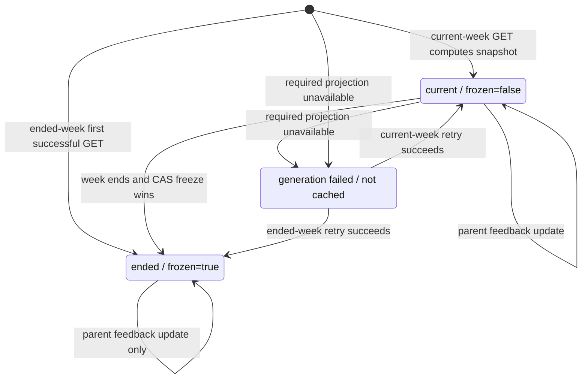

`Failed` 不对应数据库记录：任一必需投影超时、历史事件不完整或冻结竞争在有限重试
后仍不可见时返回 `503 AGGREGATION_UNAVAILABLE`，不得把空统计写入缓存。冻结后只
允许修改反馈字段，不允许重算统计或恢复为 current。

### 4.8 ReminderSettings 与 MediaAsset

`ReminderSettings` 由 `notification-service` 独占写入，每个 `familyId` 唯一，保存提醒开关、ISO 周报日和家庭本地安静时段。提醒按读取时派生，以 `type + childId + LocalDate + sourceId` 去重；不在第一阶段引入后台推送任务。

`MediaAsset` 由 `resource-service` 独占写入。对象存储键只保存在服务端，数据库保存
`familyId`、可选 `childId`、purpose、服务端检测 MIME、规范显示名、大小、PDF 页数、
扫描审计状态和软删除状态。上传链路校验 JPEG/PNG/WebP/PDF 和 10 MiB 上限；PDF
仅用于任务与错题附件，最多 50 页，拒绝加密或主动/嵌入内容并复制页面重新序列化。
图片重新编码并剥离 EXIF。读取链路先做家庭/孩子授权，再返回不超过 5 分钟的授权
URL；图片 inline，PDF 使用清理后的 attachment 文件名。

进程启动时固定选择媒体安全配置。`trusted-local` 面向可信家庭私有网络，不构造
ClamAV，审计为 `skipped_trusted_local`；`secure-production` 对规范字节执行私有
ClamAV 扫描，只接受 clean，扫描器异常时拒绝上传且不自动降级。业务模型只能引用
`active` 且 scope/purpose 匹配的 `mediaId`。删除后立即禁止读取和新引用，解除引用后
30 天物理清理。

#### MediaAsset 状态机

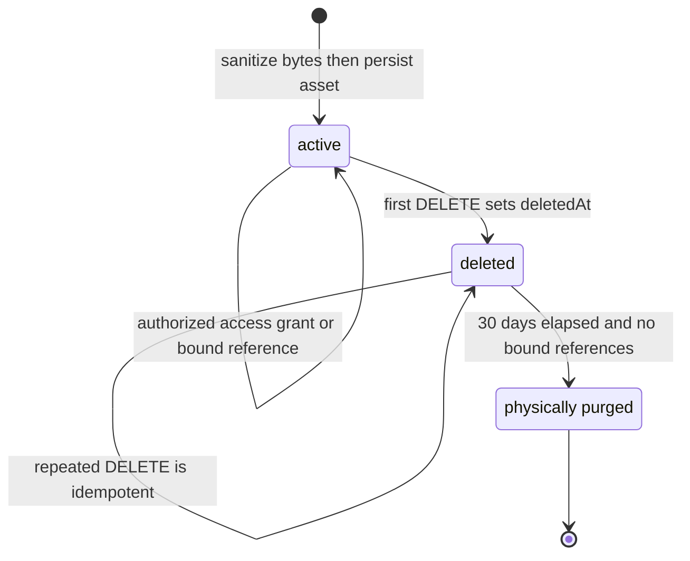

软删除立即拒绝授权读取和新的 prepare，但不会偷偷释放仍有效的业务引用。物理清理
以 `deletedAt` 和最后一个 bound 引用的 `releasedAt` 中较晚者为起点计算 30 天。

#### MediaReference 状态机

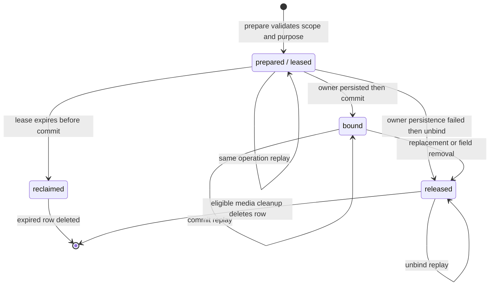

业务模型的 `mediaReferenceState=none|pending|bound` 是跨服务恢复标记；权威引用状态
仍在 resource-service 的 `MediaReference`。新绑定先 commit，旧绑定后 unbind，保证
替换期间不会出现新旧对象同时失去保留依据。

| 状态所有者 | 状态 | 含义 |
| --- | --- | --- |
| resource-service `MediaReference.state` | `prepared` | 引用租约已创建，等待业务对象持久化并提交 |
| resource-service `MediaReference.state` | `bound` | 权威引用已提交，媒体必须继续保留 |
| resource-service `MediaReference.state` | `released` | 该引用已经解绑，可参与后续媒体清理判断 |
| 业务对象 `mediaReferenceState` | `none` | 对象当前没有待恢复的媒体绑定；不对应一条 `released` 引用 |
| 业务对象 `mediaReferenceState` | `pending` | 对象已保存引用目标，但跨服务 commit 尚未确认完成 |
| 业务对象 `mediaReferenceState` | `bound` | 对象侧确认当前引用已经完成 commit |

这两组枚举描述不同聚合的生命周期，不能互相替换或按名称一一映射。例如，业务对象
处于 `none` 时可能从未创建过引用，也可能已有历史 `released` 引用；业务对象处于
`pending` 时对应的权威引用通常仍是 `prepared`。

### 4.9 StarLedgerEntry 与 Reward

星星使用不可变流水记录，不在 `User` 或 `Reward` 上直接维护可被并发覆盖的余额。

`StarLedgerEntry` 关键字段：

- `familyId`
- `childId`
- `type: earn|spend|adjust`
- `amount`
- `sourceType: task_confirmation|reward_redemption|parent_adjustment`
- `sourceId`
- `createdBy`
- `createdAt`

`familyId + childId + sourceType + sourceId + type` 必须建立唯一索引。家长首次确认任务后，任务先进入 `confirmed + starAwardState=pending`，随后 `homework-service` 调用 `progress-service` 内部积分命令；命令使用任务 ID 作为幂等来源，每个确认任务固定发放 1 颗星，重试不得重复加星。成功后任务更新为 `starAwardState=awarded`；失败返回 `503 STAR_AWARD_PENDING`，任务保持 confirmed 时再次确认会重试未完成的发放。余额由流水求和得到，兑换奖励必须在一个事务中写入扣减流水并更新 `Reward.status`。

第一阶段只实现星星余额和家庭奖励兑换。徽章不进入 MVP，避免在没有规则版本、授予记录和撤销语义时只做静态展示。

#### 星星发放状态机

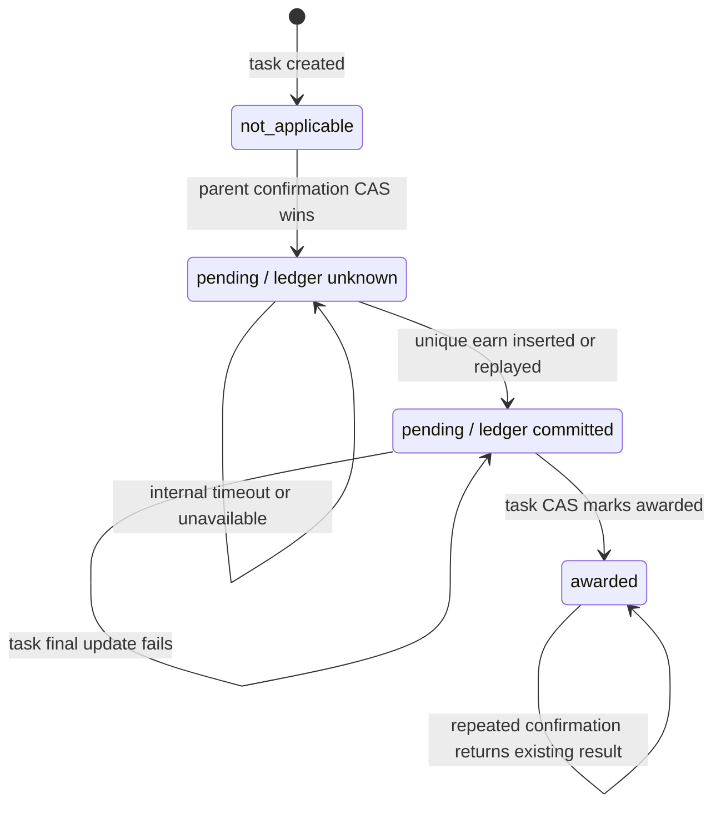

`LedgerCommitted` 是跨服务推理状态，不是额外数据库字段。任务仍保存 `pending`，但
`StarLedgerEntry` 的唯一索引已经证明发放完成；下一次调用按任务 ID 读回原流水并
完成任务侧 CAS。

#### 奖励兑换状态机

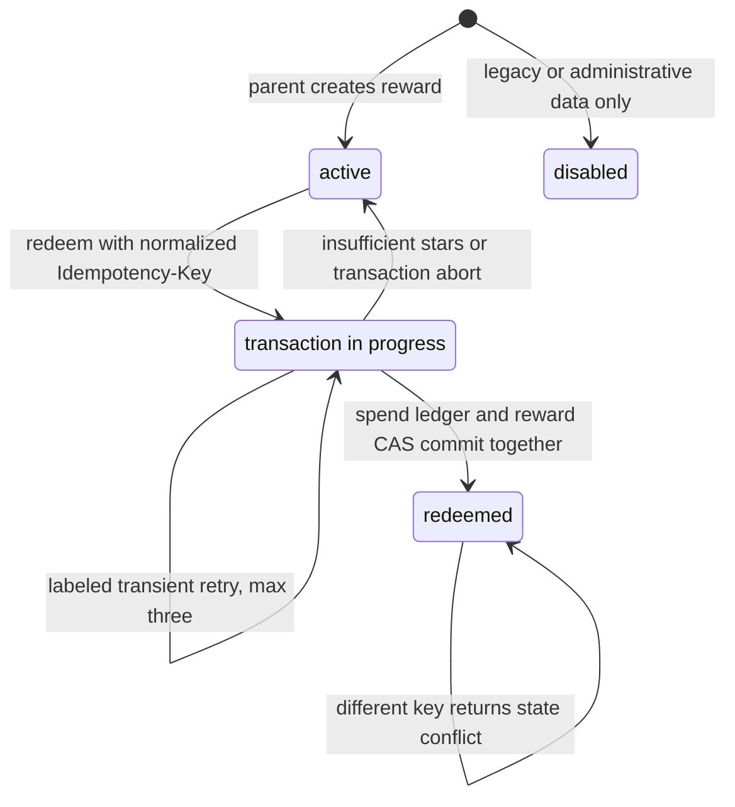

兑换必须在 MongoDB 副本集事务中同时写扣减流水并把奖励改为 `redeemed`。余额不足、
幂等键复用到其他操作或事务最终失败时不产生部分扣减。`disabled` 是模型兼容状态，
当前 MVP 没有公开的禁用命令。

### 4.10 核心实体关系

下图只展示家庭成长 MVP 的权威实体和关键关联，不展开旧学校版 Class、Homework
等兼容模型。所有孩子域实体除 `childId` 外都携带 `familyId`，授权查询必须同时
收敛两个边界。

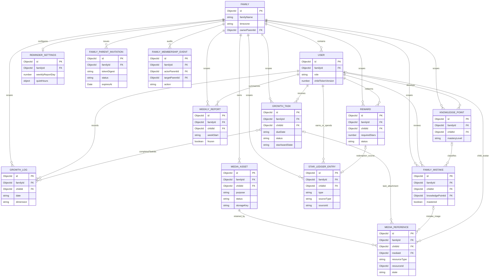

## 5. 数据归属规则

所有家庭数据必须满足以下规则：

1. 家庭级对象必须携带 `familyId`。
2. 孩子拥有的数据必须同时携带 `familyId` 和 `childId`。
3. 任务、记录、错题、奖励、周报和提醒都不得只依赖用户角色判断访问权限。
4. 查询列表时必须先按 `familyId` 收敛，再按 `childId`、`dimension`、日期等业务条件过滤。
5. 跨服务数据聚合时，`childId` 只能在同一个 `familyId` 内使用。
6. 所有业务唯一索引都必须包含 `familyId`；调用者提供的 `familyId` 不可信，必须从已验证 token 和孩子归属关系推导。邀请 token 摘要自身全局唯一，并同时按 `familyId` 建立生命周期索引。
7. 家长成员关系以 Family 为权威源，`User.familyId` 与旧 `User.children` 只是事务内同步的身份和兼容投影；授权不得只读取 `User.children`。

## 6. 权限规则

### 6.1 权限矩阵

| Resource/action | Family owner | Second parent | Child self | Sibling | Other-family parent | Anonymous |
| --- | --- | --- | --- | --- | --- | --- |
| Family read/update | allow | allow | deny | deny | deny | deny |
| Invite create/list/revoke | allow | deny | deny | deny | deny | deny |
| Remove member/transfer owner | allow non-owner target | deny | deny | deny | deny | deny |
| Leave family | transfer first | allow | deny | deny | deny | deny |
| Child create/update | allow | allow | deny | deny | deny | deny |
| Child profile read | allow | allow | allow own | deny | deny | deny |
| Child list | allow | allow | deny | deny | deny | deny |
| PIN set/reset | allow | allow | deny | deny | deny | deny |
| PIN login | public credential flow | public credential flow | public credential flow | public credential flow | public credential flow | public credential flow |
| Task list/detail | allow | allow | allow own | deny | deny | deny |
| Task create/edit | allow | allow | deny | deny | deny | deny |
| Task complete | allow | allow | allow own | deny | deny | deny |
| Task confirm/delete | allow | allow | deny | deny | deny | deny |
| Growth logs/mistakes | allow | allow | allowed self fields | deny | deny | deny |
| Reports/rewards | allow | allow | read own only | deny | deny | deny |

PIN 登录虽然不要求已有 token，仍必须使用统一凭据错误和限流，不能泄露家庭或孩子是否存在。

### 6.2 家长

家长可以：

- 查看和编辑自己家庭信息。
- 添加、查看、编辑自己家庭下的孩子。
- 为自己家庭下的孩子创建、编辑、确认任务。
- 查看和维护自己家庭下孩子的成长记录、错题、能力点、奖励和周报。

家长不能：

- 访问其他家庭的孩子。
- 访问其他家庭的任务、记录、错题、奖励和周报。

两位家长拥有相同日常权限。创建家庭的家长是治理所有者，可邀请或移除第二家长、
撤销邀请和转移所有权；第二家长可主动退出。所有者退出前必须转移所有权。退出或
移除后，下一次请求通过实时 Family 关系校验立即拒绝，即使原 JWT 尚未过期。

父级 JWT 和 Gateway 身份信封不携带可用于授权的 `familyId`。homework、progress、
analytics、notification 与 resource 服务都必须按已认证 parent ID 实时查询
`ownerParentId`/`memberParentIds`；resource-service 不得优先信任
`identity.familyId` 或旧 `User.familyId`。孩子身份仍按 `familyId + childId +
tokenVersion` 校验。

### 6.3 孩子

孩子可以：

- 使用 PIN 进入简化入口。
- 查看自己的今日任务、成长记录、错题复习和奖励。
- 标记自己的任务完成。
- 写自评、难度、实际用时、实际数量和是否需要帮助。

孩子不能：

- 查看兄弟姐妹的数据。
- 创建或确认家长任务。
- 修改家长反馈。
- 访问家长端设置。

### 6.4 教师和管理员

教师、管理员、班级和学校相关路由第一阶段仅作为旧代码兼容保留，不出现在 MVP 导航和演示闭环中。

## 7. 兼容、迁移与回滚

- MVP 保留 `Homework`、旧进度模型及学校角色枚举，不执行破坏性迁移。
- 新家庭路由只写入家庭域字段和新模型，旧学校路由不写入 `GrowthTask`。
- 家庭版 UI 隐藏学校、班级、教师和管理员入口，但不删除对应后端路由。
- 回滚通过停用家庭版 gateway 路由和 UI 导航完成，不删除家庭数据或旧学校数据。
- Task 12 回滚只停用邀请和成员治理路由及页面；现有服务已经按 `ownerParentId` 或
  `memberParentIds` 授权；resource-service 必须先移除父级家庭声明捷径。回滚保留已经
  形成的两家长关系、兼容投影和历史事件，不执行破坏性回退。
- Task 12 升级时先保持新 schema、路由和 UI 关闭；运行成员关系修复 dry-run，人工解决
  多家庭归属或超过两位候选成员等冲突，再应用确定性修复。随后执行 `--check`，只有
  待修复项与冲突均为零且退出码为 `0` 才能启用 Task 12。`--check` 发现任一操作或冲突
  必须非零退出。修复范围包括缺失 owner、重复 member、同家庭 `User.familyId` 和
  `User.children` 投影，禁止猜测归属或自动截断成员。
- 当前 BSON Date 形式的家庭任务 `dueDate` 在切换到 LocalDate String 前必须另写迁移脚本：按家庭时区转换、验证 `YYYY-MM-DD`、保留备份字段并支持回滚。门禁整改期间没有已发布家庭数据时，可以通过测试数据库重建完成切换。
- 任何已批准基线语义变化都必须创建新 ADR 或更新替代 ADR，并同步 API、追踪矩阵和测试。

## 8. 前端信息架构

### 8.1 家长 Web 端

首轮导航：

- 首页
- 任务
- 记录
- 错题
- 成长
- 进度
- 孩子
- 设置
- 家庭成员

首页必须突出：

- 今日任务。
- 本周完成率。
- 本周成长投入时长。
- 德智体美劳分布。
- 待复习错题。
- 需要帮助。
- 本周鼓励语。

`/app/family-members` 展示所有者和第二家长两个稳定成员槽。所有者可生成、复制和
撤销邀请，并在确认对话框中移除成员或转移所有权；第二家长只显示主动退出。
`/family/invitations#token=<token>` 位于家长认证边界内，未登录访问在 SPA 内保留
fragment 并在登录或注册后返回。fragment 不进入 HTTP 请求目标；预览和接受通过
脱敏 POST 请求体提交 token。客户端通过 React Router `useLocation().hash` 读取 token，
只允许回跳 `/family/invitations`，并完整保留 fragment 经过登录和注册。邀请明文不写入
`localStorage`、`sessionStorage`、query 或请求 URL；接受成功后使用 replace 导航到
`/app/family-members`，避免浏览器后退恢复 token。

### 8.2 孩子简化入口

首轮导航：

- 今天
- 错题
- 成就
- 我的

孩子入口只保留完成、反馈和自评动作，不提供复杂管理能力。

### 8.3 Web 会话和页面状态

家长和孩子使用独立的路由守卫与会话存储键。身份恢复完成前不渲染受保护页面；`401` 清除当前身份并回到对应登录页，`403` 显示无权限且不自动切换资源。家长切换孩子时取消旧请求、清空旧孩子查询缓存，再加载新孩子数据。

所有数据页面必须显式实现 loading、empty、retryable error 和 partial 四种状态；写操作禁用重复提交。布局支持 360px 到桌面宽度，核心流程可用键盘操作，控件具备可访问名称，状态同时使用文字或图标而非只用颜色。

#### 孩子会话与 stale token 状态机

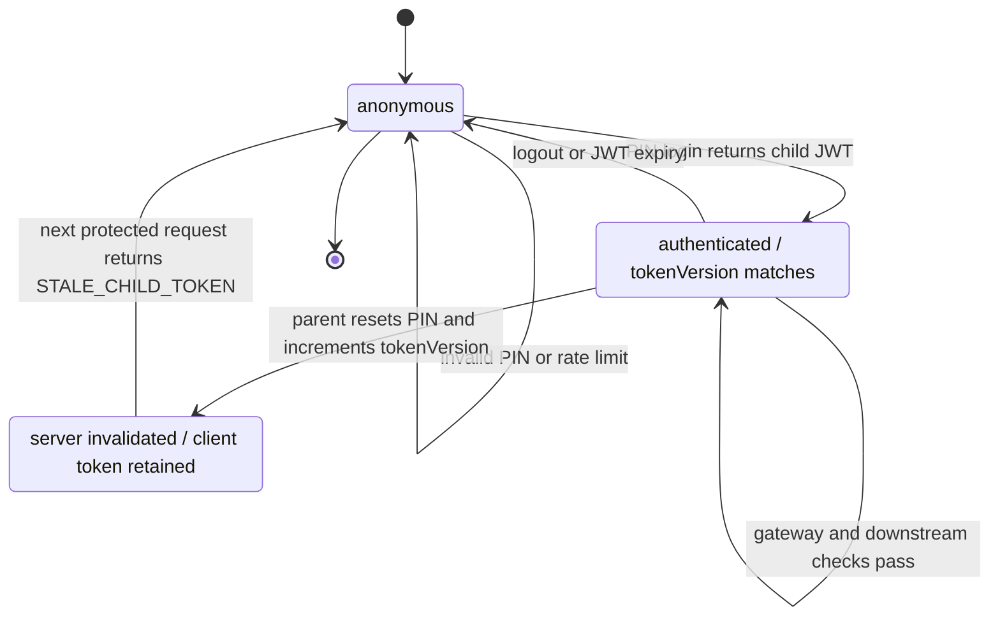

Gateway 先验证 JWT 并签发包含 `familyId`、`childId`、`tokenVersion` 的身份信封；
下游服务再读取当前孩子版本。版本不一致返回 `401 STALE_CHILD_TOKEN`，`childApi`
触发会话过期事件、清除独立孩子存储并跳回 `/child/login`。

### 8.4 前端组件与数据边界

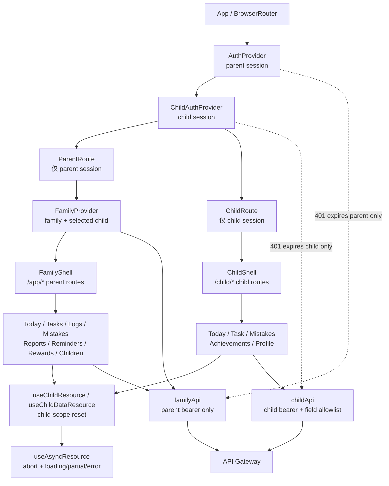

`AuthProvider` 与 `ChildAuthProvider` 可以同时挂载，但 session key、路由守卫和 API
客户端互不回退。家长切换孩子时 `FamilyContext` 递增 scope version、取消旧请求并
清空旧孩子缓存；孩子 API 始终从已验证会话推导 childId，并在客户端过滤可写字段。

## 9. 本地演示部署

第一阶段本地 Demo 只启动这些必要组件：

- `gateway`
- `user-service`
- `homework-service`
- `progress-service`
- `analytics-service`
- `notification-service`
- `resource-service`
- MongoDB
- `frontend/web`

`interaction-service`、会议、公告、复杂消息和移动端不作为首轮 Demo 必需服务。

Compose 和 Kubernetes 清单中保留的 `interaction-service` 属于兼容部署面。它可以随完整旧系统一起启动，但 Task 1-7 家庭成长基线不以该服务可用作为门禁条件；任何新的家庭 MVP 功能若需要亲子反馈或孩子自评，必须先在 Task 8+ 设计中定义 API、状态、权限和回归门禁。

MongoDB 必须以名为 `rs0` 的副本集运行。Compose 使用单节点副本集并由一次性初始化容器执行 `rs.initiate()`；所有服务连接串带 `replicaSet=rs0`。Kubernetes 使用单副本 StatefulSet、稳定主机名和初始化 Job；生产环境应替换为托管或至少三成员副本集。`progress-service` 启动时验证事务能力，不能在 standalone 上降级执行奖励兑换。

## 10. 非目标

第一阶段不做：

- 学校组织、班级、教师端和管理员后台。
- 视频会议、班级公告、群聊和消息已读。
- AI 周报、AI 解题、OCR 识别和自动批改。
- 专业体育测评、医疗健康判断和艺术等级评价。
- 新增微服务或复杂事件编排。
- 生产级定时任务系统。

## 11. 拟议的家庭 AI 学习扩展

DeepTutor、K12-KGraph 和家长人工审核手写订正的后续方案见
[家庭 AI 学习管理平台完整设计](family-ai-learning-platform-design.md)。该方案遵守并保留
本文的家庭隔离、Gateway 身份信封、私有媒体和服务数据所有权，不把 DeepTutor 或 K12
变成新的业务权威方。

该文档当前状态为 `DRAFT FOR REVIEW`。其中的 `CurriculumRef`、
`TutorLearningCycle`、`TutorCycleAttempt`、`TutorGenerationInput`、`TutorGenerationJob`、
`TutorArtifact`、API 路由和
feature flag 尚未进入 FGT-MVP-1.7 实现。正式开发时必须先批准对应增量设计，并同步
更新 PRD、API 契约、需求追踪、权限拒绝路径、迁移/回滚和发布 Gate；不能仅依据草案
修改生产数据或对外开放服务。

## 12. 自主学习 MVP 增量架构契约（PLANNED）

本节把 `SL-01` 至 `SL-07` 固定在现有家庭成长架构内。它是 T1 至 T9 的实现约束，不改变
FGT-MVP-1.7 当前已实现状态。完整交互与分期见
[家庭自主学习系统设计](family-self-directed-learning-system-design.md)，执行状态见
[自主学习 MVP 增量 Gate](../development/family-self-directed-learning-mvp-gate.md)。

### 12.1 服务所有权

| 计划需求 | 写模型所有者 | 跨服务边界 | 禁止事项 |
| --- | --- | --- | --- |
| `SL-01` 图片作品 | `homework-service` 写任务完成快照与命令记录；`resource-service` 写媒体和引用 | 继续使用 prepare/commit/unbind 媒体引用协议 | 不保存底层路径、签名 URL 或跨 purpose 复用 mediaId |
| `SL-02` 独立求助 | `homework-service` 写任务当前求助 | 家长查询仍通过 Gateway 和任务 API | 不增加聊天、通知 worker 或掌握度写入 |
| `SL-03` 自检清单 | `homework-service` 写任务清单及版本 | 前端只提交允许字段和预期版本 | 不建立儿童画像或独立客户端 |
| `SL-04` 日计划 | `homework-service` 独占写 `DailyLearningPlan` | Gateway 只代理精确日计划路径 | 不复制任务状态或修改 `dueDate` |
| `SL-05` 来源连接 | `analytics-service` 写错题来源；`homework-service` 写订正任务来源 | 所有者服务用内部凭据读取最小归属投影 | 不跨服务写数据库，不建设一次性分布式向导 |
| `SL-06` 周复盘 | `progress-service` 继续写成长反思；`analytics-service` 继续写周报反馈 | 复用当前公开接口 | 不让孩子修改冻结周报统计 |
| `SL-07` 部署验证 | 无新业务写模型 | 复用 Compose、备份和恢复流程 | 不把配置存在当成真实部署证据 |

本轮不新增微服务。第二家长、孩子 PIN、Gateway 身份信封、家庭实时成员关系、LocalDate、
单次 GrowthTask、不可变星星流水和私有媒体边界全部沿用现有 ADR。

### 12.2 `GrowthTask` 计划字段

`GrowthTask` 采用加法兼容字段：

```text
checklistSnapshot[]
  itemId
  label
  required
checklistVersion
completionVersion
completionEvidence?
  checkedItemIds[]
  completionMediaIds[]
  difficulty?
  needsHelp?
  childNote?
  submittedByActor
  childSubmittedAt
completionMediaReferenceState?   // stable|pending_recovery
helpVersion
helpRequest?
  status                         // pending|resolved
  helpType
  note?
  requestedByActor
  requestedAt
  resolvedByParentId?
  parentResponse?
  resolvedAt?
sourceTaskId?
sourceMistakeId?
```

关键规则：

- 老任务字段缺失时读取投影为清单 `[]`、`checklistVersion=0`、`completionVersion=0`、
  `helpVersion=0`，GET 不因投影默认值写数据库。
- 创建任务时未提供或显式提供空清单，保存 `checklistSnapshot=[]`、`checklistVersion=0`；
  创建时提供非空有效清单，保存 `checklistVersion=1`。后续修改才从当前版本 CAS 递增。
- 第一次改变对应内容的写入在同一原子条件更新中按需初始化版本，并从 0 递增到 1；
  历史无媒体确认是唯一例外，只把缺失 `completionVersion` 持久化为 0。不得批量重写全部任务。
- `checklistSnapshot` 最多 5 项，`itemId` 在任务内唯一，`label` 为 1 至 100 字。
- `completionMediaIds` 是最多 10 项的有序唯一集合，媒体必须属于相同 `familyId + childId`、
  active 且 purpose 为 `task_completion`。
- `pending|completed` 可提交新完成快照；`confirmed|cancelled|archived` 拒绝修改。
- 家长确认使用其读取到的 `completionVersion` 做 CAS；确认成功后完成内容冻结。
- 存在活动完成意图或媒体引用处于 `pending_recovery` 时，完成新写、清单编辑、任务编辑、确认、
  取消和归档都受第 12.3 节的服务端互斥条件保护；恢复后重新读取并校验版本。
- 当前求助与任务主状态正交；请求或处理求助不能完成任务、发星或修改知识点。
- 家长代录保存认证 actor 和 `subjectChildId`；客户端不得提交审计身份或服务端时间。

求助 request 的安全重放必须同时满足：当前记录仍为 pending、
`currentHelpVersion === expectedHelpVersion + 1`、规范化后的 `helpType + note` 完全相同，且
认证 actor 与 `requestedByActor` 相同。否则返回 `409 VERSION_CONFLICT`。resolve 严格使用
`expectedHelpVersion` 做 CAS；旧版本 resolve 返回 `409 VERSION_CONFLICT`，客户端重新 GET 后
由用户决定是否再次处理，不自动重复操作。

### 12.3 完成命令幂等与并发

`GrowthTaskCompletionOperation` 只保存最小命令记录：作用域、`operationId`、`remoteOperationId`、规范请求哈希、
目标版本、不可变成功响应投影 `successResponse`、稳定失败结果和恢复状态，不保存图片正文或签名 URL。

`successResponse` 固定为完成接口的 HTTP 200 响应体，字段为 `success=true` 及 `data.task` 中的
`taskId/status/checklistVersion/completionVersion/completionMediaIds/completionMediaReferenceState/parentConfirmed/completedAt`。
其中媒体 ID 保持原顺序；status 固定 completed，引用状态为 stable，parentConfirmed 为 false。
投影与作品发布在同一事务中写入，只有命令进入 SUCCEEDED 才返回。后续作品更新、确认或归档
不修改该投影；原命令重放必须读取投影，不能从当前任务拼装旧版本，也不再次修改 completedAt。
重放响应表示原命令结果，当前状态由 GET 获取；旧媒体 ID 不赋予读取权，媒体访问仍实时授权。
投影随命令记录和任务生命周期保留，本轮不单独 TTL 清理，不保存备注或作品正文历史。

任务内部另保存当前完成命令的最小 pending 意图：目标版本、完成此次收敛所需的最小规范业务 patch
及其哈希、有序目标 mediaId、旧稳定引用代次、媒体差集、操作阶段和
`mediaRemoteOutcomeUncertain`。业务 patch 只包含规范化后的 `checkedItemIds`、`actualMinutes`、
`actualAmount`、`difficulty`、`needsHelp`、`childNote` 和服务端认证 actor，不包含图片正文、签名 URL
或客户端审计时间。它只在 pending 恢复期间保存，命令成功或稳定失败收敛后从任务隐藏字段清除；
命令记录只保留哈希、成功响应投影或稳定失败结果及必要阶段信息。这样受控恢复可以脱离客户端原请求发布同一证据，
但不会形成长期多版本作品正文库。这些隐藏字段不作为已完成作品返回；公开 status、完成证据和
媒体列表在新引用 commit 前保持上一份稳定快照。

媒体差集按 mediaId 计算并保留目标顺序：新增集合只包含目标中尚未绑定的媒体，保留集合沿用旧
稳定引用的 `bindingOperationId`/代次，移除集合记录待释放媒体及其精确旧绑定 operation。只有新增
集合执行 prepare/commit；发布新稳定证据后，只有移除集合执行 unbind。每个阶段不发送空媒体命令；
新增集合为空时跳过 prepare/commit，纯重排或只修改非媒体完成字段时直接以本地事务发布规范 patch。
删除部分或全部媒体时仍必须处理非空移除集合；纯重排仍递增完成版本，但不改变任何媒体绑定代次。

唯一作用域为：

```text
familyId + childId + taskId + actorId + action + operationId
```

客户端 `operationId` 只标识上述本地命令，不能直接作为远程媒体命令的身份。homework-service
为每条新命令生成服务端 UUID `remoteOperationId`，远程标识与首次命令占位同事务持久化，
包括新增集合为空的命令；它不是公开请求字段，也不进入公开成功响应。不同 actor 使用同一 UUID 必须分配不同远程标识。
本地命令集合建立全局 remoteOperationId 唯一索引，并保留原完整业务作用域唯一索引。首次占位的
唯一竞争必须区分：本地命令键竞争重读原命令；仅远程标识碰撞且占位事务确认已回滚、尚无远程调用时
才可重新分配 UUID。提交结果未知时先查原本地命令/恢复同一事务提交结果，不得另建映射或发送候选标识。
持久化映射不可变，和本地终态记录一起保留、不单独 TTL；恢复/终态重放绝不重新生成远程标识。
所有进程和运维恢复只从已确认提交的命令记录读取该值；缺失映射时阻断并告警，禁止回退到客户端 UUID。

内部 operationId 必须取持久化 remoteOperationId：prepare/commit/abort 和 status 的 operation 模式
继续使用内部字段名 `operationId`，其值来自该映射；响应 operationId 必须等于映射值且摘要/作用域匹配
才可驱动本地状态。新增引用的 `bindingOperationId` 等于该远程标识；保留引用沿用原绑定代次。
unbind 的命令 operationId 也使用当前命令的远程标识（releaseOperationId 的来源），但每个移除项的
bindingOperationId 必须是持久化的旧远程绑定代次，不能用当前标识替换。references 模式不携带命令标识。
commandHash 仍覆盖本地完整 scope（含客户端 operationId、actor/action）和规范正文，不包含生成的远程标识；
请求哈希比较不能因重试而变化。远端唯一键的 operationId 属于独立的服务端命名空间，不增加公开 actor 字段。

处理顺序固定为：实时授权、请求 schema 校验、规范请求哈希、幂等查询、本地版本 CAS 与命令
占位、远程媒体收敛、公开结果和响应。相同作用域与相同哈希重放原结果；相同作用域但不同哈希返回
`409 IDEMPOTENCY_KEY_REUSED`。授权失败发生在幂等结果返回之前，已经离开家庭的家长或错误
孩子不能借重放读取历史结果。

每个任务最多一个活动完成命令。任务隐藏字段 `activeCompletionOperation` 保存完整命令作用域，
创建占位的 CAS 除版本/状态外必须要求该字段为空，缺失旧字段等同空；与命令创建在同一事务中提交。
占位起即标记 pending_recovery，直到成功或稳定失败收敛。新 operationId（包括不同 actor 使用相同
UUID）不得覆盖活动意图；恢复每次本地更新都校验完整 owner、当前阶段和目标版本，旧执行器不能
清除新 owner 或重复发布。只有相同 scope、哈希、operationId 的活动命令可以进入恢复。

完成新写、清单编辑、任务编辑、确认、取消和归档在各自最终原子写入中统一要求无活动完成意图且
引用状态非 pending_recovery，否则返回 `503 MEDIA_REFERENCE_PENDING`；不得只在读后做预检查。
任务材料有独立 pending 引用时也阻止新完成占位。鉴权/schema/同 key 异正文冲突和已终态命令重放
先于该锁检查；因此先前成功命令仍可重放其投影，不能恢复另一个活动命令。独立求助仅局部更新
help 字段，不改任务主状态或完成意图，不必持有此锁。恢复结束后新写调用方必须重新 GET。

首次执行必须按以下顺序收敛，不能先调用远端再记录本地意图：

1. 在同一 MongoDB 事务中，以期望版本、任务状态和无活动完成意图做 CAS，创建 PREPUBLISH 命令占位，并在任务上持久化
   最小规范业务 patch、pending 意图、目标顺序、稳定引用代次、新增/保留/移除集合和
   `mediaRemoteOutcomeUncertain=false`；失败则整体不落库。
2. 以 CAS 将 `mediaRemoteOutcomeUncertain` 设置为 `true`，确认成功后才调用 resource-service
   prepare；只有非空新增集合调用 prepare/commit，并始终使用已保存的 `remoteOperationId` 与目标代次。
3. commit 成功（或新增集合为空）后用事务/CAS 发布完成证据和新稳定引用、递增 `completionVersion`，
   同时固化成功响应投影并转入 `PUBLISHED_CLEANUP`；保留集合继续使用原绑定代次。
   移除集合全部收敛后，以本地事务将命令置 SUCCEEDED、引用状态置 stable 并清除 pending 元数据及
   活动 owner。移除集合为空可在发布事务中直接成功。解绑期间公开新作品但引用状态仍为 pending_recovery。
4. 网络超时、5xx、畸形响应、数据库结果未知或 unbind 未收敛时保留 pending 意图并返回
   `503 MEDIA_REFERENCE_PENDING`。客户端只能以完全相同的 `PATCH` 请求和原 `operationId`
   重放；GET 不触发恢复并保持无副作用。运维恢复也只能读取已持久化意图重放同一命令。

请求 schema、数量和重复 mediaId 等本地校验必须在命令占位前完成。仅首次进程内 prepare
直接返回经过认证、结构完整且带有匹配 commandHash 的 ABORTED 终态的稳定业务拒绝时，
homework-service 才使用当前命令阶段和目标代次做事务/CAS，把命令记录为失败、把
`mediaRemoteOutcomeUncertain` 收敛为 false、清除 pending 意图并恢复上一稳定引用状态。该路径
不得递增 `completionVersion`，不得改写完成证据或 `completedAt`，也不得执行 bind/unbind。
相同 scope、请求哈希和 operationId 重放同一失败结果；用户修正请求后必须使用新的 `operationId`。
不存在、跨家庭、跨孩子、错误 purpose 和不可用媒体继续使用既有不可枚举的公开错误映射。
恢复执行不得凭后来收到的稳定 4xx 清理 pending 意图，因为此前调用可能已经到达远端；裸
`400/403/404/409` 不证明 operation 已终止，必须查询或执行下述 abort。首次稳定拒绝后的本地事务
结果未知时同样返回 `503 MEDIA_REFERENCE_PENDING` 并只允许原命令恢复。

#### 远程 operation 终态与租约

T1 为 `growth_task.completionMediaIds` 的非空新增集合增加 resource-service 所有的
`MediaReferenceOperation`，现有其他字段的引用协议不迁移。记录唯一键为
`{familyId, childId, resourceType, resourceId, field, operationId}`，保存规范引用身份集合、
`commandHash`、服务端计算的引用集合摘要、`PREPARED|COMMITTED|ABORTED`、leaseExpiresAt、
terminalAt 和最小稳定失败码；不保存业务 patch、媒体内容或存储路径。commandHash 为 homework
对完整本地命令 scope（含 actor/action）和规范正文的摘要；四个内部端点都校验同键的摘要及引用
集合一致，不一致返回 `409 MEDIA_OPERATION_CONFLICT`。这里的 operationId 是持久化 remoteOperationId，
不是客户端 UUID；不同 actor 的合法本地命令不会因客户端 UUID 相同碰撞。内部同键异摘要仍保持 pending
并告警，不放宽为凭冲突清锁；它表示映射/请求不变量被破坏，不是正常的跨 actor 分支。

prepare/commit/abort 使用同一 MongoDB 事务写 operation 和其新增引用；终止与提交必须竞争同一 operation 记录。
每次写入按状态和记录版本 CAS，唯一键冲突/事务写冲突后重新读取状态，不得只读 operation 后仅写引用。
租约由 resource-service 时钟判定，沿用配置的 900 秒默认值；同 operation 重试不续租。
以下 ABSENT 是没有 operation 行的查询投影，不是持久状态：

| 当前 operation | prepare | commit | abort |
| --- | --- | --- | --- |
| ABSENT | 验证新增媒体并原子创建 PREPARED 和全部 prepared 引用；确定的业务拒绝原子存 ABORTED | 409 MEDIA_OPERATION_NOT_PREPARED，不创建引用 | 原子创建 ABORTED 终止标记，即使引用尚不存在 |
| PREPARED，租约有效 | 返回原 lease，不重建或续租 | 全部引用同代次且有效，原子置 bound/COMMITTED | 原子释放本 operation 的 prepared 引用并置 ABORTED |
| PREPARED，租约已过期 | 原子过期终止并返回 ABORTED | 原子过期终止并返回 ABORTED | 原子过期终止并返回 ABORTED |
| COMMITTED | 返回原 COMMITTED，不重绑 | 返回原 COMMITTED，不重绑 | 返回 COMMITTED，不解绑，提交已胜出 |
| ABORTED | 返回原 ABORTED，不创建引用 | 返回原 ABORTED，不提交引用 | 返回原 ABORTED |

租约过期原子转为 ABORTED，失败码为 MEDIA_OPERATION_EXPIRED，同时将该 operation 的 prepared
引用置 released；过期边界为 `now >= leaseExpiresAt`。请求处理路径负责过期收敛，不依赖 worker。
确定的媒体业务拒绝必须提交 ABORTED 后才响应，不能在事务内抛异常使终止标记也回滚；鉴权/schema
失败、事务结果未知和摘要冲突不携带可用于终止本地命令的证明。ABORTED 稳定码首次写入后不改写。
abort 主动终止使用 MEDIA_OPERATION_ABORTED；prepare 的媒体业务拒绝沿用既有不可枚举错误映射。

新协议的后台回收不得直接删除 prepared 引用：如启用回收，应调用相同的过期终止事务。其他代次、
意外 bound、部分丢失等不满足 operation 不变量时整个事务拒绝并告警，不释放别人的引用。
完成作品隐私删除遵守下方专门契约：PREPARED 必须整组终止；COMMITTED 不反转终态，但目标媒体
的 bound 可凭持久删除凭证释放。不能仅改单条 prepared 而遗留 PREPARED operation。
所有重试事务重新读取记录并采样服务器时间，不沿用上次事务的租约判断。
终态记录不做 TTL 删除，媒体物理清理也保留最小 operation 终止标记；COMMITTED 后的正常 unbind
只改变引用，不反转 operation。旧 prepare/commit 重放只报告终态，不复活已解绑引用。终态清理
需另行设计请求代次淘汰/授权与数据生命周期，不能以删除记录作为恢复手段。

T1 同时增加仅服务凭据可用、不会经 Gateway 公开的只读 status 和有写入的 abort 接口。
受控引用状态对账携带完整 scope、operationId、commandHash 和规范新增集合，返回 operation 的
`ABSENT|PREPARED|COMMITTED|ABORTED`、匹配摘要、leaseExpiresAt、服务端 leaseExpired、稳定失败码，
以及每个目标身份的 `absent|prepared|bound|released` 和必要的绑定 operation，不返回媒体内容或路径。
查询不能以请求 operationId 过滤掉其他代次；必须报告实际代次供调用方判断。absent 无绑定代次，
只说明完整引用身份不存在，不声称某个 operation 已执行。对账先从本地事务记录确定阶段，再按以下规则收敛：

- PREPUBLISH：仅对账非空新增集合。absent 不能作为失败终态证据；operation ABSENT 或租约过期
  调用原 operation 的 abort。PREPARED 且租约有效继续 commit，commit 会再次按服务器时钟检查租约。
  只有匹配摘要的 COMMITTED 且全部新增引用 bound 于该 operation（或具有下述精确隐私删除凭证）才能发布；只有匹配摘要的 ABORTED
  才能把本地命令收敛为 FAILED，清除 pending 意图并保留上一稳定作品和版本。abort 返回 COMMITTED
  表示提交竞争胜出，继续发布，不能回滚或解绑新增集合。摘要冲突、引用不一致、查询/终止结果未知
  保持 pending 并告警。不存在单纯根据 absent/released 清锁的分支。
- 新增集合为空时不进行全称状态判断；PREPUBLISH 直接发布本地 patch，再进入解绑阶段。
- `PUBLISHED_CLEANUP`：发布后不得回滚已发布作品，不再 prepare/commit、不重复发布或递增版本。
  只按持久化移除集合及精确旧绑定代次对账：bound 且代次相同则以当前 remoteOperationId 重放 unbind；
  released 且代次相同视为已解除；absent 视为该完整身份已无引用（依靠活动命令锁禁止并发重绑）。
  不要求 releaseOperationId 相等，沿用现有 unbind 的目标状态幂等语义；它只用于内部审计。
  其他绑定代次或 prepared 状态阻断并告警。有效混合 bound/released/absent 逐项收敛，不把已释放项
  再绑定。移除集合全部收敛后才能终结成功；移除集合为空直接完成本地终结。
  此阶段使用 status 的 references 查询模式读取移除集合，不把它当作原新增集合计算摘要；不得调用 abort。
- 查询失败或本地提交结果未知时保持 `MEDIA_REFERENCE_PENDING`；先读取命令阶段和 owner，
  已 SUCCEEDED/FAILED 则重放终态，否则沿原阶段恢复。不能靠远端新增集合推断本地是否发布成功。

该状态查询只提供事实，不自行修改引用。homework-service 不直接读取 resource-service 数据库；
所有自动或运维恢复都必须先重新授权，再读取已持久化意图并遵守上述规则。
本地 owner/阶段 CAS 与远端终态一起防御重复执行器：迟到 abort 无法推翻 COMMITTED，迟到 prepare/commit
无法推翻 ABORTED；本地失败释放锁前必须收到确定远端终态。远端 ABORTED 后本地落库未知时重读同终态恢复。

在调用 prepare 前设置不确定标记，关闭“远端可能已收到请求但本地没有恢复记录”的崩溃窗口。
恢复不得猜测成功，也不得创建第二个 operationId。

完成写入同时校验 `expectedCompletionVersion`、`expectedChecklistVersion` 和任务状态。
任一版本过期返回 `409 VERSION_CONFLICT` 且不改变任务、命令或媒体引用。家长确认与孩子更新
竞争时最多一方成功，家长不能确认读取后已被替换的作品。

#### 完成作品隐私删除（PLANNED）

这是 SL-01 的安全闭环，不是全量家庭数据删除。现有任务 DELETE 仅取消/归档，并不解除媒体引用；
§4 的既有媒体 DELETE 保留 bound 的行为仍是已实现基础。以下扩展仅适用于新 purpose=task_completion，
必须在 T1/T2 启用完成作品前实现，不能把旧实现声称为已经满足。

复用 `DELETE /api/media/:mediaId`：当前家庭任一家长或孩子本人经实时 scope 校验可请求；孩子不能删
兄弟姐妹媒体，已离家家长不得操作。无新角色或上传者特权。确认/归档冻结教学内容，不剥夺媒体隐私删除。
UI 明示删除整份媒体会影响其所有完成作品引用，需明确确认；孩子可请家长代办，但服务端仍记录实际 actor。

resource-service 是删除与引用的唯一写入者。对 task_completion 在同一事务内：

1. 将资产置 deleted（首次 deletedAt 不变），写入最小 `MediaDeletionTombstone`，保存 scope/mediaId、
   实际 actorId/role、服务器 deletedAt 和固定原因 user_requested；无图片正文、文件名、备注或存储路径。
   每个释放的 bound 另保存精确 resourceType/resourceId/field/bindingOperationId/releasedAt 删除凭证。
   资产 tombstone 以 mediaId 唯一，释放凭证以完整 scope/引用身份/bindingOperationId 唯一；首次字段不可覆盖，
   重复请求读取原记录，不因不同重试 actor 重写首次事实。
2. 对涉及的 PREPARED operation 竞争原记录 CAS，整组 ABORTED 并释放其全部 prepared；对已 COMMITTED
   记录竞争版本 CAS 但不反转状态，仅释放该媒体的 completionMediaIds bound 引用、持久保存对应凭证。
   禁止静默解除其他 purpose/字段引用，异常 scope/字段阻断并告警。全部操作原子提交，未知结果重试原 DELETE。
3. prepare 对 active MediaAsset 执行实际写入的 referenceFence CAS（不只是读取状态），删除同样写该资产；
   避免“删除看不到尚未提交 prepare、prepare 又读到旧 active”的写偏差。commit 与删除竞争同 operation，
   事务重试重查状态。删除后不能创建新引用，迟到的旧 COMMITTED 仅重放终态，不能重绑。

删除成功后授权读取、签名内容读取和新 prepare 均拒绝；重复 DELETE 返回 204，保留首次时间和 actor，
从 tombstone 仍需校验权限。丢响应不重复审计或重置 30 天起点。资源已不存在且无凭证时沿用原 404。
任务只保留原 mediaId 和教学确认事实，显示“作品已删除”；不修改 completionVersion、confirmedAt、星星或
不可变成功响应。GET/旧成功重放中的 mediaId 从来不是读取授权；UI 不得把不可读占位显示为仍可审核的图片。

COMMITTED 后本地发布未知的恢复：status 返回同 scope、媒体身份及绑定代次的 privacyDeletion 凭证。
新增集合每项必须为同代次 bound，或有匹配该 remoteOperationId 的持久隐私删除凭证，才可发布原业务 patch
并显示不可读占位。普通 released/absent、客户端声明或其他代次凭证绝不能替代 bound。远端仍 ABORTED 时
按原失败路径；无新增集合时无需远端提交。PUBLISHED_CLEANUP 可接受精确凭证/已 released/absent，禁止重绑。
这消除“已提交后隐私删除导致永久 pending”，不放宽远程终态与家庭隔离。

物理清理在 deletedAt 和最后释放时间两者都满 30 天且无 prepared/bound 后才有资格执行；30 天不是自动
删除完成承诺，须记录清理命令实际执行和残留。删除凭证及 operation 终态保留，不随内容清理删除/TTL。
备份可能仍有正文：现有示例为 7 日/4 周/12 月快照，不得声称 30 天后所有副本消失。恢复只能在隔离停读写
环境进行，合并截至恢复切换时完整的最新删除凭证、重新应用禁读/释放并核对后才开放；凭证不可用时停止恢复上线。
仅有早于最后已确认删除的日志或无法证明日志完整时也不得上线，不能以恢复出旧快照就认定恢复成功。
本轮要求在受保护备份介质保存独立删除凭证日志，并在删除成功前确认本地持久性；受控恢复必须取得完整日志。
T1 第三批服务层实现说明（仍未启用生产入口）：

- 最小资产事实为 MediaDeletionTombstone；精确 bound 释放事实单独存入 MediaDeletionReceipt，
  两者与资产禁读、operation CAS、引用释放同事务提交，无 TTL，不保存正文/文件名/路径。
- prepare/commit 和删除复用资产 __v 的真实写入作为 referenceFence。新删除事务设置
  privacyDeletionRecorded=true，旧清理在选择及删除资产时排除该标记，不影响旧协议历史删除。
  标记只作清理分流；权限与恢复证明仍以 tombstone/精确 receipt 为准，不依赖此布尔值。
- createMediaDeletionJournal 要求显式的绝对目录及已存在的受保护父目录，不提供工作目录默认值。
  逐媒体固定最小 JSON，0600 文件/0700 目录；临时文件 fsync、原子硬链接发布、目录和父目录 fsync，
  重试核验相同内容，不覆盖首次事实。数据库提交后日志确认失败返回 pending，不能先报告成功。
  部署时必须指定实际受保护介质；仅在临时目录测试不等于备份/恢复验收通过。
- 独立清理先在事务中检查删除/最后释放均满 30 天、无活跃引用且凭证存在，确认日志持久性，
  再在事务外幂等移除文件，最后重新检查并事务删除资产与 released 引用。文件已移除但数据库失败
  时保留禁读元数据重试，绝不重建文件或删除凭证/operation；不将文件系统副作用放进可重试事务回调。

T8 演练旧快照恢复不复活内容，记录实际快照保留/清理日期。立即销毁全部备份或全量家庭导出/删除另行授权，
不在本轮实现；任何已删除内容不得因代码回滚重新开放，应保留 tombstone 并前进修复。

T1 第四批传输信任边界（独立模块，尚未生产接入）：公共 mediaReferenceClient 通过按需导出新增
completion client，旧工厂不加载新协议。client 只把调用者提供的持久化 remoteOperationId 转换为
内部 operationId，不生成映射或直接读取任一服务数据库；映射的持久化保证仍由 homework 占位事务承担。
严格验证请求 scope/非空引用集合，响应校验远程身份、摘要、完整集合、终态/租约形状与精确删除凭证。
错误响应不等于终态证据；裸 4xx/5xx、超时或不完整/矛盾响应均 pending，不返回远端敏感错误信息，
不自动重试或跟随重定向。仅经验证的 200 ABORTED 返回为终态数据，后续本地清锁必须再遵守阶段规则。
历史终态的当前 absent/其他代次不会被过滤或改写为成功绑定，不能仅凭 client 校验成功就发布作品。
本批测试使用真实临时副本集的服务契约 adapter，不宣称已有新 HTTP handler；生产入口继续拒绝新字段，
status/abort 仍未注册。公共 client 的业务注入及 homework 编排另批实施，路由启用须单独确认。

T1 第五批在独立 service/client 增加精确代次 unbind：当前远程标识只写 releaseOperationId 审计，
不创建空 operation，不使用新增集合 commandHash；各移除项携带原 bindingOperationId。
bound 必须属于对应旧 COMMITTED operation 的规范集合，同一事务按每个旧 operation 版本 CAS、
每行代次/状态 CAS 释放；不改变历史终态。同代次 released 保留首次审计，absent 如实返回；
其他代次或 prepared（含过期）整批冲突，不能以 unbind 代替整组 abort。
响应 operation=null，client 验证完整 released/absent 集合及每项旧代次凭证；普通解绑不产生删除凭证。
这些结果不代替 homework 的发布后 owner/阶段 CAS，生产路由与业务注入仍未启用。

T1 第六批在 homework 增加独立 completion service 与媒体编排：

- GrowthTask 加法定义版本、清单与稳定 completionEvidence，历史字段缺失按版本 0 投影，无迁移写入。
  completionMediaBindings、activeCompletionOperation、completionPending 默认不被查询选出；
  编排显式读取，公开只读投影排除隐藏状态，pending patch 不提前变成稳定证据。
- 初次占位在本地事务内 CAS 任务状态/版本/无 owner，同时保存完整 owner、最小 patch、差异集合、
  规范 hash 和唯一 remoteOperationId。远程标识跨事务重试保留，只有确认回滚的映射唯一冲突可重分配；
  结果未知不能发出未经确认持久化的标识。所有远端 I/O 均在本地事务外，经公共 client 执行。
- 独立完成意图使用 completionPending.remoteOutcomeUncertain，不与旧材料状态混用。
  标记 CAS 确认后才 prepare；恢复先 status，ABSENT/过期先 abort，COMMITTED 逐项检查当前绑定或
  精确隐私删除凭证。裸错误、普通 released/absent 和其他代次不足以发布。
- 每次本地推进重新鉴权，并按完整 owner、phase、operation/任务版本、目标版本与 hash 同事务 CAS。
  发布同时更新证据、完成版本和不可变成功响应；纯重排保留旧绑定代次。PUBLISHED_CLEANUP 仅做
  旧代次 status/unbind，全部收敛才 SUCCEEDED/清 owner，迟到执行器不能覆盖新 owner 或重复发布。
  终态重放重新鉴权后返回历史投影，不从当前任务重建；GET/read 不恢复。
- 本批仅通过合成副本集与真实服务契约 adapter 验证，不代表内部 HTTP 已接通。旧完成、确认、编辑、
  取消、归档写入口尚未统一接入新锁；这些改造和生产组合须另行确认，新服务不得在此前写真实任务。
  隔离测试验证生产工厂仍只注入旧附件服务，GET 不加载新模块、不执行恢复、不暴露 pending patch。

T1 第七批确认并发实现补充（独立服务，未生产接入）：确认以实时家长授权为前提，同事务 CAS
completed/期望 completionVersion、无 activeCompletionOperation/完成 pending、两类引用稳定以及任务
__v，保存首位确认者/时间/反馈并转 confirmed、starAwardState=pending。历史无完成媒体的缺失版本
在该事务初始化为 0，不递增作品版本；与完成服务的占位写同一任务文档，最多一方成功。
外部发星不进入可重试事务回调，复用既有 starAwardClient/Task 5 账本，不在 homework 写奖励库。
结果未知保留 pending，原版本重试后以同 taskId 幂等恢复；本地第二事务再次授权与 CAS pending→awarded。
共管家长可以恢复发星，但只能保留原任务确认审计，不能替换作品、反馈、时间或确认人。
本批不接旧 HTTP handler，不改已存在的奖励算法，也不宣称已实现确认与所有旧写入口的生产互斥。

T1 第八批独立 mutation 服务补齐非材料任务编辑、取消/归档的事务互斥。最终写入使用同一任务
文档的 owner/pending、两类引用状态、状态/版本/__v CAS，与完成占位及确认事务串行竞争。
普通编辑只允许 pending；pending 删除仅取消，completed/已发星 confirmed 删除仅归档，
confirmed 发星 pending 拒绝归档。任务、完成证据、绑定和账本不删除，首次取消/确认事实不覆盖。
未知提交返回 503 后重新读取当前状态，不复用旧文档写入；取消/归档重复调用无写入。
材料变更和清单编辑未纳入该服务，旧路由保持未接入，不能在统一切换验收前对真实任务调用新服务。

### 12.4 `DailyLearningPlan`

```text
DailyLearningPlan
  familyId
  childId
  localDate
  items[]
    taskId
    childEstimatedMinutes?
    estimateRecordedBy? { actorId, role }
  version
  updatedByActor { actorId, role }
  createdAt
  updatedAt
```

- 唯一索引为 `{familyId, childId, localDate}`；同一计划最多 20 项且 taskId 不重复。
- GET 不存在时返回空 items 和 `version=0`，不隐式创建。
- PUT 首次创建必须携带 `expectedVersion=0`，成功后版本为 1；后续使用 CAS 递增。
- 版本或首次唯一索引竞争返回 `409 VERSION_CONFLICT`。
- 只允许修改家庭当地“今天”；历史计划只读，未来计划不在本轮实现。
- 新加入项必须是同家庭同孩子的 pending 任务；已完成项可保留为当日事实，取消或归档项不可行动。
- 估时仍用 childEstimatedMinutes（可空或 1..240 整数），短/中/长只是 5/15/30 分钟快捷值；
  不保存估时等级，不代表时限或能力。estimateRecordedBy 在估时新增/变化时由认证 actor 写入，未变则保留；
  清空估时清空归属，缺失旧归属显示 unknown、不推断为孩子。updatedByActor 记录本次计划写入者。
  客户端不能提交这些审计字段；排序不改估时归属，家长代录不计为孩子独立估时。
- 日计划只是排序投影，不复制或写入任务状态，不覆盖家长的 `estimatedMinutes`。
- Gateway 只能把精确的日计划路径代理给 `homework-service`，不得接管既有 `/api/children` 路由。

### 12.5 来源关联和失败边界

`FamilyMistake.sourceTaskId`、`GrowthTask.sourceTaskId` 和 `GrowthTask.sourceMistakeId` 均为可选。
写入前由资源所有者服务通过带内部凭据、同时包含 `sourceId + familyId + childId` 的最小读取
验证来源存在且符合预期类型。公开调用中，来源不存在与来源属于其他家庭或孩子统一返回同一
`404 RESOURCE_NOT_FOUND` 响应；真实原因只进入脱敏内部审计，不能形成资源存在性侧信道。
来源之后不可用时公开读取只返回“来源不可用”，不能泄露其他孩子的标题或媒体。

任务到错题、错题到订正任务是两个显式用户操作，不提供跨服务原子事务。一个步骤成功而下
一步失败时保留已完成内容并允许重试。`task_completion` mediaId 不能直接保存为
`mistake_answer`；首版由家长在错题流程重新上传正确 purpose 的媒体。

### 12.6 迁移、发布兼容和回滚

1. 首次发布只增加可选字段、`DailyLearningPlan`、本地完成命令记录、resource 所有的
   `MediaReferenceOperation` 及必要索引，不删除或重命名旧字段。
2. 老数据通过读取默认值和按需原子初始化兼容；没有实际冲突时不编写批量迁移脚本，且不得批量重写全部任务。
   历史 `completed` 任务缺少 `completionVersion` 时投影为 0；没有完成媒体且缺少
   `completionMediaReferenceState` 时投影为 `stable`。新客户端用
   `expectedCompletionVersion=0` 可以确认这类记录。确认 CAS 同时把缺失版本持久化为 0，
   但不递增版本；只有替换完成证据才递增 `completionVersion`。同一确认 CAS 继续把
   `starAwardState` 置为 `pending`，后续沿用现有可恢复发星命令，版本初始化本身不发星。
   重复确认不得重复发星。
3. 索引在启用写入口前创建并检查冲突。冲突只输出匿名资源 ID 清单，停止启用，不自动删除儿童记录。
   本地 remoteOperationId 唯一索引和 resource 的 operation 复合唯一索引必须就绪；status/abort/prepare/commit 与软删除/清理路径同版本
   部署，通过终态/租约用例后才开放 completionMediaIds 写入，禁止新字段走旧的无 operation 协议。
4. 新完成和确认写接口强制要求 operation/version 字段。旧客户端缺失这些字段返回
   `400 CLIENT_UPGRADE_REQUIRED`，不能退回无版本写入；前后端必须协调发布并提示 iPad 刷新。
5. 旧任务仍可读取、列出、取消或归档；“旧数据可读”不等于旧写客户端继续获准修改完成证据。
6. 回滚首先关闭新增页面和写入口，保留新字段、索引、本地和远端命令记录、媒体引用和日计划；
   保留不可变的本地 remoteOperationId 映射，未终结命令只能由理解映射及新协议的版本恢复，不降级资源服务绕过终态检查。
   T0 尚无已上线完成命令；若发布前发现缺失映射的试验记录，停止启用并单独评审修复，不能猜测补值或批量删除。
7. 一旦接收增强写入，不得仅回滚到会绕过冻结/版本规则的旧后端继续写；优先前进修复。
8. 恢复旧数据快照会丢失新作品或计划时，必须停写、备份当前状态、列出 RPO 并取得明确数据回退授权。

上述增量未改变现有架构决策，因此 T0 不新增 ADR。未来若引入后台调度、独立作品版本聚合、
持久复习队列、跨服务事件流或新的数据权威源，必须另立 ADR。
