# 家庭自主学习系统设计

> 状态：拟议设计（Proposed）；增量总体仍位于正式 PRD/架构/API 的 PLANNED 部分；T0/T1 已完成，T2 合成工程已关闭，不等于整体产品已实现或发布
> 实施状态：T0/T1 后端已获用户关闭批准，T2 三项 P2 CLOSED、工程总门禁 APPROVED / CLOSED。T2 验收范围为 ENGINEERING_SYNTHETIC_ONLY；最新全量仍 FAILED（D2B-05），DEVICE_PENDING、T8_PENDING / NOT_AUTHORIZED、高级恢复/新孤儿回收 REMAINDER_DEFERRED 保留。当前裁决见增量 Gate §22.6 及 T2 执行记录 §17
> 决策方向：方向 C——孩子主导、家长教练、软件脚手架、AI 后台辅助
> 试点家庭：3 名小学生（四年级 1 名、一年级 2 名）
> 试点范围：数学；家庭自有 Ubuntu 服务器；仅家庭局域网使用
> 上位方案：[家庭自主学习支持体系：理论基础、总体方案与数学试点规划](../research/family-self-directed-learning-theory-and-program.md)
> 当前实现基线：[家庭成长跟踪总体架构](./family-learning-tracker-architecture.md) / [当前 API 契约](../api/family-learning-tracker-api.md)
> AI 子域详细契约：[家庭 AI 学习管理平台完整设计](./family-ai-learning-platform-design.md)

## 0. 文档定位与权威关系

本文把上位教育方案转换为可编码、可验证、可分期部署的系统设计，但不表示本文中的拟议
模型、路由和页面已经实现。实现前必须按项目流程更新 PRD、ADR、API 契约、迁移、测试和
发布 Gate。

发生冲突时按以下顺序处理：

1. 当前已发布行为以现有代码、当前 API 契约和家庭成长总体架构为准；
2. 自主学习长期主目标以 PRD 为权威，理论方案解释依据，价值验收以增量 Gate §14 为唯一判定规则；
3. DeepTutor、K12、教学制品、人工审核和跨服务收敛以 AI 平台设计及机器契约为准；
4. 本文负责新增自主学习能力的边界、组件、交互、部署顺序和验收；
5. 任何字段或状态只有在迁移、测试、Gate 和发布审批完成后才成为正式基线。

本文刻意不复制 AI 平台设计中已经稳定的复杂契约，避免形成第二套
`TutorLearningCycle`、`TutorArtifact`、幂等或审核规则。

---

## 1. 设计摘要

### 1.1 核心决策

系统不建设“自动监督孩子的 AI”，而建设一个逐渐撤除支架的家庭学习工作台：

- 孩子在适龄范围内选择任务顺序、估时、执行、检查、求助和反思；
- 家长创建边界、示范策略、审核作品和决定下一步，不把判断权交给模型；
- LMS 保存任务、作品、错题、知识点、反馈和周复盘，是唯一业务权威源；
- DeepTutor 仅生成候选讲解、提示、例题和变式练习，家长批准后才给孩子使用；
- K12-KGraph 仅提供版本化课程结构证据，不保存孩子数据，不判断掌握度；
- 首期在局域网内运行，不公开暴露服务，不在 8 GB 老电脑上运行本地大模型或重型 OCR；
- AI、课程图谱或网络不可用时，手工任务、作品提交、错题和周复盘必须照常工作。

### 1.2 首期最小闭环

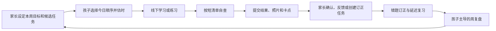

首期不要求新增全部功能。可以先用现有任务、孩子备注、`needsHelp`、错题、知识点和周报
人工跑通一个数学单元；普通任务的孩子完成作品当前不能稳定绑定到任务，P0 由家长现场查看
或在家庭侧暂存，不能把错题/任务材料字段当作通用作品集。只有已证实的摩擦才进入开发队列。

### 1.3 目标与非目标

目标：

- 让三个孩子都能在符合年龄的支架下完成“计划—执行—检查—求助—复盘”；
- 对每个孩子独立记录学习证据，不做兄弟姐妹排行榜；
- 将数学错题从一张照片转化为可复习的知识点、错因、订正和再练习；
- 让家长每周用 10–20 分钟掌握重点，而不是持续盯屏；
- 让支架使用逐步减少成为长期成效，而不是单纯追求任务数和使用时长。

非目标：

- 替代学校、教师、教材或专业诊断；
- 自动识别并判定儿童手写答案；
- 让孩子自由访问 DeepTutor 聊天、联网搜索、代码执行或管理界面；
- 用 AI 自动确认错因、成绩、掌握度或处分；
- 在首期支持所有学科、所有教材版本或完整 K12 图谱；
- 建设社交、班级、教师管理、实时监控或兄弟姐妹竞争系统。

---

## 2. 约束、假设与设计原则

### 2.1 已知约束

| 类别 | 条件 | 设计响应 |
| --- | --- | --- |
| 用户 | 四年级 1 人、一年级 2 人 | 同一数据模型，分龄交互和默认支架 |
| 终端 | 孩子主要使用 iPad 和 Apple Pencil | 触控优先；线下书写；拍照/PDF 上传；不依赖鼠标键盘 |
| 主机 | 家庭旧电脑、8 GB 内存、250 GB SSD、Ubuntu Server | 核心服务优先；AI 按需启动；限制并发和资源 |
| 网络 | 首期仅局域网 | 单一 Gateway 入口；不开放数据库、DeepTutor 或 K12 端口 |
| 学科 | 先试点数学 | 课程映射、检查清单和复习规则先按数学验证 |
| 规模 | 一个家庭、三个孩子 | 不做多租户商业运营优化，但家庭边界仍必须严格 |
| 审核 | 家长人工看作业和订正 | 手写 OCR 与 AI 判分不进入关键路径 |
| 当前能力 | 家庭成长 MVP 已有任务、错题、知识点、周报、媒体和奖励 | 优先扩展现有服务，不新增常驻微服务 |

### 2.2 设计原则

1. **逐步放手。** 系统衡量孩子需要多少支持，并逐渐把计划、检查和反思责任交给孩子。
2. **证据先于判断。** 照片、孩子解释、家长观察和延迟再练习先保存，掌握判断随后发生。
3. **人工最终负责。** AI 内容是候选；家长批准、审核和纠错不可被跳过。
4. **最小儿童数据。** 只收集支持当下学习闭环的数据，不记录常态化屏幕、音视频或情绪监控。
5. **不做横向排名。** 只比较同一孩子自身的策略、支架和学习证据变化。
6. **确定性优先。** 日期、状态、权限、提醒、统计和掌握事件由规则处理，不交给大模型决定。
7. **故障可降级。** AI、K12 或网络故障不能阻断日常任务和纸笔学习。
8. **延用服务边界。** 新能力优先进入现有业务所有者；跨服务通过 API/事件，不跨库写入。
9. **离线活动优先。** 软件负责开始、提交和复盘；真正的书写、演算、朗读和操作尽量离屏。
10. **部署可恢复。** 使用真实儿童数据前，必须建立并演练 MongoDB、私有媒体和配置恢复。

---

## 3. 当前能力、缺口与实施阶段

### 3.1 能力矩阵

| 学习环节 | 当前 LMS | 首期处理 | 后续增强 |
| --- | --- | --- | --- |
| 家庭/孩子身份 | 已有家庭、第二家长、孩子 PIN | 直接复用 | 无 |
| 家长布置任务 | 已有 `GrowthTask` | 直接复用 | 任务模板与周期实例 |
| 孩子选择今日顺序 | 未正式建模 | P0 用纸卡/孩子备注；P1 增加日计划 | 周计划 |
| 估时与实耗 | 任务已有预计/实际分钟 | P0 人工使用；P1 增加孩子估时 | 偏差趋势 |
| 自查 | 尚无结构化短清单 | P0 写在任务描述；P1 清单快照 | 按题型模板 |
| 求助 | `needsHelp` 随完成表单提交，接口同时把任务设为 completed | P0 当面求助；P1 增加独立求助及处理入口 | 支持级别和趋势 |
| 作品证据 | 媒体层已允许 `task_completion` 图片，但任务尚未保存稳定引用 | P0 家长现场查看普通作品；P1 把完成图片绑定到任务 | PDF 完成作品、作品集 |
| 家长确认 | 已有确认状态 | 直接复用 | 反馈提示模板 |
| 错题/知识点 | 已有错题、媒体、知识点 | 人工录入和审核 | K12 候选映射 |
| 周复盘 | 成长记录已有 childReflection，周报已有家长反馈 | P0/P1 复用现有记录与周报 | 孩子结构化周反思 |
| AI 讲解/出题 | 只有拟议完整设计 | 不进入 P0 | 家长审核后按需启用 |
| 间隔复习 | 错题有复习日期，通用队列不足 | P0 人工安排 | 只读复习投影/计划 |

### 3.2 分期范围

| 阶段 | 目标 | 新开发 | 退出条件 |
| --- | --- | --- | --- |
| P0：人工使用与基线观察 | 观察当前流程与操作负担 | 使用现有任务、备注、错题、周报 | 取得基线和具体场景，可与 P1 补齐并行 |
| P1：本轮自主学习 MVP 补齐 | 跑通数学学习与人工反馈 | 按第 15.2 节六个工作包逐项交付 | 功能验收后，三个孩子完成四周/至少一个数学单元的家庭验证 |
| P2：验证后习惯与复习增强 | 降低已证实的重复负担 | 按需选择模板实例、结构化周反思、复习视图、支持级别/趋势 | 由真实使用问题决定是否进入，不要求全部实现 |
| P3：AI 辅助 | 提高讲解和变式题供给 | 按现有 AI 设计接入 DeepTutor、人工审核制品 | AI 故障可降级；内容质量经家长验收 |
| P4：课程图谱增强 | 改善知识点映射和先修关系 | 小范围 K12 卡片/只读 Adapter | 一个教材版本、一个年级章节验证有效 |

本轮“MVP”指在现有家庭成长 MVP 上补齐自主学习闭环，不表示原有代码或发布基线失效。
P0 观察不再是必须等满四周才能开发 P1 的串行门槛；四周家庭验证用于检验补齐后的 P1。
P2、P3、P4 和第 18 节长期项目均在本轮 MVP 验证完成后按需求重新排序，并非必须依次实现。

### 3.3 本轮范围上限

本轮必须交付：普通任务图片作品提交及家长查看、进行中独立求助、短自检清单与基本分龄
操作、今日顺序与孩子估时、人工订正/复习连接、复用现有记录的周复盘，以及对应家庭部署验收。
具体顺序与完成标准以第 15.2 节为准。

以下内容先人工完成：题干和错因确认、讲解和选题、复习日期设置、知识图绘制、家长最终审核。
孩子周反思先复用成长记录的 `childReflection`；周报继续使用现有家长反馈。支持级别可以
先写在备注中观察，不要求第一版引入 S0–S4 采集和统计。

验证后再评审：重复任务模板、通用复习队列/间隔算法、结构化周反思、支架趋势、DeepTutor
完整集成、K12 映射、错题打印包、长期项目、普通完成作品 PDF 和语音输入。本文后续章节
保留这些设计作为储备，不得仅因存在字段示例、时序图或 API 草案就纳入本轮开发。

本轮复用现有服务与账号权限，不新增微服务、聊天系统、自动调度平台、通用工作流引擎或
完整作品版本库。分龄仅调整同一页面的字段、提示和操作密度，不开发两套独立客户端。

---

## 4. 总体架构

### 4.1 业务协作架构

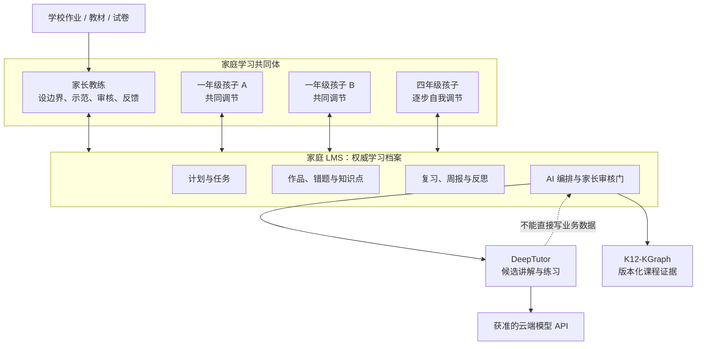

### 4.2 逻辑组件

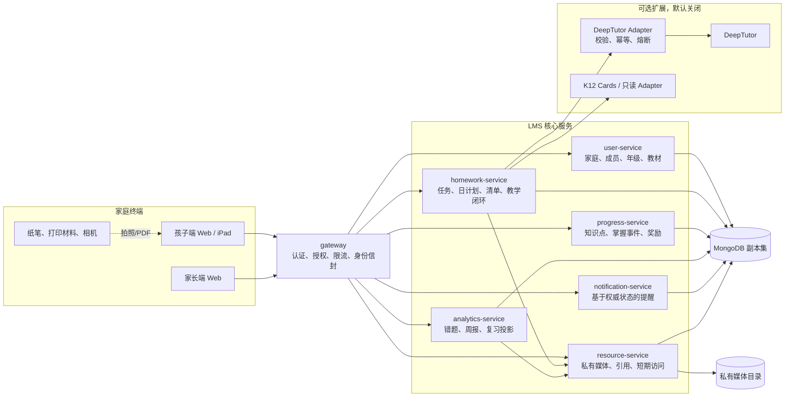

### 4.3 组件职责与禁止事项

| 组件 | 负责 | 明确不负责 |
| --- | --- | --- |
| 孩子端 | 今日顺序、估时、开始、短清单、提交、求助、反思 | 查看兄弟姐妹记录；直接访问 AI 管理面 |
| 家长端 | 任务/模板、审核、错题、知识点、反馈、周复盘、AI 候选审批 | 常态化实时监控；用 AI 输出自动处分 |
| `gateway` | JWT/PIN、家庭和孩子授权、签名身份上下文、公开 API 聚合 | 保存业务事实；直通 DeepTutor/K12 |
| `user-service` | Family、家长、孩子、年级和教材版本 | 学习任务、掌握度或 AI 会话 |
| `homework-service` | `GrowthTask`、日计划、清单快照、教学循环编排 | 直接改错题或知识点数据库 |
| `resource-service` | 私有媒体生命周期、purpose/scope、引用协议、签名访问 | 判断作业正确性；公开底层路径 |
| `progress-service` | `KnowledgePoint`、掌握事件、奖励流水 | 采信 AI 或上传行为作为最终掌握证据 |
| `analytics-service` | `FamilyMistake`、周报、复习只读投影 | 跨服务写任务；改写冻结周报历史统计 |
| `notification-service` | 从权威状态派生提醒 | 自建第二套任务状态；根据 AI 会话直接提醒 |
| DeepTutor Adapter | LMS 稳定契约、输出 Schema、幂等、超时、熔断 | 绕过审核门；接受任意工具或路由 |
| DeepTutor | 候选讲解、提示、例题和变式题 | 写 LMS；自动判定掌握；面向孩子自由聊天 |
| K12 Adapter | 版本化、只读课程节点和关系 | 保存 `familyId`/`childId`；决定孩子掌握度 |

### 4.4 为什么首期不增加新微服务

日计划、任务清单和任务完成证据与 `GrowthTask` 生命周期高度一致，首期放入
`homework-service` 的内部模块最简单。复习视图先由已有错题和知识点生成只读投影；只有在
跨学科调度、队列规模或独立发布需求真实出现后，才评估拆分。这样可以减少 8 GB 主机的
常驻内存、部署单元和跨服务事务。

---

## 5. 数据设计

### 5.1 聚合关系

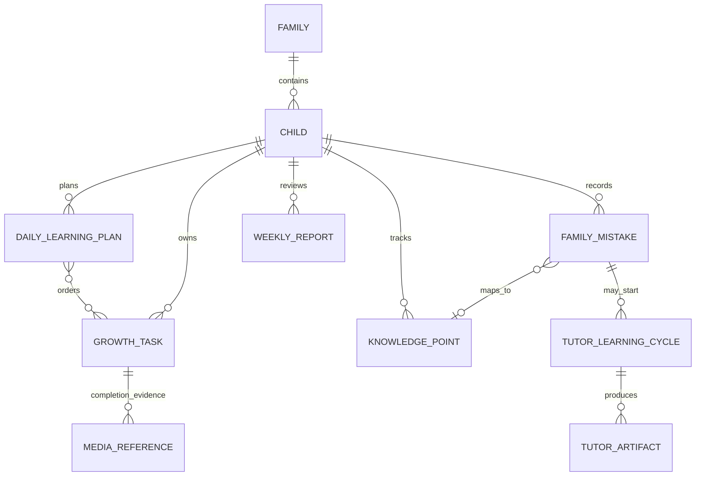

该图表达业务关联，不表示允许跨服务数据库联表或跨库写入。

### 5.2 `DailyLearningPlan`（P1 新增，`homework-service` 所有）

```text
DailyLearningPlan
  planId
  familyId
  childId
  localDate                    // 家庭时区 YYYY-MM-DD
  items[]                      // 有序，建议 1–3 项，硬上限 20
    taskId
    childEstimatedMinutes?     // 1..240
    estimateRecordedBy?        // 服务端 actorId/role，缺失不推断
  version                      // 乐观并发版本
  updatedByActor               // 最近一次计划写入者，服务端生成
  createdAt
  updatedAt
```

约束：

- 唯一键为 `{ familyId, childId, localDate }`；
- `taskId` 必须属于相同 `familyId + childId`，且处于允许展示的状态；
- 同一计划内 `taskId` 不重复；
- 日计划只表达焦点顺序，不修改任务 `dueDate`，也不复制任务状态；
- 孩子只能编辑自己的计划；家长可为本家庭任一孩子编辑；
- 请求携带 `expectedVersion`，版本不匹配返回 `409 VERSION_CONFLICT`；
- 服务端按已验证身份补齐 `familyId/childId`，不信任请求体中的作用域字段；
- 跨日后历史计划只读；迟到任务仍由任务查询规则决定，不靠复制进新计划。
- 短/中/长只是 5/15/30 分钟快捷值，可留空/改分钟，不是能力或时限。estimateRecordedBy 只在
  估时新增/改变时更新，重排保留旧归属；updatedByActor 记录本次写入者。字段白名单与 null 语义以 API §14.4 为准。

### 5.3 `GrowthTask` 的 P1 最小扩展

不改变现有单次任务语义和状态机，仅增加自主学习证据：

```text
checklistSnapshot[]             // 最多 5 项
  itemId
  label                         // 家长可见文本，限制长度
  required
checklistVersion                // 无/空清单为 0；非空清单从 1 开始

completionEvidence?
  checkedItemIds[]              // 引用当前 checklistVersion
  completionMediaIds[]          // 最多 10 张图片，purpose=task_completion；本轮不扩展 PDF
  difficulty?
  needsHelp?                    // 完成时的兼容性困难回顾
  childNote?
  submittedByActor
  childSubmittedAt
```

T1 第六批的加法字段定义还包括 completionVersion、completionMediaReferenceState，以及隐藏的
completionMediaBindings、activeCompletionOperation、completionPending。稳定证据保存
actualMinutes/actualAmount（可选）和 subjectChildId；服务端写 submittedByActor 与 childSubmittedAt。
completionPending 保存 PREPUBLISH/PUBLISHED_CLEANUP、阶段版本、期望/目标版本、hash、最小 patch、
目标媒体及旧绑定差异集合、remoteOutcomeUncertain；远程 UUID 的权威映射只在本地 operation 中。
旧任务缺失这些字段不写默认值，服务读取投影版本 0。所有服务均未注入生产，清单写入与旧 HTTP
写入口锁的接入不在本批，不能将上述模型定义视为增强接口已经开放。实现及证据见增量 Gate §18.7。

进行中独立求助的 `helpType`：

- `instruction_unclear`：没看懂要求；
- `cannot_start`：不知道怎么开始；
- `stuck_midway`：做到一半卡住；
- `uncertain_result`：完成但不确定；
- `fatigued`：当前精力不足；
- `other`：其他，由简短 `note` 补充。

`supportLevelUsed`（P2 储备，以下分级用于解释，不是本轮必填项）：

| 值 | 含义 | 示例 |
| --- | --- | --- |
| `S0` | 独立完成 | 自己计划、检查并提交 |
| `S1` | 环境/提醒支持 | 计时器、安静位置、提醒看清单 |
| `S2` | 策略提示 | “先画图”“先读题两遍” |
| `S3` | 共同完成部分步骤 | 家长示范一题或共同拆解 |
| `S4` | 成人主导 | 家长带着完成；说明任务或难度需调整 |

业务规则：

- 清单不是测验；一年级默认 1–3 项，四年级默认 2–5 项；
- 家长在任务未完成时可更新清单，并递增 `checklistVersion`；
- 创建任务时未提供或显式提供空清单使用 `checklistVersion=0`，提供非空有效清单使用
  `checklistVersion=1`；
- 孩子提交时携带 `expectedChecklistVersion`，过期返回 `409` 并刷新清单；
- `required=true` 的项未勾选时，前端提醒并提供独立求助入口；求助不能触发任务完成。
  孩子明确选择完成时可以保留未勾选项供家长审核，勾选结果不作为正确性或掌握判断；
- 媒体在同一请求中按现有 prepare/bind 引用协议绑定；未完成绑定返回现有
  `MEDIA_REFERENCE_PENDING` 恢复语义；
- 完成作品和任务材料使用不同 purpose；不得把任意 URL 当作作品证据；
- 当前完成接口允许 `pending/completed → completed`，确认前可以更新完成信息，
  `confirmed/cancelled/archived` 拒绝继续完成。P1 沿用该语义：确认前更新当前作品，
  确认后冻结完成内容；不增加多轮提交版本库，也不声称当前已经实现不可变提交历史；
- 作品更新与家长确认必须做原子状态/版本校验，家长只能确认自己看到的那版完成内容。
  媒体引用待恢复时先收敛，不得确认尚未稳定的作品；
- 教学上的订正创建独立任务或错题，保留来源，原任务不重新变为 pending。

T1 第七批独立确认服务落实上述版本确认：确认与完成占位写同一任务文档，使用版本/状态/owner CAS
和本地事务；确认成功不递增作品版本，先固化确认审计和 pending 发星，再经既有 Task 5 client 发星。
远端丢响应或本地结果未知时由同版本重试恢复，不覆盖首次确认人、时间和反馈；当前有权限的共管
家长可代为恢复，任务审计与远端请求授权人明确分离。生产路由仍未接入，测试证据见增量 Gate §18.8。

T1 第八批独立任务 mutation 服务复用现有编辑白名单，在同一事务内完成实时家长授权、状态/版本/
__v CAS 与无 owner/pending 检查；只编辑 pending 任务的非材料字段。删除转换为取消或归档，
不物理删除、不改作品/发星事实；confirmed 发星 pending 时拒绝归档。读取旧快照后出现新完成
owner 时，写冲突重试必须重新鉴权和检查锁，不能仅检查最初快照。结果未知只返回可重试错误；
重新读取后执行，取消/归档终态重试无写入，普通编辑不是新增幂等命令协议。
此能力未注入生产；材料附件、T2 清单和旧 HTTP 入口统一接入不在本批，见增量 Gate §18.9。

#### 进行中独立求助（P1）

`needsHelp` 继续表示完成时的困难回顾；`helpType` 只属于当前 `helpRequest`。新增求助操作在任务
保持 pending 时保存卡点类型、短说明和待处理/已处理状态，由家长端列出并处理；可以在任务上
嵌入一条当前求助记录，记录服务端时间和实际操作人，第一版不建立消息会话或求助历史系统。
`supportLevelUsed` 继续作为 P2 储备，不进入本轮完成请求或求助请求。

独立求助、家长处理求助都不能改变任务主状态、产生星星或修改掌握度。已处理后可以再次
求助；重复操作不得重复创建提醒。任务后来完成仍可保留待处理求助，由家长明确处理；任务
取消/归档后停止显示可行动求助，保留审计字段。完成路由不得意外清空独立求助内容。
request 的安全重放必须同时满足：当前记录仍为 pending、
`currentHelpVersion === expectedHelpVersion + 1`、规范化后的 `helpType + note` 完全相同，且
认证 actor 与 `requestedByActor` 相同。旧版本 resolve 返回 `409 VERSION_CONFLICT`，客户端重新
读取当前求助后由用户决定是否再次处理。
具体字段和路由已进入正式 API 契约，拒绝其他孩子和跨家庭访问。

2026-10-25 T3 实施补充：只新增当前求助子文档和独立 helpVersion，不新增跨服务账本。
仅 pending 可新 request；已有求助可在 pending/completed/confirmed 上 resolve，后两者不会因此
解冻作品。cancelled/archived 保留记录但拒绝写入与重放。NFC+trim 后按 Unicode 码点校验
200 字；缺省文本为空字符串，null 拒绝。未知提交结果保留原请求，旧 resolve 冲突后重新读取，
不升级版本自动处理。普通完成事务、材料修改与求助各自只更新所属字段，通过事务冲突重试及
最终任务状态/helpVersion 条件避免丢写。读取不初始化历史任务，也不转换 needsHelp。
正式 enabled 工厂装配求助接口，保留原启动预检、默认关闭和旧客户端拒绝边界。
前端复用会话隔离及任务页；求助筛选清除原日期/任务状态限制，沿用任务分页。
无真实数据迁移或新增索引；若后续测量发现瓶颈，按 Gate §5 用查询计划决定。

### 5.4 任务模板（P2，非首期）

`GrowthTaskTemplate` 只负责生成单次 `GrowthTask`：

```text
GrowthTaskTemplate
  templateId, familyId, childId
  title, dimension, defaultChecklist[]
  scheduleRule, timezone
  active | paused | archived
  lastGeneratedLocalDate
  version
```

- 每次实例有独立 `taskId`、状态、媒体和反馈；
- 不让一个任务对象每天在 `pending/completed` 之间循环；
- 生成使用 `{templateId, occurrenceLocalDate}` 唯一键幂等；
- 计划规则变更只影响未来实例；
- 不在 P1 为了“每日习惯”提前引入调度器。

### 5.5 周反思（P2）

在不改写 `WeeklyReport` 冻结统计的前提下，增加可变的反馈区：

```text
childReflection
  proudOf?             // 我本周最满意的事
  strategyThatHelped?  // 什么方法有用
  needHelpWith?        // 哪件事还需要帮助
  nextGoal?            // 下周一个可执行目标
  updatedAt
  updatedBy
```

统计快照继续按现有 ADR 冻结；孩子反思与家长反馈作为独立可变字段保存审计信息。不得用 AI
自动代写孩子反思。

### 5.6 复习视图

P1/P2 不新增第二套“错题状态”。复习页面先聚合：

- `FamilyMistake.reviewReminderDate` 到期且仍需处理的错题；
- `KnowledgePoint.lastReviewedAt`、掌握状态及家长选择的重点；
- 已创建的订正/再练习 `GrowthTask`。

该页面是只读投影。真正的状态仍由各自所有服务维护。若以后需要通用间隔算法，先新增 ADR，
明确 `ReviewSchedule` 的所有者、重排规则和删除语义，再实施持久化队列。

### 5.7 AI 子域数据

`TutorLearningCycle`、Attempt、GenerationJob、Artifact、最终审核、幂等记录、outbox 和
掌握事件扩展完全沿用 [AI 平台设计](./family-ai-learning-platform-design.md) 与
[机器契约目录](../contracts/)。本文不另定义简化版本。特别是：

- AI 生成内容只能是 candidate；
- 家长批准后才能进入孩子页；
- 孩子提交图片不等于答案正确；
- OCR/模型输出不能单独产生掌握事件；
- 最终审核和跨服务写入必须遵守既有冻结、幂等和收敛命令。

---

## 6. 状态与业务规则

### 6.1 任务主状态保持不变

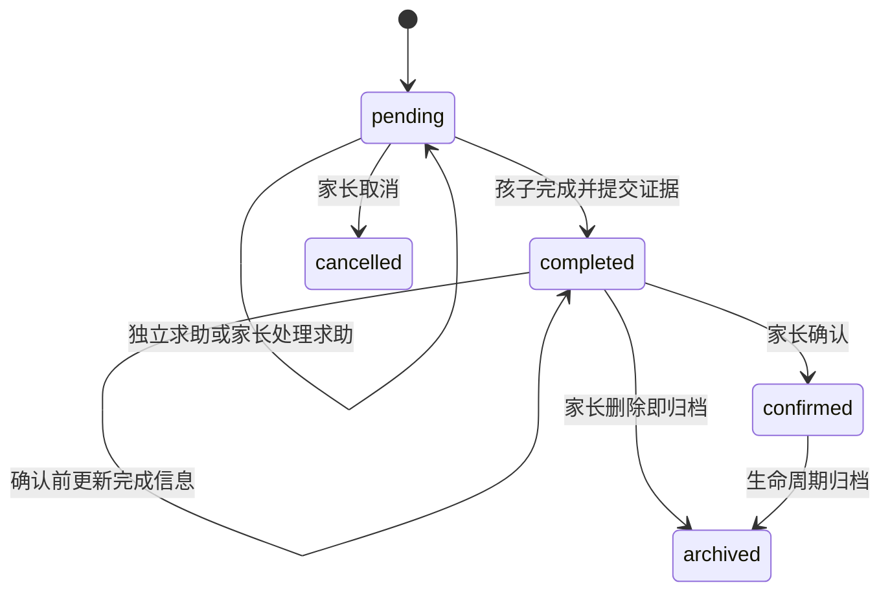

具体合法转移仍以当前架构/API 为准。P1 不新增 `started`、`returned`、`reopened` 等状态，
避免扩大并发与迁移范围：

- “开始”是界面行为，不是必须持久化的业务事实；
- 家长发现需要订正时创建关联的新任务或错题；确认后的完成证据保持冻结；
- 日计划只排序，不拥有任务状态；
- `needsHelp/helpType/supportLevelUsed` 是学习过程证据，不是任务主状态。

### 6.2 支架逐步放手规则

以下是家庭指导原则；S0–S4 的结构化采集和趋势属于 P2。本轮先用观察和现有备注实践。

支架不是自动升级的惩罚等级。系统只给出趋势，家长决定调整：

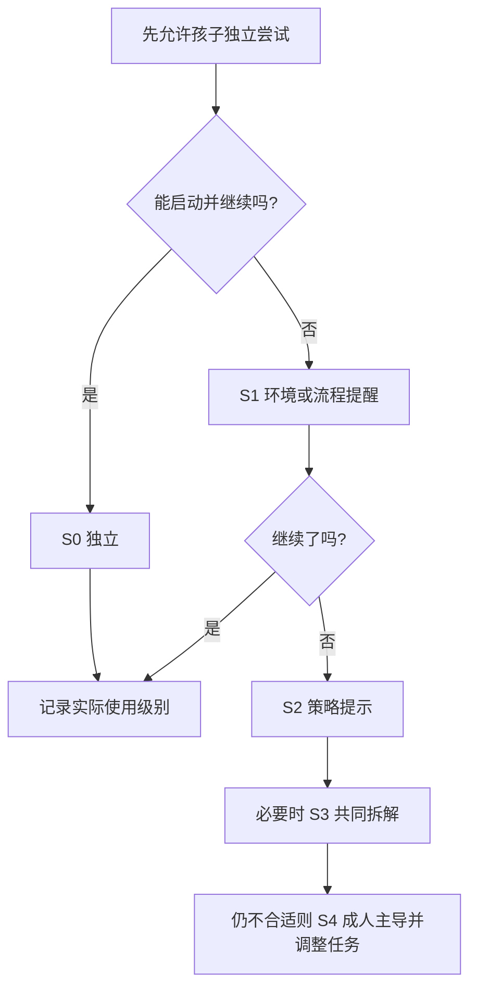

- 同类任务连续表现稳定时，家长下次少给一级支持；
- 支持增加不扣星、不公开比较，不解释为能力下降；
- `S4` 频繁出现首先检查任务难度、说明、睡眠、环境和时间，而不是责备孩子；
- 系统不依据一次数据自动调整年级、教材或掌握度。

### 6.3 年龄默认值

| 设计项 | 一年级 | 四年级 |
| --- | --- | --- |
| 今日焦点任务 | 1–2 项，家长共同选择 | 2–3 项，孩子先排序 |
| 估时 | 可选短=5/中=15/长=30 分钟快捷值，可留空；家长输入明示代录 | 可改填 1–240 分钟，保留实际输入者；不以偏差评分 |
| 清单 | 1–3 项、短句、图标、可朗读 | 2–5 项，按题型选择策略 |
| 反思 | 口述或点选，家长转录 | 孩子输入一句证据和下周目标 |
| 求助 | 大按钮和口头描述 | 先选择卡点，再写一句已尝试策略 |
| 屏幕角色 | 开始/提交/复盘，主要线下 | 可短时查看材料，仍优先纸笔 |
| 家长参与 | 共同调节为主 | 每日抽查、每周教练式复盘 |

---

## 7. API 边界与交互约束

正式 API §14 是 P1 字段、错误码和响应的唯一权威，T0 已登记 PLANNED 契约；本节仅保留关系、交互与
恢复不变量，不维护第二份完整请求体。校验器和拒绝测试仍待 T1–T7 实现。第 7.4/7.5 的结构化周反思和
复习队列为 P2 储备，不能替代本轮复用入口；`supportLevelUsed` 继续作为 P2 储备。

### 7.1 日计划

```http
GET /api/children/:childId/daily-learning-plans/:localDate
PUT /api/children/:childId/daily-learning-plans/:localDate
```

请求/响应与实际输入者语义见[正式 API §14.4](../api/family-learning-tracker-api.md#144-sl-04每日学习计划)。

响应必须带最新 `version`。孩子 token 只能访问自身 `childId`；家长 token 必须属于同一
`familyId`。日期按家庭时区验证，不能用服务器 UTC 日期替代家庭本地日期。

### 7.2 家长创建/修改任务清单

复用当前任务创建/修改路由，字段与版本见[正式 API §14.2](../api/family-learning-tracker-api.md#142-sl-01sl-03任务清单和完成作品)。

服务端生成或严格校验 `itemId`，防止重复和不可显示字符。更新成功递增
`checklistVersion`。

### 7.3 孩子完成任务

T0 已固定本节契约；字段、错误码和恢复行为以
[正式增量 API 契约](../api/family-learning-tracker-api.md#142-sl-01sl-03任务清单和完成作品)为准。
复用当前完成路由；完整请求与响应只在上述 API 维护，本节约束其执行顺序。

`operationId`、`expectedCompletionVersion` 和 `expectedChecklistVersion` 均为必填。
`supportLevelUsed` 不在本轮请求中；进行中求助使用独立 help 路由。服务端先重新授权和校验
schema，再做幂等查询与版本 CAS。首次执行必须在任何远程媒体调用前原子保存命令占位、
pending 意图、远程标识、目标代次和不确定标记；随后使用同一持久化远程标识依次 prepare、commit、发布稳定
结果并 unbind 旧代次。相同幂等作用域和相同规范请求重放同一结果，不同请求返回
`409 IDEMPOTENCY_KEY_REUSED`。未知结果返回 `503 MEDIA_REFERENCE_PENDING`，只允许相同 PATCH
和原 operationId 重放；GET 不触发恢复。

本地命令保留客户端 operationId/actor/action 的幂等作用域；另由 homework-service 为每条新命令
生成 UUID `remoteOperationId`，远程标识与首次命令占位同事务持久化，含新增集合为空的命令。
建立全局 remoteOperationId 唯一索引，不同 actor 使用同一 UUID 必须分配不同远程标识。
本地幂等键竞争重读原命令；仅远程 UUID 碰撞且占位事务确认回滚、无远程调用时可重新分配。
事务提交结果未知时先恢复原事务结果/重读命令，不发送未确认持久化的标识，不重建映射。
映射不可变，重试/重启/运维恢复读取原值，与终态一同保留、不单独 TTL；缺失映射阻断并告警。
内部 operationId 必须取持久化 remoteOperationId：prepare/commit/abort/status(operation) 保留内部
字段名 operationId，但它不再是客户端 UUID；响应身份及摘要/作用域必须匹配才可驱动本地状态。
新增 bindingOperationId 使用当前远程标识，保留项沿用旧值；unbind 命令使用当前远程标识，
移除项 bindingOperationId 使用持久化旧远程代次。references 模式不携带命令标识。
remoteOperationId 不接受公开输入、不进入公开响应，不加入本地规范请求哈希；纯删除也复用映射，
不创建空的远端 operation。发布前验证两个本地唯一索引和远端索引，回滚保留映射；缺失映射的试验
记录必须停用并另行评审修复，不能回退到客户端 UUID。

完成命令保存不可变成功响应投影 `successResponse`，字段固定为正式 API 的 taskId、status、
checklistVersion、completionVersion、有序 completionMediaIds、引用状态、parentConfirmed 和 completedAt。
投影与作品发布同事务保存，命令成功后才返回；之后作品更新、确认或归档不改变重放响应，当前状态
由 GET 获取。只保存最小响应，不保留备注、图片正文或签名 URL；媒体访问继续实时授权。

每个任务最多一个活动完成命令。`activeCompletionOperation` 保存完整命令作用域，首次占位的 CAS
要求其为空并检查版本/状态，恢复的 CAS 校验同 owner/阶段/目标版本。从占位到终态期间，完成新写、
清单编辑、任务编辑、确认、取消和归档在最终原子写入中受锁保护，返回 `503 MEDIA_REFERENCE_PENDING`；
不能只依赖客户端禁用按钮。鉴权/schema/同 key 异正文冲突及已终态命令重放先于锁检查。
独立 help 只局部更新求助字段；材料引用 pending 阻止新完成占位，恢复后新写须重新 GET。

仅首次进程内 prepare 直接返回经认证、结构完整且带匹配 commandHash 的 ABORTED 终态的
稳定业务拒绝时，homework-service 才以事务/CAS 把命令收敛为失败、
清除 pending 意图并恢复上一稳定作品。该路径不得递增 `completionVersion`、改写完成证据或执行
bind/unbind；相同命令重放同一失败结果，用户修正内容后使用新的 `operationId`。
恢复执行不得凭后来收到的稳定 4xx 清理 pending 意图；首次稳定拒绝的收敛事务结果未知时仍进入
`MEDIA_REFERENCE_PENDING`，不能猜测已经回滚。

pending 意图保存完成恢复所需的最小规范业务 patch 及哈希，包含清单勾选、完成自评、实际量和
服务端认证 actor，不保存图片正文或签名 URL；成功或稳定失败后清除临时 patch。媒体目标按
新增集合、保留集合和移除集合处理：只 prepare/commit 新增集合，保留集合沿用原绑定代次，发布
后只 unbind 移除集合；各阶段不发送空媒体命令。纯重排和仅非媒体更新只发布本地 patch；
删除图片时新增为空也仍需解绑非空移除集合。

若首次远端结果与本地失败收敛结果都未知，恢复程序通过 resource-service 的内部只读 status
接口做受控引用状态对账。resource-service 为新完成字段持有 `MediaReferenceOperation`，
以完整 scope/field/operationId 为唯一键，其中 operationId 是 remoteOperationId，校验 commandHash
（含本地客户端 operationId、actor/action，不含生成的远程标识）及规范新增集合摘要。
内部同键异摘要仍阻断并告警，不能凭冲突清锁；合法跨 actor 命令使用不同远程键。
状态为 PREPARED/COMMITTED/ABORTED；ABSENT 仅为无记录投影。终止与提交必须竞争同一 operation 记录，
每个写命令以记录版本 CAS、引用变更同事务提交，冲突重读。abort 对 ABSENT 也写 ABORTED 终止标记，
对 COMMITTED 只返回提交已成功；ABORTED 永远拒绝迟到 prepare/commit 的副作用。

租约过期原子转为 ABORTED，同时释放本 operation 的 prepared 引用；资源服务按 now >= leaseExpiresAt
判断，prepare 重放不续租，prepare/commit/abort 的请求路径都处理过期。status 只读并返回服务器
leaseExpired；无需后台清理才能恢复。终态记录不做 TTL 删除，媒体回收保留最小标记，新协议清理
不得直接删除 prepared 行。业务拒绝也先提交 ABORTED 再响应，裸 4xx/5xx 不证明已终止。
prepare/abort 的租约决策在异步完整性查询后重新采样；commit 在资产写屏障后再次采样。
响应投影在最终引用读取后独立采样，不用旧时间掩盖过期；决策后才到期的 PREPARED/leaseExpired=true
不是成功或有效租约凭证，下一次 commit/abort 仍须重新检查并原子终止，不能据此发布或清锁。
完成作品隐私删除涉及 PREPARED 时整组终止；commit 胜出保留 COMMITTED 终态，并按正式 API 的
MediaDeletionTombstone 精确凭证释放目标媒体 bound，禁读不受教学冻结限制。新协议、唯一索引、公共 client、软删除/回收路径需匹配
部署后才启用新完成字段；回滚保留两端记录，不允许旧协议绕过终态，事务重试重新校验服务器时间。

先读本地阶段；PREPUBLISH 中 absent 不能作为失败终态证据：operation ABSENT 或租约过期调用原 abort，
有效 PREPARED 继续 commit。仅匹配摘要的 COMMITTED 且新增引用全部同代次 bound 或具有精确 privacyDeletion 凭证才发布；仅匹配
ABORTED 才本地终止失败。abort 返回 COMMITTED 时继续发布，不回滚。EXPIRED/ABORTED 映射为公开
409 稳定失败码，原命令重放同一失败。其他代次、矛盾或未知结果保持 pending。
新增集合为空时不进行全称状态判断，直接发布本地 patch。

发布事务递增版本、固化响应投影并转入 `PUBLISHED_CLEANUP`，仍持有 owner 和 pending_recovery。
发布后不得回滚已发布作品，不再 prepare/commit 或重复发布。此时只对账移除集合：bound 且旧
bindingOperationId 相同则以当前 remoteOperationId 重放 unbind；released 且旧代次相同或完整身份 absent
视为已解除，后者依赖活动命令锁禁止并发重绑。其他代次/prepared 阻断并告警；合法混合逐项收敛。
移除集合全部收敛后，事务置 SUCCEEDED/stable 并清除 pending/owner；无移除项可在发布事务直接终结。
本地结果未知先读阶段，不凭远端状态猜测是否已发布。只读 status 返回实际 bindingOperationId，
不按请求 operationId 隐藏其他代次，releaseOperationId 仅审计。发布后使用 references 模式查询移除
集合，不能把移除集合当作原 commandHash 的新增集合，也不得调用 abort。查询失败继续 MEDIA_REFERENCE_PENDING。
接口使用服务凭据且不经 Gateway，不返回媒体内容或存储位置。

### 7.4 周反思

```http
GET   /api/reports/weekly/:weekStart/children/:childId
PATCH /api/reports/weekly/:weekStart/children/:childId/reflection
```

孩子只能修改自己的 `childReflection`；家长可以协助更新但必须记录 `updatedBy`。禁止通过此
路由修改冻结的任务数、星星、错题数或掌握统计。

### 7.5 复习视图

```http
GET /api/children/:childId/review-queue?asOf=YYYY-MM-DD
```

Gateway 可聚合或由 `analytics-service` 使用最小只读仓储生成。返回来源类型、来源 id、到期日、
标题和允许操作，不生成新的权威状态。分页和硬上限必须存在。

### 7.6 权限矩阵

| 操作 | 家庭 owner | 第二家长 | 孩子本人 | 其他孩子 | 跨家庭用户 | AI/K12 |
| --- | --- | --- | --- | --- | --- | --- |
| 查看自己的日计划 | 是 | 是 | 是 | 否 | 否 | 否 |
| 调整孩子自己的顺序 | 是 | 是 | 是 | 否 | 否 | 否 |
| 创建/修改任务和清单 | 是 | 是，按现有共管规则 | 否 | 否 | 否 | 否 |
| 提交自己的完成证据 | 可代办并审计 | 可代办并审计 | 是 | 否 | 否 | 否 |
| 查看私有作品 | 是 | 是 | 自己 | 否 | 否 | 否 |
| 确认任务/错因/掌握 | 是 | 是，按现有规则 | 否 | 否 | 否 | 否 |
| 修改自己的周反思 | 可协助 | 可协助 | 是 | 否 | 否 | 否 |
| 生成候选 AI 内容 | 是 | 是 | 否 | 否 | 否 | 仅内部调用 |
| 批准 AI 内容给孩子 | 是 | 是，按治理规则 | 否 | 否 | 否 | 否 |

所有“是”都要求服务端从已验证身份恢复 `familyId` 并校验资源所属关系，不能只依赖前端隐藏。

---

## 8. 关键交互与页面设计

### 8.1 孩子首页

首屏只回答三个问题：“今天先做什么”“我做到哪里”“需要什么帮助”。

```text
┌─────────────────────────────────────────┐
│ 早上好，小明                  今日 2/3 │
├─────────────────────────────────────────┤
│ 1  口算订正       约 10 分钟      开始 │
│ 2  数学书练习     约 20 分钟      调序 │
│ 3  阅读            约 15 分钟      调序 │
├─────────────────────────────────────────┤
│ [我需要帮助]                    [周回顾] │
└─────────────────────────────────────────┘
```

一年级：更大触控目标、少文字、图标+朗读、一次只显示当前任务。四年级：允许拖动排序、填写
估时和查看简短进度，但不展示复杂统计。

### 8.2 任务完成页

1. 显示任务目标和最多五项检查清单；
2. 孩子离开屏幕完成纸笔任务；
3. 返回后勾选清单，可拍一张或多张作品照片；
4. 选择难度并可用简短备注描述帮助；结构化支持级别留到 P2；
5. 如需要帮助，选择卡点并可口述给家长代录；
6. 提交后显示事实性反馈，不显示兄弟姐妹分数或速度。

不要强迫一年级孩子输入长文本。Apple Pencil 继续用于纸笔或系统批注；上传照片只作为
证据，由家长看，不以 OCR 成败决定流程能否继续。

#### iPad 图片输入与真机验收

不假设 Safari 会自动把 HEIC 转为 JPEG。完成作品只接受 JPEG/PNG/WebP，后端检测真实字节，
不能改后缀冒充格式。现有图片组件的 accept 只是选择提示，不是转码保证；本轮不增加 HEIC 解码器或 OCR。

最小可操作路径：有“设置 → 相机 → 格式 → 兼容性最佳”的设备，先选择该设置，再拍摄新照片并上传 JPEG；
它不会转换历史照片。历史 HEIC 可在 iPadOS 26 的“预览”中打开，菜单选择导出为 JPEG，再从文件选取；
无该功能的旧设备由家长在受控 Mac 预览中导出 JPEG/PNG 再传回本地文件，或重新拍摄 JPEG。
不使用公共在线转换站。设备不具备这些路径时记阻塞，不能把“提示不支持”算作核心流程通过。
依据：[Apple 拍摄与转换说明](https://support.apple.com/en-gb/116944)、
[iPadOS 26 预览导出说明](https://support.apple.com/en-ie/guide/ipad/ipad78347fa8/26/ipados/26)。
这些来源证明系统操作选项，不证明本项目已通过 Safari 测试。

| 用例 | 真实设备步骤及断言 |
| --- | --- |
| TC-SL-IPAD-001 | 记录 iPad 型号/iPadOS/Safari 版本；相机新拍及相册选取，记录实际 MIME/大小和服务器格式识别，上传后孩子/家长回看清晰、方向正确 |
| TC-SL-IPAD-002 | 选择历史 HEIC：若收到 HEIC 则拒绝并提供上述可操作路径；显式导出 JPEG 从“文件”重新选取，成功上传/回看，不假装原 HEIC 已支持 |
| TC-SL-IPAD-003 | 多图、10 MiB 边界、取消选择、错误格式、断网/重试；表单保留、无重复完成/引用，错误明确且可重新选文件 |
| TC-SL-IPAD-004 | 代表性纸笔题目/小字/旋转图片，孩子上传后家长可查看实际内容并确认版本；隐私删除后不显示旧缓存，旧访问链接拒绝 |

本次无实际 iPad 验证，状态 DEVICE_PENDING；不记录真实作业、姓名、Token 或媒体 URL 到仓库。
T2 组件测试可先进行，T8 必须有目标设备至少一条完整可用输入路径和全部负面用例证据，不以 Chromium 模拟替代。

### 8.3 家长审核台

按“需要家长行动”排序：

- 孩子明确求助；
- 待确认的任务；
- 待审核错题/订正；
- 到期复习；
- 待批准 AI 候选；
- 普通已完成记录。

家长操作保持简单：确认、写一条过程反馈、创建订正任务、记录错题、批准/拒绝候选。不得把
“今日所有在线行为”做成监控流。

### 8.4 周复盘页

按以下顺序呈现：

1. 孩子先说/写“最满意的一件事”和证据；
2. 看一项策略或支架趋势，而不是先看完成率；
3. 共同选择一个要继续练的知识点/习惯；
4. 孩子提出一个下周目标；
5. 家长给具体、可行动的反馈；
6. 如需奖励，只认可过程、策略、诚实求助和坚持，不按兄弟姐妹排名。

---

## 9. 关键流程与时序

### 9.1 每日计划

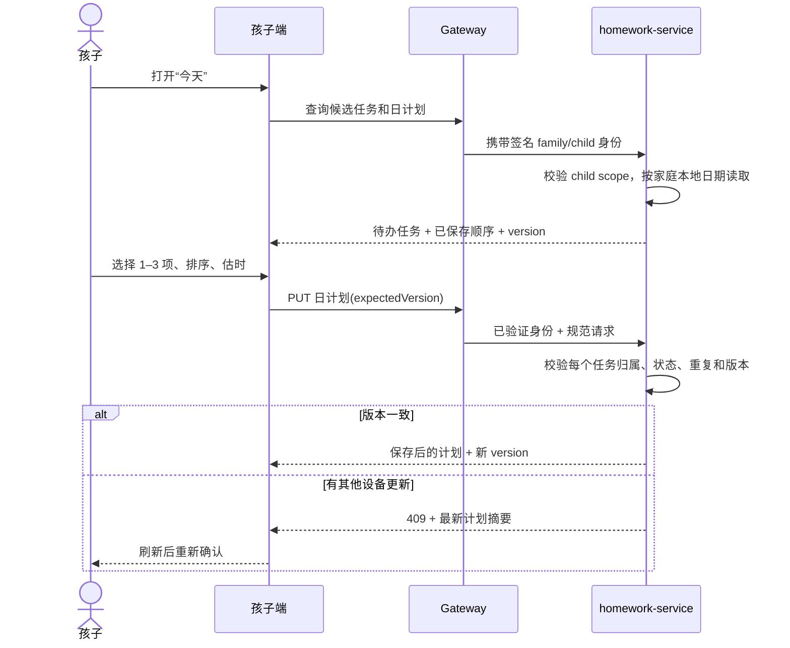

### 9.2 上传作品并完成任务

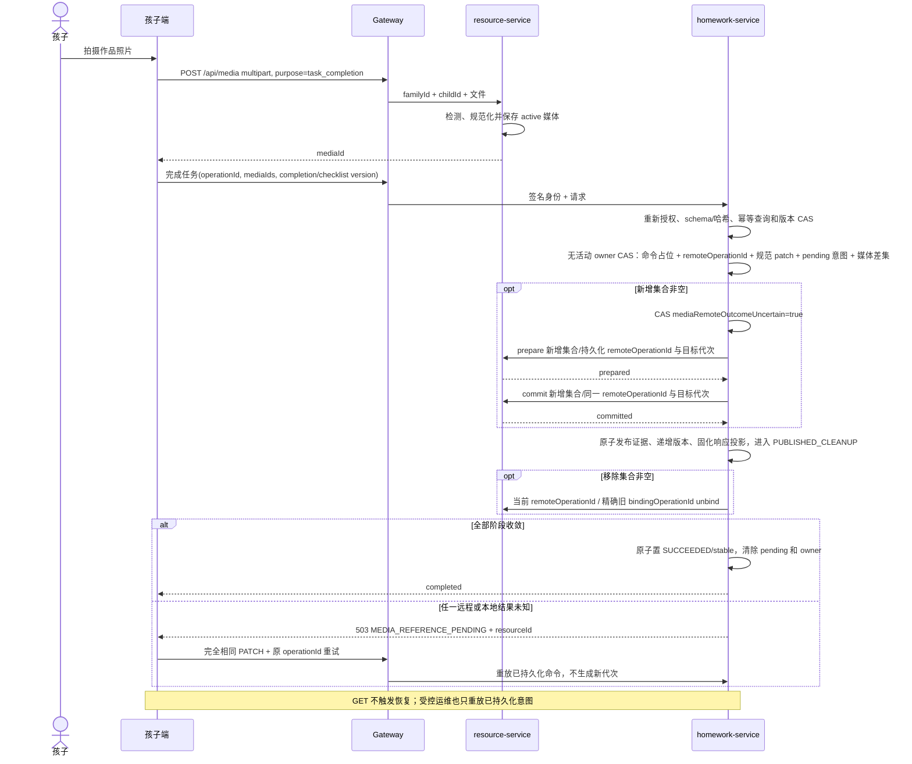

上述“结果未知”不包含已持久化 ABORTED 的稳定业务拒绝。resource-service 明确拒绝 scope、purpose、状态或
其他媒体引用前置条件，且响应携带匹配摘要的 ABORTED 终态时，homework-service 以事务/CAS
记录失败并清除 pending 意图，继续公开上一稳定作品。该路径不得递增 `completionVersion`；
相同命令重放相同失败，修正后的用户请求必须使用新的 `operationId`。如果本地失败收敛结果
未知，则仍按原 operationId 进入恢复路径。

### 9.3 家长审核与订正

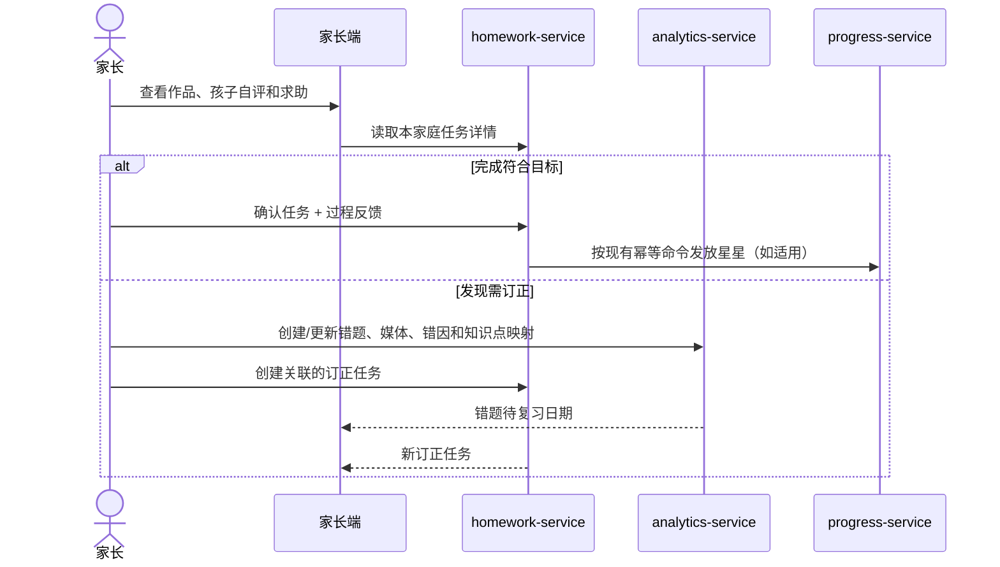

确认不等于孩子永远掌握。掌握状态只能由符合当前进度契约的家长证据操作更新。

### 9.4 每周家庭复盘

下图展示 P2 的结构化目标流程。P1 复用成长记录 `childReflection` 与现有周报家长反馈，
不实现图中的新增 `PATCH reflection` 路由，也不提供尚未采集的支架统计。

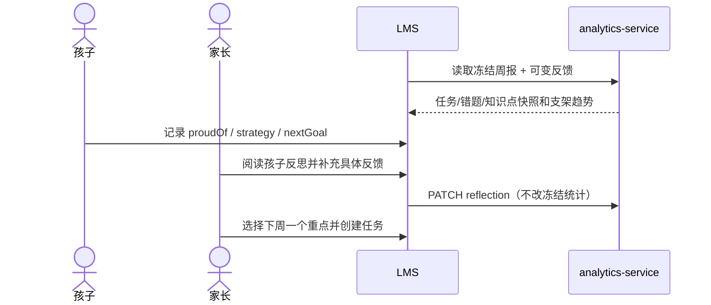

### 9.5 AI 讲解与变式题（P3）

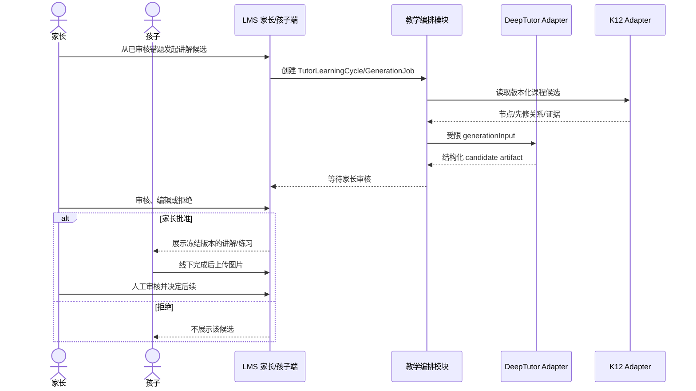

实际状态、幂等、Artifact 冻结和 final-review 时序必须直接采用 AI 平台设计，不以本简图
替代其机器契约。

### 9.6 “数学第一单元知识图”任务

该作业可以直接成为试点用例：

1. 家长创建“整理第一单元知识图”任务，附教材单元和一个空白模板；
2. 一年级使用图片/关键词卡片，家长共同读题；四年级自行先列节点；
3. 孩子在纸上或 iPad 手写完成；P1 上传照片/导出的图片，PDF 完成作品留待验证后扩展；
4. 家长按照“主要知识点、例子、连接、孩子能否讲清楚”四项清单审核；
5. 漏项作为反馈或新订正任务，不让 OCR 自动判定；
6. 家长把确认后的节点手工关联到 `KnowledgePoint`；
7. 若启用 K12，只用于给家长提供候选节点和先修关系；
8. 若启用 DeepTutor，只生成面向家长审核的提示问题，例如“请孩子说明这两个节点为什么相连”。

---

## 10. 服务间一致性与失败处理

### 10.1 一致性策略

- 单服务内使用 MongoDB 事务和唯一索引保证状态、事件和幂等记录共同提交；
- 跨服务使用既有内部 API、幂等命令和必要的 outbox，不做分布式数据库事务；
- `homework-service` 不直接写 `analytics/progress/resource` 的集合；
- 周报、复习视图和提醒从权威数据生成，不复制可变主状态；
- 客户端未知结果使用同一 `operationId` 重试，不能生成第二次业务动作；
- AI 路径完全复用现有 GenerationJob/FinalizationCommand 等收敛规则。

### 10.2 失败矩阵

| 故障 | 用户可见行为 | 系统要求 |
| --- | --- | --- |
| iPad 短暂断网 | 保留本地表单，提示稍后重试 | 相同 operationId；不得重复完成/附件引用 |
| 作品上传失败 | 任务仍可保存为草稿式界面状态，但不能伪装已上传 | 可重选文件；孤儿媒体按生命周期清理 |
| 媒体绑定未知 | 显示“正在确认”，允许安全重试 | `MEDIA_REFERENCE_PENDING` 恢复协议 |
| 日计划版本冲突 | 提示另一个设备已更新 | 返回最新版本，不静默覆盖 |
| DeepTutor 不可用 | 错题、订正和家长手写讲解照常 | Job 可重试/失败；不改业务审核状态 |
| K12 不可用 | 家长手工选择/输入知识点 | 不自动猜测映射 |
| 云端模型超时 | 不给孩子展示半成品 | candidate 保持未生成/失败；支持重试 |
| 磁盘接近满 | 禁止或限制作业媒体上传并通知家长 | 核心数据库避免被媒体占满；告警和清理策略 |
| MongoDB 故障 | 停止接受不可确认写入 | 恢复副本集/备份，不降级成不一致本地文件 |

---

## 11. 隐私、安全与儿童保护

### 11.1 身份与家庭隔离

- 所有公开请求只经 Gateway；服务验证签名身份信封；
- 资源读取和写入同时校验 `familyId + childId + role + resource ownership`；
- 孩子 URL 中替换 `childId` 必须得到拒绝，而不是依赖页面隐藏；
- 第二家长权限沿用既有共管治理，不在本文扩大角色权限；
- DeepTutor/K12 不接收 LMS JWT、孩子 PIN、Gateway 密钥或完整家庭档案。

### 11.2 私有媒体

- 作品、试卷、错题和订正默认私有；
- 只保存受控 `mediaId`，不在业务对象保存任意 URL 或底层路径；
- 下载经授权接口或短期签名地址；日志不记录签名 URL；
- 服务端检测 MIME/大小；保留文件数量、单文件大小和 PDF 页数上限；
- 既有普通媒体禁读后保留 bound；新 task_completion 隐私删除的原子解除、最小凭证、30 天清理和
  备份恢复防复活以[总体架构 §12.3](./family-learning-tracker-architecture.md#123-完成命令幂等与并发)和正式 API 为准。
  确认/归档不阻止隐私删除；UI 不把已删除媒体占位当成可查看作品，不改教学确认/星星。全量家庭导出/删除仍未实现。

### 11.3 AI 数据最小化

- 首期默认不把整张包含姓名、学校、班级的试卷上传到云模型；
- 只传生成所需的题干、家长确认错因、年级、教材范围和最小上下文；
- 能由家长手工转写题干时，不上传原始手写图；
- 不让模型推断心理、智力、人格、疾病或家庭关系；
- 不使用孩子数据训练第三方模型，除非以后有独立、明确、可撤回的家长授权；
- AI 日志和指标不得包含题目正文、孩子姓名、备注或媒体 URL。

### 11.4 儿童交互保护

- 不设置无限滚动、连续奖励动画、公开排名、羞辱式提醒或在线时长目标；
- 不因求助、使用较高支架或答错扣除既得奖励；
- 所有 AI 内容明确标识为辅助材料；孩子随时可以转向家长；
- 家长可导出和删除孩子数据；删除与备份恢复按既有审计规则处理；
- 一年级操作应在家长可见环境中进行，软件不是电子看护工具。

---

## 12. 初期家庭部署设计

### 12.1 物理拓扑

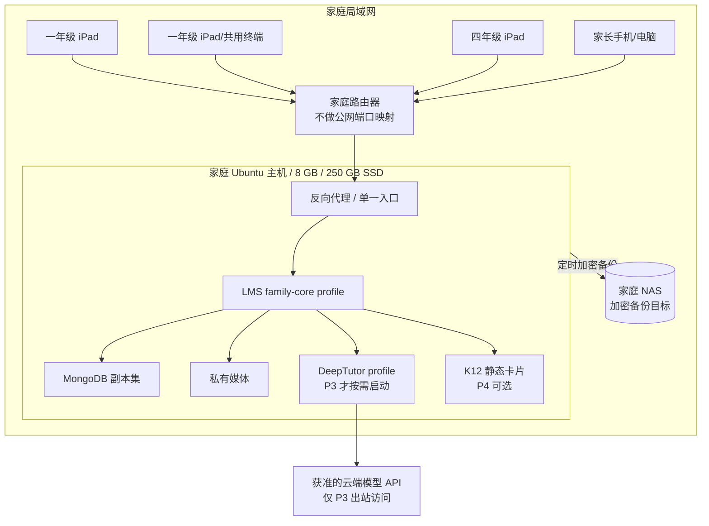

### 12.2 网络边界

- 家庭路由器不设置公网端口映射；UPnP 不应替应用自动开端口；
- iPad/家长终端只访问反向代理，不能直连 MongoDB、DeepTutor、K12 或内部服务；
- MongoDB、内部服务和可选 AI 组件只加入 Docker 内部网络；
- SSH 只允许家庭管理网络/可信设备，使用密钥登录并逐步停用密码登录；
- 首轮受控验证可暂用局域网 HTTP；开始积累真实儿童数据后应配置本地 HTTPS，或仅通过
  可信 VPN 访问。浏览器证书分发方案应单独验证；
- 未来需要远程访问时优先 VPN，不直接公开 Gateway；该变更必须进入严格模式安全评审。

### 12.3 资源策略

| 组件 | 初期策略 |
| --- | --- |
| LMS 核心 | 始终优先，按家庭最小 profile 启动 |
| MongoDB | 保证副本集、持久卷和备份，不为 AI 让出可靠性预算 |
| 私有媒体 | 独立目录/卷；监控容量；照片客户端压缩但保留可读性 |
| DeepTutor | P0–P2 关闭；P3 按需启用，初始上限约 2–3 GB、1–1.5 CPU、单并发 |
| 本地大模型 | 不部署；使用获准的云端 API |
| OCR | 不进入关键路径；如以后试验，仅做可编辑建议 |
| K12 | 先用当前章节的 Markdown/JSON 卡片；不运行训练/benchmark/Neo4j |
| 日志 | 容器日志轮转；不记录儿童内容；保留必要错误和审计元数据 |

### 12.4 数据目录与备份范围

使用真实儿童数据前至少备份：

- MongoDB 一致性逻辑备份；
- 私有媒体目录和资源元数据；
- Compose、脱敏配置模板、部署版本清单；
- 密钥的独立安全副本，不把明文密钥混入普通备份；
- P3 后增加 DeepTutor 实际使用的配置/知识库/索引元数据；
- P4 后增加 K12 卡片、数据版本清单和家庭自定义映射。

派生缓存、可重建镜像层、临时上传和公开 K12 原始副本不必优先备份。备份应以加密方式推送
到家庭 NAS；每月至少恢复到隔离目录一次，检查数据库、媒体引用和三名孩子的隔离仍成立。
详细命令和恢复顺序沿用部署文档及 AI 平台设计，不在本文复制可能漂移的脚本。

### 12.5 部署阶段与回滚

| 阶段 | 部署动作 | 验证 | 回滚 |
| --- | --- | --- | --- |
| D0 | 只运行当前 LMS family-core | 三个测试孩子、权限、任务/错题/周报 | 恢复现有 compose/数据备份 |
| D1 | 发布 P1 schema/API/UI | 迁移前备份；新旧客户端；拒绝路径 | 关闭 feature flag；必要时回滚应用和迁移 |
| D2 | 启用模板/复习/反思 | 实例幂等、跨周和家庭日期 | 暂停模板；历史实例保留 |
| D3 | 启动 DeepTutor profile | 资源、内部端口、鉴权、契约、降级 | 停止 profile；LMS 手工流程继续 |
| D4 | 加载小范围 K12 卡片 | 教材版本、节点、家长确认 | 关闭 Adapter；回到手工知识点 |

迁移必须有向后兼容读取期。新增可选字段不得让旧任务失效；部署前备份并实际验证恢复命令。

---

## 13. 可观察性与家庭反馈

### 13.1 技术指标

- Gateway/API 的错误率和 P95 延迟；
- MongoDB 健康、磁盘使用量、备份完成时间和最近恢复演练日期；
- 媒体 prepare/upload/bind 的失败和悬挂数量；
- 日计划/任务的版本冲突率；
- DeepTutor/K12 的 timeout、schema invalid、熔断和队列深度；
- 容器重启/OOM 和主机内存压力。

标签只使用服务、路由模板、状态码和错误类别；不使用姓名、`childId` 明文、题目正文、备注
或媒体地址作为指标标签。

### 13.2 产品评估指标

指标用于判断支架是否有效，不用于比较孩子：

这些指标是观察维度，不是独立的通过规则。学习效果可比证据、下降复核及结论优先级统一采用
[增量 Gate §14](../development/family-self-directed-learning-mvp-gate.md#14-t9-轻量价值验收规程)，不能仅凭启动/排序改善认定通过。

| 维度 | 建议观察 | 不应优化 |
| --- | --- | --- |
| 启动 | 是否能在一次提醒内开始 | 点击次数、在线时长 |
| 计划 | 是否能选择顺序并做合理估时 | 计划填得越多越好 |
| 监控 | 是否使用清单或发现自己的错误 | 永不出错 |
| 求助 | 能否说明卡点和已尝试方法 | 求助越少越好 |
| 支架 | 同类任务的支持级别是否逐步降低 | 强行追求全部 S0 |
| 订正 | 能否解释错因并延迟再做 | 当天刷题数量 |
| 反思 | 能否给出具体证据和一个下周目标 | AI 生成的漂亮长文 |
| 家长负担 | 每日/每周投入是否可持续 | 监控得越细越好 |

原始数据只保存完成业务所需部分。行为指标优先按周、按孩子生成本地聚合，不建设持续行为
埋点仓库。

---

## 14. 测试与验收

### 14.1 测试层次

1. **模型/校验单测**：日期、数量、枚举、清单版本、重复 task/media、大小上限；
2. **权限拒绝测试**：其他孩子、跨家庭、无效家长、伪造 `familyId/childId`；
3. **状态和并发测试**：重复完成、日计划 CAS、清单并发更新、完成更新与确认竞争、确认后证据冻结、求助不改变任务状态；
4. **媒体集成测试**：错误 purpose/scope/MIME、绑定未知、重试、删除引用；
5. **服务契约测试**：Gateway 身份信封、内部命令、错误映射、AI/K12 降级；
6. **UI 测试**：iPad Safari、触控尺寸、相机上传、断网重试、一年级最短路径；
7. **教育场景验收**：一个数学单元从任务到订正、延迟复习和周回顾；
8. **部署验证**：Compose config、资源上限、内部端口、日志轮转、重启恢复；
9. **备份恢复演练**：数据库、媒体、引用、权限和三个孩子隔离；
10. **AI 专项 Gate**：完整沿用 AI 设计中的 Schema、审核、幂等、未知结果和攻击面测试。

### 14.2 家庭验证场景（P0 可预演，P1 补齐后正式验收）

一周无干预基线先于 P0 人工预演，开发可并行；正式四周在 T8 工程通过后开始。各孩子的证据下限、
PASS/PARTIAL/FAIL、停止和缺失规则统一引用[增量 Gate §14](../development/family-self-directed-learning-mvp-gate.md#14-t9-轻量价值验收规程)，
无干净基线不得 PASS，工程可用不等于价值成立。以下是使用场景，不是另一个关闭标准。

- 为三个测试/真实孩子分别建立数学任务，所有数据互不可见；
- 四周目标约每周 3 个自然学习日，最低证据以 Gate §14 为准，中断不补刷；
- 每个孩子至少完成一次“计划—执行—检查—提交—家长反馈—周回顾”；
- 至少一个真实错题完成录入、错因人工确认、订正和延迟再练习；
- “第一单元知识图”完成纸面/iPad 作品、家长清单审核和知识点关联；P0 不要求把普通作品
  稳定上传到任务，并将这一缺口作为 P1 验收输入；
- 记录家长每日投入、孩子卡点和哪些步骤需要纸面替代；
- 备份成功，且至少一次从隔离目录恢复并核对媒体；
- P0 可用现有功能人工预演；P1 验证必须实际使用本轮新增功能。两者均不要求 AI、K12 或 OCR。

### 14.3 P1 功能验收

- 三个孩子可以分别保存同一天的独立日计划；
- 越权修改另一个孩子的计划、作品、求助或成长记录全部被服务端拒绝；
- 清单版本冲突不会静默覆盖；
- 一次或多次作品上传可恢复，重复提交不产生重复业务动作；
- 没做完也能独立求助，任务仍为 pending，不产生确认、星星或掌握事件；家长能处理求助；
- 未勾完清单仍可求助，明确完成时保留真实勾选结果供审核；
- 家长可从作品创建订正任务/错题并保留来源；确认前可更新作品，确认后不能修改完成内容；
- 家长审核旧版本时遇到并发更新必须刷新重审，不能误确认更新后的作品；
- 孩子提交后可以打开自己的任务，查看作品和家长反馈，确认前可修改；
- 孩子反思通过现有成长记录保存，家长使用现有周报反馈完成周复盘；
- 一年级路径不要求键盘长文本；四年级能自行排序和估时；
- 禁用所有可选 AI/K12 组件后，核心闭环仍通过。

### 14.4 P3 AI 验收

- 未经家长批准的 candidate 不能出现在孩子端；
- DeepTutor 无法写 LMS、读取其他家庭或访问公开业务写 API；
- OCR/模型结论不能单独更新掌握度；
- 重试、并发和未知结果不产生重复 turn/Artifact/最终副作用；
- 模型超时、K12 缺失、Schema 无效时回退到家长手工流程；
- 固定镜像、OpenAPI 快照、课程数据版本和最小云端数据范围可审计。

---

## 15. 编码实施顺序

执行拆分见[自主学习 MVP 开发计划](../superpowers/plans/2026-10-21-family-self-directed-learning-mvp.md)。
该计划按本节范围列出 T0–T9、文件落点、测试和发布/家庭验证步骤；T0 已完成契约基线，
T1 后端工程已关闭，仅限既定合成验收；T2 合成工程已关闭，T3 合成工程已关闭，T4 实施中，T5–T9 待执行。
T3 限定合成验收及两项 P2 独立复评关闭见增量 Gate §23.8；真机 DEVICE_PENDING、SL-02 PLANNED、T7 集成及真实部署边界不变。
T0/T1 证据见增量 Gate §17–§18；T2-2 至 T2-6 及三项 P2 已获用户批准关闭；当前工程裁决见 Gate §22.6 和[执行记录 §17](../development/family-self-directed-learning-t2-execution.md#17-t2-限定合成范围批准关闭2026-10-24)。最新全量 D2B-05 失败不改写，不代表高级恢复通过。
T2 关闭范围为 ENGINEERING_SYNTHETIC_ONLY；DEVICE_PENDING、T8_PENDING / NOT_AUTHORIZED 及高级恢复/新回收 REMAINDER_DEFERRED 保留，不外推为 SL-01 整体通过。
发现与原本地命令在同一服务内按快照读取，公开仅返回 operationId/目标版本，不暴露远程映射或待发布正文；完整契约见 API §14.2。
完成/审核/回看、原 actor 显式恢复及私有媒体页面已实现；无 UI 自动写入或强制接管能力，GET 不触发恢复。T2-G 尚未完成回收/正式组合验收，默认关闭及真实部署另批边界保留。
下述 T1 分批记录保留当时的未接入边界，最新正式装配与关闭裁决见 Gate §18.40；不代表真实部署授权。

T1 第九批补独立内部 HTTP router 工厂及真实 Axios 组合验收，不注册生产入口。
传输层只负责现有服务凭据、明确动作白名单、响应封装和错误传播，不复制 operation 状态机。
测试应用使用 loopback 随机端口与临时副本集；本地/远程事务仍分别提交，跨边界仅由 HTTP client
调用，不共享事务或在业务代码中跨库写入。测试共用临时数据库不等于多进程部署/备份恢复验收。
旧材料协议分流和统一写互斥的独立实现见下述第十批；生产装配与隐私 DELETE HTTP 入口仍单独待办；
新 router 不得直接替换旧 router，否则会使既有 attachmentMediaIds 等字段不可用。

T1 第十批实现边界：既有 `growthTaskAttachmentMediaService` 新增显式
`completionIsolation: true` 依赖注入选项，默认 `false`，生产装配不传入该选项。
启用时，材料写入与恢复要求 pending 主状态、无 activeCompletionOperation/completionPending，
完成媒体为 stable 或历史缺失态。占位、远程结果不确定标记、发布、解绑后清理、首轮稳定拒绝
回滚及无附件本地编辑的最终写入，都校验家庭/孩子、材料 owner/阶段、`__v`、完成/清单版本。
远程调用前重读 owner；远程调用后仍以最终 CAS 为准，不能用事前检查替代最终写屏障。

新材料意图在同一占位写入中持久化隐藏的 `mediaCompletionFence`：
`{completionVersion, checklistVersion}`，数值为非负安全整数；历史缺失版本只投影为 0，不回填。
恢复必须与占位基线相同，不把旧意图重基到当前版本；稳定终结才清除 fence。
丢失本地响应时，重读结果须为同家庭/孩子、同完成版本、紧邻的 `__v`，并核实同材料 owner/阶段
或预期最终绑定集合与代次；不同 owner 或仅媒体 ID 相同不能证明成功。
没有 fence 的旧 pending 仅在两个版本均为 0/缺失且完成协议空闲时，以 owner/阶段/版本 CAS
补入 fence，再做远程恢复。无法证明版本 0 的旧意图返回 pending、保留原数据，需接入前单独核查，
不得自动丢弃/重建。此字段没有默认值、不建索引，不需要批量迁移；生产回滚不可在已启用新协议、
仍有 pending 意图时直接切回旧 writer，应先停写并按原协议对账。当前批次未启用，回退无真实数据影响。

第十批复审 P2 修订：材料创建和修改的 prepare 重放必须接受完整集合中各引用的
`prepared` 或 `bound` 状态。旧 provider 在同一 operation 已提交时返回 bound，不能据此判为异常。
这不是直接发布许可：仍使用原 operation 和原完整引用集合执行幂等 commit，严格要求全部 bound，
再执行上述最终 owner/阶段/版本 CAS；不生成新 operation，不清除不确定意图，不修改绑定代次。
prepare 中的 released、缺失/多余/重复引用、错误媒体/字段以及非 bound 的 commit 结果仍返回 pending。
旧 pending 接续先完成版本基线校验，再走同一恢复流程。该修订同时修复共享旧材料服务的合法重放，
不启用 completionIsolation 默认选项、不改变旧/新协议分流及生产路由装配。

独立 `createMediaReferenceProtocolRouter` 复用旧/新 router，先服务凭据校验，再按完整引用集合分流。
全部为 `growth_task.completionMediaIds` 才进入 operation provider；材料/头像/错题字段使用旧 provider。
混合集合、未知字段或资源类型不匹配拒绝；旧字段携带新协议标记也拒绝，禁止失败后回退旧协议。
旧响应仍是 `{success:true,data:{references}}`，新响应仍包含 operation（unbind/reference status 为 null）。
两个 client 分别保留原契约。该工厂不被生产 server/Gateway 加载，不创建连接或监听；独立 HTTP
测试不能替代生产授权、公开 homework/隐私删除接入或多进程部署验收。

T1 第十一批增加独立 `createGrowthTaskCompletionRouter`，只将 complete/confirm PATCH 转交
既有完成/确认服务。每个入口固定使用 authenticateGateway，授权身份不可由正文覆盖；
服务负责实时授权、事务、终态重放和发星接续，HTTP 层不重复实现状态机或捕获后改写错误码。
异常进入宿主公共 errorHandler，未提供独立 recover、GET/列表或完整 CRUD。
测试 app 使用真实签名身份信封、loopback HTTP、临时副本集和真实内部媒体协议；
星星侧仍用合成幂等适配器，不宣称真实 progress HTTP/部署验收完成。
生产 server、旧路由及 Gateway 不导入该工厂；后续生产切换须覆盖全部写入口并另行批准。

T1 第十二批增加独立 `createCompletionMediaPrivacyRouter`，固定网关认证，适配 task_completion
隐私 DELETE；身份只取验证后的 req.user，无客户端删除凭证输入，非空 JSON 正文拒绝。
它复用第三批整组事务/精确凭证和持久 journal 服务，不实现第二套删除状态机；204 晚于
事务及日志落盘确认，未知结果仍 503。测试 app 中显式挂载于旧媒体读取路由之前，DELETE
不回退旧服务；非 task_completion 拒绝，既有读取继续验证签名与 active 状态。
这是受限验收组合，不是生产分流方案：生产混合 purpose 的路由装配须另行设计确认，不能
直接用该工厂替换全量 media router。真实受保护日志介质/恢复重放、前端禁缓存与生产接入仍待验收。

T1 第十三批增加独立详情/列表 read service/router：固定网关认证，服务内以事务快照查询家庭、
孩子和当前 actor，再用完整 familyId/childId 限定列表；同一 session 顺序读取 items/total。
公开 task 使用显式嵌套字段白名单，详情和列表一致；旧版本投影 0、不回填，pending 意图不参与
公开证据投影。PREPUBLISH 读旧证据，PUBLISHED_CLEANUP 读已发布证据及 pending_recovery。
该服务没有媒体/发星 client 或恢复依赖，GET 不写任务、不清锁；媒体 ID 不代表读取授权或可用性。
列表复用家庭 LocalDate、分页工具，补安全整数及标量查询校验、稳定 _id 排序；孩子显式请求其他
childId 拒绝。隔离生产装配期间暂不改旧 taskView/GET，以免顺带启用新协议或改变旧材料恢复行为；
后续生产切换再统一投影入口。本批不修改 schema/索引，不替代真实发星链路与生产全写入口验收。

T1 第十四批补真实发星 HTTP 组合验证：独立完成/确认测试 app 注入既有 starAwardClient，
连接另一个 loopback app 的真实 internalStars 路由、服务凭据校验与 StarLedgerEntry 唯一账本。
业务服务、奖励路由及生产装配保持原样；仅故障夹具在响应发送前断开/损坏正文，或在本地事务内
抛错/提交后抛错。用真实账本和首次确认审计验证未知结果、共管接续、客户端自动重试和最终授权。
本批测试共用临时 Mongo 连接，不能代替独立进程/数据库与三服务完整部署验收；完成操作使用无图片路径，
此前媒体协议组合证据仍独立保留，生产新协议接入仍需单独确认。

T1 第十五批在独立测试应用中组合 resource 完成引用协议、homework 完成/只读/确认与 progress
真实发星 HTTP。引用操作与星星均落临时数据库；用提交后断响应验证 PREPUBLISH/PUBLISHED_CLEANUP
阻断确认和发星，GET 不帮助恢复，原命令收敛后仅发一次星。补纯重排/全量移除的绑定代次、
不同 actor 同公开 UUID 映射隔离及共管恢复审计验证，不新增跨服务直接数据库写入或业务协议。
测试夹具共享进程和临时 Mongo 连接，合成媒体资产不含真实图片上传流程；三应用 HTTP 组合
不等于独立部署或生产端到端验收。生产全写入口切换、稳定性根因核查及完整发布门禁仍待后续处理。

T1 第十六批为第八批 mutation service 增加独立 HTTP 工厂：PATCH/DELETE 固定网关认证后，
仅将当前身份、taskId 和正文转交既有服务，统一返回其公开投影或公共错误。状态机、实时家庭授权、
schema 转换校验与最终 owner/版本 CAS 均继续在事务服务中执行，不在 router 复制。
通过测试宿主和真实发星 HTTP 验证事务/公开响应丢失后的重读，以及完成持锁、确认 pending 发星
时的编辑/删除互斥。编辑仍为普通赋值语义；软取消/归档保留首次审计，不清除引用或星星。
该工厂无生产 import/mount，生产全写入口、材料和清单编辑仍需后续接入验收；撤回工厂不涉及数据迁移。

T1 第十七批仅扩展既有三服务测试装配，把独立 mutation router 与完成/读取/确认路由组合，
补齐第十六批无图片测试的边界。真实完成图片引用在 PREPUBLISH/PUBLISHED_CLEANUP 未收敛时
阻止编辑/取消归档；稳定后归档保留完整引用集合与精确旧/新绑定代次，不触发引用清理或重复发星。
通过归档丢响应、发星丢响应和共管接续验证首次审计以及终态重放；应用服务重建后复用持久结果。
仅测试代码装配发生变化，业务服务、schema、生产 server/Gateway 保持原样；不将软归档当作隐私删除。

T1 第十八批补 homework 侧显式启用前只读预检，不加入生产 server。直接使用本服务连接的原生
集合只读 API，避免导入模型时触发自动建索引；不访问 resource 数据库。检查实际非部分、非稀疏的
唯一约束、禁止 operation TTL、远程映射格式/冲突及业务作用域冲突。使用带 includeBuildUUIDs 的
原生游标拒绝构建中索引，拒绝额外 prepareUnique 窄键约束；读取显式指定 primary，映射严格匹配字符串结束。
查询服务端执行限时、禁止聚合落盘，
错误仅含固定问题码。调用者声明停写是前置条件而非代码实现的锁；检查完成后的竞态仍由发布停写
流程控制。预检不负责修复、迁移、凭证持久化验证或跨库备份恢复，不能单独解锁生产发布。

T1 R2 在上述独立预检之外增加[运维准备入口](../deployment/completion-operations.md)，不接入生产 server。
homework/resource 分别使用自有连接，禁用 autoIndex/autoCreate；resource 先通过整条数据库预检，
再验证独立私有媒体/删除日志目录的权限与合成发布探针。`--writes-paused` 和持久介质确认均是
操作者声明，不构成锁或备份证明；ready 结果始终携带 productionEnabled=false。
保留清理必须显式 `--execute`，每次重新预检并复用原清理状态机；日志失败不得继续删除正文，
批次中途失败不宣称整批回滚。目录不自动创建/修权，索引不自动迁移，生产挂载及路由装配仍归 R3 审批。

R3 [四步装配方案](family-self-directed-learning-r3-assembly-proposal.md)于 2026-10-23 获批，
第 1 步实现两服务启动模式与预检门禁：legacy 原生只读防降级，maintenance 认证后阻断相关入口，
enabled 要求实际停写声明和本服务 URI，执行 R2 预检及 resource 存储探针。第 1 步已复审关闭；
第 2 步 resource 正式组合及单次响应 P3、第 3 步 homework 正式组合及材料快照/空更新 P2 已关闭。
两服务 enabled 在本地预检及 scanner/MQ 初始化成功后监听；第 4 步 Gateway 合成链路实现提交复审，不表示真实启用验收。
配置校验先于连接，MQ/scanner 先于监听；失败关闭本次获取的资源并脱敏。
维护包装与内层应用共享运行时 locals，避免未阻断的原有路由失去队列状态。
本批仅合成验证，不改变版本/CAS/客户端升级拒绝契约，不部署真实环境；R3/T1 总门禁未关闭。
Gateway 在所有公开入口剥除客户端服务凭据，内部媒体/记星前缀不代理；三服务工厂通过真实回环 HTTP 验证。
家庭最小栈与 Ubuntu Compose 共用显式模式/停写配置，默认 legacy/false；resource 存储确认默认 false，
删除 journal 使用独立持久卷。卷和目录仍须人工核实完整祖先链、运行 UID/0700、真实介质及备份。
没有自动建索引或修目录权限；两服务实际启动验证无新写入可撤回、有新状态拒绝 legacy，详见运维 §8。
resource enabled 延迟装配既有 operation/privacy 服务与协议分流器，复用同一模型连接/事务运行器。
公共删除先验证实时用户、家庭与孩子范围，再按服务器 Asset/Tombstone 分派；墓碑优先，错误不回退旧服务。
移出家庭的孩子、外家庭及不存在媒体统一 404，只有无 child 的 avatar 允许家长例外；写服务仍重新鉴权。
enabled 拒绝非空 DELETE body；上传、签名内容、安全 profile、显式保留清理不改契约。
正式启动拒绝替代 app/依赖工厂/启动工厂，不能把部分装配伪装为 enabled；legacy 冷加载边界保留。
homework enabled 延迟组合 completion/confirmation/read/mutation 和隔离材料服务，事务使用同一正式模型连接。
GET 仅只读投影；POST 严格创建；PATCH 按显式材料字段分派，空数组也属于材料命令；DELETE 走新取消/归档。
材料与普通字段共同发布，pending 重试必须匹配持久普通字段与完整有序附件集合，异正文冲突不推进旧意图。
材料重读恢复绑定首次验证的原快照（作用域、operation/阶段/种类、版本、fence、附件及普通字段 patch），
不匹配返回 503 MEDIA_REFERENCE_PENDING，不得接续替代意图或返回其稳定结果；稳定任务编辑的再次读取亦如此。
仅附件且集合未变的空更新，其最终只读加载也比较原快照；变化时拒绝，不恢复新意图，无竞争时零写入返回成功。
旧 pending 接续只能在原快照仍匹配时进行，后续 owner/阶段和版本 CAS 不放宽。
创建 pending 的恢复使用返回的任务 ID 和仅附件 PATCH，不重复 POST；错误仅保留校验后的 resourceId，不泄漏远程映射。
完成/确认仍要求 UUID/所见版本，旧客户端返回 CLIENT_UPGRADE_REQUIRED；前端未扩围，T1 未关闭。

T1 第十九批对 resource 自有 MediaReferenceOperation 账本增加同类独立只读预检。
除事务和实际索引外，流式检查原生命令身份、规范引用集合及摘要、版本和租约/终态字段；
不导入模型以避免 autoIndex。过期 PREPARED 保留给原恢复协议处理，预检不执行状态转换。
读失败固定脱敏错误并关闭游标；不做跨库或引用/删除凭证/墓碑一致性证明，不挂载生产入口。
检查账本 `_id` 的原生 ObjectId 类型以满足后续 hydrate/CAS；要求集合默认 simple 排序规则，
因为运行时操作查询继承集合默认值。非 simple 配置明确阻断，不仅给预检聚合添加排序规则，
也不自动修改集合或数据。集合元信息游标同样限时、primary 读取并在 finally 中关闭。

T1 第二十批增加独立隐私删除证据预检，先复用 resource operation 账本前提，再原生只读遍历
墓碑、精确代次凭证及新协议删除标记，检查与当前媒体/引用的双向关联。区分正常解绑/整组中止
与隐私删除；清理后允许媒体和引用均缺失，但保留墓碑、凭证和历史 COMMITTED operation。
同一完整作用域/媒体的跨代次凭证冲突不依赖当前引用存在即可识别并阻断；正常解绑后重绑
只能为删除时绑定的代次产生凭证，同一媒体关联不同任务的多份精确凭证仍合法。
查询必须有界且关闭游标，不加载模型、不调用日志持久化/文件清理或数据库写 API。
默认停写由调用方落实，跨集合读取不是在线一致性快照；本批不构成生产启动或发布开关。

T1 第二十一批在前两项 resource 预检之上增加完成作品引用一致性检查，仍只读且显式调用。
当前 completion 引用须指向同家庭/孩子的完成图片及包含该项的账本；PREPARED 反向要求原代次
完整集合和租约一致，到期仍留给恢复协议处理。COMMITTED 历史允许重绑后由新代次持有当前行，
不强迫恢复旧绑定；当前行缺失仅允许媒体同时清理且存在相同家庭/孩子的删除墓碑。
ABORTED 可能从未准备，不能把无当前行误报成缺失；其存在的原代次引用只能是整组释放状态。
普通解绑不要求释放命令有独立账本，隐私释放凭证继续由前置检查保护。scope 为 reference-consistency，
不是跨服务或发布就绪；不读文件、不验证日志介质、不修改旧协议字段、不接入生产。

T1 第二十二批补既有删除 journal 的故障边界验证，不新增持久化格式或生产装配。
文件同步必须先于不可覆盖的硬链接发布，目录同步必须先于成功确认；已发布但未确认同步的
文件仍需重试核验并同步，不能仅凭路径存在报告成功。并发相同证据幂等，冲突证据拒绝覆盖首次事实。
文件系统调用失败或进程在发布前后终止后，重试使用原证据；遗留临时文件不作为已确认日志，
普通重试不自动扫描/删除它们，避免误删并发写入，运维回收须单独制定停写流程。
组合测试要求删除未知结果期间保持媒体禁读、审计不变；保留清理先确认日志再删除正文及元数据。
临时目录真实 I/O 与进程终止只验证应用协议，不代表断电、NAS、日志完整性或跨服务备份恢复验收。

T1 第二十三批复用三服务独立 HTTP 工厂，增加合成 BSON 快照重建后的恢复组合验证。
先停止测试 HTTP、序列化固定模型集合，再在同一临时副本集中清空并重新插入 BSON 解码记录，
核对记录及原索引后重新创建 app/client；不把重用旧服务对象视为持久恢复。
覆盖原映射/终态、到期租约、精确代次解绑、只读无副作用和共管发星首次审计。此测试仍共用
临时数据库，既不是跨库一致性快照，也不是实际数据库进程重启、物理媒体或受保护日志恢复。
不提供生产恢复工具，不接入生产路由，不据此关闭 TC-SL-REMOTE-ID-004 的部署恢复部分或 T8。

T1 第二十四批在同一独立三服务组合中挂载显式注入的隐私删除测试路由，重建删除后的 BSON 记录，
重新创建删除服务、清理服务及日志/媒体 store；日志和正文使用保留于临时目录的真实合成文件。
覆盖 PREPARED 整组中止、COMMITTED 精确凭证在保留清理前后恢复、30 天边界、缺失/错误代次
凭证拒绝，以及日志/文件删除失败重试；首次删除审计与星星账本不得被恢复改写或重复。
数据库快照与临时目录均非真实灾备介质，不模拟删除前旧快照或日志重放，不能据此开放访问或关闭 T8。

T1 第二十五批在三服务测试工厂中显式注入清理事务故障：只有元数据删除回调完成后才允许
回滚注入，或在真实事务提交完成后抛出确认丢失。文件删除仍发生于事务外，故障后分别核对
元数据整体保留/整体移除、正文缺失、终态和删除证据不变，再重建删除后 BSON 并重试。
组合 PREPARED 删除中止与 COMMITTED 精确凭证恢复，保留另一媒体内容、首次审计和账本幂等。
该故障注入仅属于测试依赖，不进入生产事务执行器、启动或路由，也不替代真实断电恢复演练。

T1 第二十六批反向组合恢复顺序：清理事务回滚/提交未知后，先重建并恢复原完成命令及家长确认，
再重试保留清理。首次恢复前保存完整媒体基线，恢复后不得重建已删正文或改写媒体/引用状态；
随后清理只移除目标元数据，保留另一媒体、原远程终态、首次删除/确认审计和幂等账本。
仅补充临时副本集与独立 HTTP 工厂的组合测试，不增加运行时实现、生产路由或恢复工具。

### 15.1 P0：用现有软件观察，可与补齐工作并行

1. 选择一个一年级数学单元和一个四年级近期单元；
2. 用现有 `GrowthTask` 创建本周任务，把短清单写入描述；
3. 用孩子备注记录估时/卡点；未完成时先当面求助，不为使用 `needsHelp` 而提前提交完成；
4. 普通作品由家长现场查看或在家庭侧暂存；真实错题才进入错题媒体流程，不误用任务材料
   或错题字段充当通用作品集；
5. 家长人工录入错题、错因和知识点；
6. 用现有周报做周复盘，另外记录孩子说的话和家长耗时；
7. 记录摩擦，用于校准已确认的第 15.2 节工作包；不要求等待四周才开始补齐。

### 15.2 P1：本轮 MVP 必须补齐的开发包与顺序

2026-10-24 范围裁决：T2-2 至 T2-6 页面开发不等待高级删除恢复或新孤儿回收验收。
保留现有上传/隐私删除、家庭隔离、幂等、审核版本、原 actor 恢复和运行预检；不撤销既有安全契约。
详细保留/后置矩阵、合成环境依赖及真实试点前条件见[T2 执行记录 §11](../development/family-self-directed-learning-t2-execution.md#11-2026-10-24-mvp-范围调整与页面运行依赖)。
先验证孩子提交—家长审核—孩子回看，真实备份与隔离恢复在 T8 验收；后置能力仍不得提前标为已完成。

本节是本轮开发范围和优先级的唯一清单。每包只做下表边界内的功能；尚未完成正式实现、测试
和发布验收之前，仍属于拟议工作，不能改写当前已发布能力。

| 顺序 | 工作包 | 最小交付 | 完成标准与范围限制 |
| --- | --- | --- | --- |
| 1 | 作品提交与家长查看 | 孩子拍照/选图/预览/提交；任务稳定媒体引用；家长查看和现有反馈；孩子提交后可回看 | 三个孩子分别交数学作品，家长审核，断线重试可恢复；仅图片，不做 PDF 扩展、OCR、画板和多版本作品库 |
| 2 | 进行中独立求助 | pending 任务上的卡点和短说明；家长待处理列表及处理操作 | 没做完可以求助且主状态不变；不发星、不改掌握；不做聊天、推送或工单系统 |
| 3 | 自检清单与分龄操作 | 1–5 项清单、版本校验；一年级少字段/大按钮/家长代录，四年级自查提交 | 一年级无须长文本，四年级可自行提交；同一套页面，不做语音识别、自动朗读或自适应算法 |
| 4 | 今日排序与孩子估时 | 日计划、有限焦点任务、排序、孩子估时，与家长预计时间分开 | 刷新后保留且孩子间隔离；用简单上下移动即可，不强制拖拽、周计划或甘特图 |
| 5 | 人工订正与复习连接 | 从任务作品进入错题录入；创建订正任务；保留来源；使用现有复习日期和提醒 | 一道真实错题完成发现、人工判断、订正和延迟再练习；讲解/出题由家长准备，不做自动诊断或复习算法 |
| 6 | 周复盘与家庭实测 | 复用 GrowthLog.childReflection、WeeklyReport 家长反馈，补必要导航；按第 14 节试点 | 三个孩子完成四周/至少一个数学单元的验证，记录负担和困难；不新增结构化周报写接口或能力评分 |

工作包 5 的“来源”采用同家庭同孩子的最小关联字段，并在所属服务中保存；相关接口需要验证
源资源归属。任务与错题通过既有服务 API 连接，失败时允许人工补做，不为一次快捷创建增加
通用流程引擎。媒体 purpose 不可混用：完成作品不能把同一个 `task_completion` ID 直接当作
`mistake_answer`；首版允许家长在错题页重新上传并引用原任务，不提前开发跨 purpose 复制服务。

各包同步补充正式字段/API、必要迁移和相关测试。复用现有服务；旧任务没有新增字段时仍须
正常读取，并由新客户端按版本 0 完成或确认。历史无完成媒体记录投影为稳定，确认只持久化
缺失版本为 0，不把确认本身算作作品版本更新。完成接口当前未实现本方案的请求级幂等与并发版本控制，工作包 1
应落实重复提交、媒体恢复、确认竞争，不能因已有任务材料引用协议就假设完成作品自动安全。

与首批功能并行做家庭部署验收：确认 Ubuntu 实际运行版本、iPad Safari 上传/查看、三个孩子
隔离、私有图片授权、容器重启和 NAS 备份恢复。仓库中存在 Compose、说明或检查脚本不代表
远程服务器已验收；部署证据必须来自实际运行和恢复演练。

### 15.3 MVP 验证后再评审的功能

| 储备 | 触发条件 | 首次评审范围 |
| --- | --- | --- |
| 模板、复习队列和间隔策略（P2） | 人工重复布置/安排复习成为持续负担 | 先模板或只读复习视图，按需选择，不一次性实现全部 |
| 结构化周反思、支持级别及趋势（P2） | 现有备注/成长记录确实无法支持家庭决策 | 最少字段和少量解释性趋势，不建能力总分或行为埋点仓库 |
| DeepTutor（P3） | 手工闭环稳定且家长准备讲解/题目费时 | 现有 AI 契约下的候选内容、家长批准、人工审核和失败恢复 |
| K12（P4） | 手工知识点映射成为瓶颈且教材覆盖已确认 | 单章节卡片和人工确认，不上全量图谱 |
| 打印复习包、PDF 完成作品、语音输入 | 试点中有反复出现的具体需求 | 独立小功能，不把可选终端能力并入基础提交流程 |
| 长期学习项目 | 真实项目需求且符合第 18.1 节门槛 | LearningProject 与现有任务关联，继续保持单孩子所有权 |

通过 MVP 验收不自动触发所有储备开发。根据家庭反馈重新确定优先级，每次选择一个能解决
具体问题的扩展。长期项目可以独立于 P2–P4 评审，不依赖先接入 AI。

---

## 16. 风险、缓解与回滚摘要

| 风险 | 影响 | 缓解 | 回滚/降级 |
| --- | --- | --- | --- |
| 工具变成家长监控 | 孩子依赖或抵触 | 孩子先反思；不做实时流和排名；少指标 | 关闭趋势模块，保留任务/作品 |
| 一年级操作负担过大 | 学习被录入打断 | 大按钮、口述、家长代录、短路径 | 回到纸卡+家长记录 |
| 家长审核成为瓶颈 | 流程停滞 | 每日批量 5–10 分钟；只审关键证据 | 不启用 AI；减少上传频率 |
| 手写识别不可靠 | 错误反馈 | OCR 不在关键路径，家长人工看 | 完全关闭 OCR |
| AI 幻觉/超纲 | 误导孩子 | K12 证据、Schema、家长批准、固定范围 | 拒绝 Artifact，使用手工讲解 |
| 跨孩子/跨家庭泄露 | 严重隐私风险 | 服务端 scope、拒绝测试、私有媒体 | 停止服务、撤销令牌、审计与恢复 |
| 旧电脑资源不足 | OOM/核心不可用 | profiles、上限、单并发、云模型 | 停止 DeepTutor/K12，保核心 LMS |
| SSD/媒体增长 | 服务故障/数据丢失 | 压缩、容量告警、NAS 加密备份 | 暂停上传，扩容/归档后恢复 |
| 局域网被误当安全 | 未授权访问 | 最小端口、本地 TLS/VPN、密钥 SSH | 断开对外访问、轮换凭据 |
| 方案过度开发 | 延迟验证 | P0 无代码试点；按摩擦排序 | 停留在现有 MVP |

---

## 17. 实施决策状态

T0 已把完成命令幂等与版本、媒体恢复、作品冻结、家长代录 actor/subject、旧数据确认和
来源权限错误写入正式 PRD、架构、API、追踪矩阵及 Gate；这些事项不再由后续工作包自行决定，
且本轮没有改变既有数据权威源或服务边界，因此不新增 ADR。以下环境和远期事项仍需在对应
阶段批准：

1. 三名孩子实际使用的教材出版社、年级上下册和试点单元；
2. 本地 HTTPS 采用内部域名+家庭 CA，还是以 VPN 作为唯一远程/可信入口；
3. 家庭 NAS 的备份协议、加密密钥保管和恢复目标；
4. P3 云端模型供应商的数据保留、地域、费用和未成年人数据条款；
5. K12 数据与实际教材版本的覆盖率及许可证边界。

默认建议：P0 先记录教材与单元，不引入任何 AI；P1 采用任务内确认前可更新、确认后冻结的完成证据；一年级
允许家长代录但保留 actor；局域网积累真实数据前完成 NAS 恢复演练。

---

## 18. MVP 后储备扩展：长期学习项目

### 18.1 状态与实施门槛

本节只保存未来设计方向，不属于 P0–P4、本轮 MVP、当前 API 或当前发布范围。科技比赛、
研究性学习、模型制作、长期阅读等一至两个月的任务可以使用该能力，但必须在基础 MVP 验证
完成后重新评审优先级，不能因本节存在而提前开发。

进入设计实施至少满足：

1. 三个孩子的数学最小闭环已完成约定试点，日计划、检查、求助、反馈和周复盘可持续；
2. 普通任务作品已经具备稳定媒体引用、权限拒绝测试和备份恢复能力；
3. 家庭中出现一个真实、持续四周以上的项目，而不是为验证功能虚构项目；
4. 家长愿意每周做一次简短项目复盘，并保留教学和安全最终判断；
5. 现有任务前缀和人工拆分方式已暴露重复摩擦，证明需要项目聚合；
6. 实施前补充正式 PRD、ADR、API 契约、迁移、回滚和发布 Gate。

不要求先完成 DeepTutor 或 K12 集成。长期项目的主要依赖是任务拆解、作品证据、周复盘和
家庭权限，不是 AI。

### 18.2 目标与非目标

目标：

- 帮助孩子把开放目标拆成阶段、里程碑和下一步行动；
- 用每周计划与复盘跟踪一至两个月，而不是一次性布置一个巨大任务；
- 保存草稿、实验记录、失败版本、最终作品和孩子反思；
- 让四年级孩子逐步承担规划和调整责任；
- 让一年级孩子只面对当前步骤，并由家长共同调节；
- 复用当前任务、私有媒体、家长确认、周报和家庭隔离能力。

非目标：

- 成人项目管理软件、甘特图、工时核算、预算和采购系统；
- 实时聊天、评论流、公开作品社区或跨家庭协作；
- 第一版支持兄弟姐妹共同编辑同一项目；
- 复杂任务依赖、关键路径、自动百分比或 AI 自动调度；
- 由 AI 完成选题、作品、实验数据、参赛报告或最终评价。

### 18.3 MVP 前的人工验证方式

在功能实现前，可以用当前系统进行一次真实项目验证，但不得把它描述为正式项目能力：

1. 家长在家庭侧保存一页项目说明，写明目标、截止日期和最终成果；
2. 现有任务统一使用标题前缀，例如 `[科技项目·智能浇花器]`；
3. 每周只创建未来一周的 1–3 条 `GrowthTask`，不预先制造几十条任务；
4. 任务描述中写本周完成标准，孩子使用现有难度、求助和备注字段；
5. 项目图片和文件先保存在家庭 NAS 的独立目录，LMS 不保存任意 NAS URL；
6. 真实错题才进入错题流程，不使用错题或任务材料字段伪造项目作品集；
7. 每周用周报和口头会议回答“完成了什么、卡在哪里、下一步是什么”；
8. 记录必须在系统外维护的重复信息，作为未来实现的需求证据。

### 18.4 轻量架构

第一版只在 `homework-service` 内增加 `LearningProject` 聚合，并给现有 `GrowthTask` 增加可选
项目引用；不新增 `project-service` 常驻进程。

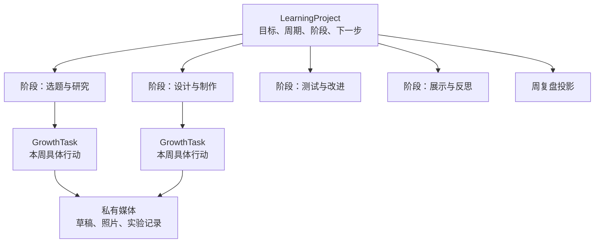

服务职责：

| 组件 | 新增责任 | 仍然禁止 |
| --- | --- | --- |
| `homework-service` | `LearningProject`、阶段、下一步、`GrowthTask.projectRef` | 跨库写媒体、错题或掌握度 |
| `resource-service` | 项目/任务作品的私有媒体和稳定引用 | 公开底层路径或判断作品质量 |
| `analytics-service` | 项目周摘要的只读投影 | 维护第二套项目/任务状态 |
| `progress-service` | 经家长确认的相关知识点证据 | 根据项目百分比自动判定掌握 |
| DeepTutor | 经审核的规则摘要、概念解释、检查问题、展示建议 | 替孩子完成作品或编造数据 |
| K12 Adapter | 只读相关课程节点和先修概念 | 决定项目阶段、进度或掌握度 |

### 18.5 拟议最小模型

```text
LearningProject
  projectId
  familyId
  ownerChildId
  title
  projectType                  // competition|research|creation|reading|other
  subject?
  goal
  successCriteria[]            // 最多 5 项，由家长与孩子确认
  startDate                    // 家庭 LocalDate
  targetDate                   // 家庭 LocalDate
  status                       // draft|active|paused|completed|archived
  stages[]                     // 有序，建议 3..9，硬上限 12
    stageId
    title
    outcome
    order
  currentStageId?
  nextAction?
  blockerType?
  blockerNote?
  finalReflection?
  createdByParentId
  version
  createdAt
  updatedAt

GrowthTask.projectRef?
  projectId
  stageId
  milestoneOrder?
```

约束：

- 第一版 `ownerChildId` 恰好一个，且必须属于 `familyId`；
- `{familyId, ownerChildId, projectId}` 是所有读取和写入的基本 scope；
- 孩子只能查看和更新自己的项目允许字段，不能通过替换 id 查看兄弟姐妹项目；
- `GrowthTask.projectRef` 只能引用同家庭、同孩子且未归档的项目和有效阶段；
- 项目不复制任务状态，进度从关联任务和明确阶段状态生成；
- 项目完成必须有家长确认和孩子最终反思，不能仅因任务数量达到百分比自动完成；
- 项目归档不物理删除项目、任务或作品；删除和导出继续遵循儿童数据生命周期；
- 更新携带 `expectedVersion`，避免孩子、两位家长在不同设备上静默覆盖；
- `nextAction` 是当前可执行的一步，不等同于 AI 自动计划；
- `blockerType` 只描述情境，例如材料、时间、方法或等待外部反馈，不推断孩子人格或能力。

### 18.6 状态与进度表达

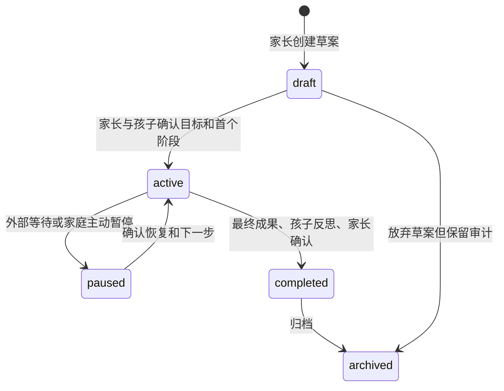

孩子端不显示虚假的精确百分比。项目健康由三类信息组成：

1. **里程碑：** 哪些阶段已完成、当前阶段是什么；
2. **状态：** 正常、有风险、被阻塞或暂停；
3. **下一步：** 一条明确、可在近期执行的行动。

项目可以计算已确认里程碑数量作为辅助信息，但不能把“3/8”解释为学习质量或掌握度。

### 18.7 年龄适配与周循环

| 项目动作 | 一年级 | 四年级 |
| --- | --- | --- |
| 理解目标 | 家长用图片/实物解释 | 孩子复述目标和成功标准 |
| 拆阶段 | 家长主导，孩子从两个选项选择 | 孩子先提方案，家长校准 |
| 计划 | 一次只显示当前一步 | 每周选择 1–3 个行动并估时 |
| 记录 | 照片、口述、家长代录 | 照片、简短实验记录和说明 |
| 调整 | 家长观察并提供支架 | 孩子说明偏差、卡点和调整理由 |
| 展示 | 口述、实物演示 | 报告、展板或演示，并回答问题 |

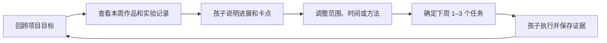

每周只要求回答：完成了什么、有什么证据、哪里与计划不同、最大卡点是什么、下周最重要的
一步是什么。孩子不需要写成人式周报。

### 18.8 作品、DeepTutor 与 K12 边界

项目可聚合关联任务的已绑定完成作品；如果以后需要独立的 `ProjectArtifact`，必须先证明同一
阶段确实存在多个需要独立版本化的成果，不能为概念完整提前建模。项目资料继续使用受控
`mediaId` 和稳定引用，不保存 NAS 路径或任意 URL。

DeepTutor 可以在家长发起和审核后：

- 将比赛规则转为适龄检查问题；
- 解释相关科学或数学概念；
- 提供实验变量、对照和安全检查候选；
- 生成模拟评委问题和展示结构建议。

DeepTutor 不得代替孩子选题、生成可直接提交的完整作品、编造实验数据、代写参赛报告，
也不得根据项目状态自动发布任务。K12 只提供相关课程知识点和先修概念候选，家长确认后才
建立学习档案关联。

### 18.9 多孩子协作明确延期

第一版不使用 `participantChildIds[]`。一个项目只能归属于一个孩子，原因是共同项目会引入
新的可见性和写权限问题：共同作品可见不等于自评、困难、支架或家长反馈可见。

如果未来确有三个孩子共同参赛的真实需求，应另立 ADR，至少定义：

- 哪些项目字段和作品对参与者共同可见；
- 每个孩子的自评、难度、求助和反馈是否保持私有；
- 谁可以完成共同里程碑；
- 孩子加入、退出或项目归档后的访问权；
- 共同成果与个人成长证据如何分离；
- 不形成兄弟姐妹贡献排行榜。

在该 ADR 完成前，可以指定一个项目 owner，并为其他孩子创建各自独立的关联任务，但不能
开放互看对方学习数据。

### 18.10 未来验收条件

- 不启用项目功能时，现有普通 `GrowthTask` 行为和查询不变；
- 项目 owner、其他孩子和跨家庭用户的允许/拒绝路径均有服务端测试；
- 项目任务仍遵守单次 occurrence 状态机，不因周循环重开已完成任务；
- 项目页能清楚显示目标、当前阶段、下一步、阻塞和关联任务；
- 项目完成要求最终成果、孩子反思和家长确认；
- 私有作品有稳定引用、备份、恢复、删除和导出验证；
- 一年级路径不要求阅读复杂图表或键盘长输入；
- 四年级孩子可以参与拆解、每周调整和最终展示；
- DeepTutor/K12 全部关闭时，项目核心流程仍可完整运行；
- 不出现甘特图、聊天、预算、复杂依赖、自动排名或 AI 项目经理等超出储备范围的能力。

---

## 19. 结论

该设计把“自主学习”落到一个可逐步交付的家庭闭环，而不是增加一个聊天机器人。现有 LMS
已经足以运行不含普通作品归档的 P0：任务、孩子自评/求助、家长确认、真实错题、知识点、
周报和媒体底座构成了主要基础。`task_completion` 图片虽然可以上传，但当前任务模型尚未保存
稳定引用，因此不能把“上传成功”误认为作品已经进入学习档案。首期真正需要验证的是家庭
行为流程，而不是技术集成。

推荐顺序以第 15.2 节为准：先观察现有流程，补齐图片作品、独立求助、清单与分龄操作、日计划、
人工订正连接和周复盘，再进行四周数学家庭验证；验证后才按需要评审 DeepTutor、K12 等增强。
长期学习项目保留为 MVP 验证后的独立扩展轨道，只有出现真实、持续四周以上的项目需求且
普通作品已经可恢复时才启动实施。这样既保留现有工程投资，又能在家庭旧电脑和三个孩子的
真实条件下控制成本、隐私与复杂度。
