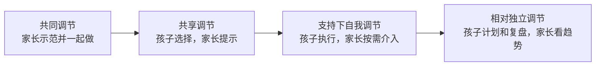
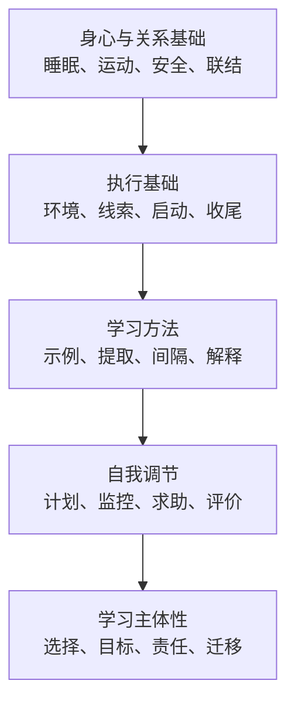
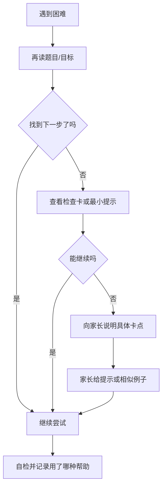
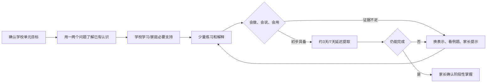

# 家庭自主学习支持体系：理论基础、总体方案与数学试点规划

> 状态：拟议方案（research and program baseline）
> 长期方向已于 2026-10-22 确认；本方案的实施与教育成效仍待验证，产品权威为 PRD，判定权威为增量 Gate §14。
> 适用家庭：3 名小学生（四年级 1 名、一年级 2 名）
> 初期学科：数学
> 初期环境：家庭自有 Ubuntu 服务器、家庭局域网、iPad/家庭终端访问
> 配套技术设计：[家庭自主学习系统设计](../architecture/family-self-directed-learning-system-design.md)
> 下游 AI 契约：[家庭 AI 学习管理平台完整设计](../architecture/family-ai-learning-platform-design.md)

## 摘要

本文提出一套面向家庭小学阶段的自主学习支持体系。体系不以提高软件使用时长、任务打卡率
或家长监控强度为中心，而以儿童逐步形成计划、执行、监控、求助、订正和复盘能力为长期
目标。总体策略采用“孩子主导、家长教练、软件脚手架、AI 后台辅助”的协同模式：LMS 是
家庭学习任务和成长证据的权威记录中心；家长负责边界、示范、反馈和最终判断；DeepTutor
只生成经过家长审核的候选讲解、提示和练习；K12-KGraph 只提供版本化课程结构证据。

方案综合元认知与自我调节学习、支架式教学、认知科学、自我决定理论、执行功能与家庭
日常流程、形成性评价和掌握学习等研究。针对一个四年级孩子和两个一年级孩子，方案采用
分龄支架、逐步放手和数学单学科试点：一年级以共同调节、视觉流程和口头反思为主；四年级
开始承担任务排序、估时、检查和周计划责任。系统先观察现有流程，按已确认缺口补齐最小
自主学习功能，再进行不依赖 AI 的四周家庭验证；验证后按真实摩擦选择复习、AI 等增强。

## 关键词

家庭教育；自主学习；自我调节学习；元认知；支架式教学；数学学习；形成性评价；儿童数据；
人工智能辅助教育

---

## 1. 背景与问题定义

### 1.1 家庭目标

本项目的长期目标不是把家庭变成第二课堂，也不是让孩子尽早独立使用 AI，而是帮助孩子在
小学阶段逐渐形成以下可迁移能力：

1. 看懂目标并知道“现在要做什么”；
2. 在有限范围内选择顺序和策略；
3. 能够启动任务并保持适龄的专注；
4. 能检查过程和结果，而不是只等成人指出错误；
5. 遇到困难能描述卡点并选择合适的求助方式；
6. 能订正错误并在延迟后重新提取；
7. 能回顾本周表现并提出一个可执行的改进目标；
8. 在学习之外保留睡眠、运动、自由游戏、阅读、劳动和亲子关系。

《义务教育课程方案（2022 年版）》把“乐学善学、勤于思考、保持好奇心与求知欲、形成
良好的学习习惯、初步具有学会学习的能力”列入培养目标。本文将该目标转化为家庭内可观察、
可练习但不过度量化的行为过程。

### 1.2 家庭与部署情境

| 约束 | 设计含义 |
| --- | --- |
| 两名一年级孩子 | 需要图片、大按钮、口头表达、家长共学和很短的软件操作 |
| 一名四年级孩子 | 可开始估时、任务拆分、检查清单和孩子主导的周计划 |
| 三个孩子共用家庭系统 | 所有记录必须按 `familyId + childId` 隔离，不能相互比较或串数据 |
| 初期只试点数学 | 先证明学习闭环有效，不同时扩展所有学科和五育模板 |
| 家庭局域网部署 | 优先私有访问、低运维成本和断网可继续完成线下活动 |
| 家庭老电脑服务器 | 不运行本地大模型、重型 OCR 或全量知识图谱训练 |
| 家长人工审核 | 手写识别、AI 判分和 AI 掌握判断不进入关键路径 |

### 1.3 当前系统基础

当前 LMS 已具备家庭账号、第二家长、孩子 PIN、五育任务、完成记录、孩子难度感受和求助、
家长确认、知识点、错题、多媒体附件、提醒、周报、星星和奖励等 MVP 能力。这些能力能够
支持“任务与记录”，但尚未形成完整的“自主学习能力训练”产品闭环：

- 任务主要由家长创建，孩子尚不能正式编排每日顺序；
- 孩子完成任务时尚缺少作品附件闭环；
- `needsHelp` 只能表达需要帮助，不能表达卡点和支持级别；
- 周报记录结果，但没有突出脚手架逐步退出；
- 重复习惯模板、通用复习队列和孩子周计划仍未实现；
- DeepTutor/K12 已有严密设计草案，但尚未进入当前发布基线。

### 1.4 核心研究问题

本文回答四个问题：

1. 如何让软件促进自主性，而不是加强外部控制？
2. 如何针对一年级和四年级提供不同脚手架，并随成长逐步撤除？
3. 如何把学习科学原则变成家庭每天能执行的轻量流程？
4. 如何让 AI 发挥内容生成优势，同时不替代孩子思考和家长判断？

---

## 2. 概念与边界

### 2.1 自主学习不等于无人帮助

本文将自主学习定义为：孩子能够在适龄支架下主动参与目标理解、计划、策略选择、过程监控、
求助、结果检查和反思，并随着能力发展逐步减少成人支持。

自主学习不等于：

- 把一年级孩子单独留给 iPad；
- 让孩子随意决定是否完成学校任务；
- 家长不提供结构和边界；
- 系统自动规划全部学习；
- 孩子能完成任务就等于已经掌握；
- 孩子不用向成人求助。

一年级的现实目标是“在熟悉流程中完成自己负责的部分”；四年级可以逐渐过渡到“参与安排、
主动检查、描述困难和提出计划”。

### 2.2 共同调节、共享调节与自我调节

本方案采用连续谱而非二元划分：



支架只能在孩子表现出稳定能力后撤除；出现新任务、疲劳、情绪压力或学习困难时，可以暂时
增加支持。支架变化不是单向升级游戏，也不能用来评价孩子好坏。

### 2.3 工具的合理角色

软件是“外部执行功能脚手架”，主要负责：

- 把任务和步骤从工作记忆移到可见界面；
- 在合适时间提供少量线索；
- 保存孩子主动完成、检查、求助和订正的证据；
- 帮助家长提供一致反馈；
- 安排少量间隔复习；
- 用周报支持家庭对话；
- 随能力增长减少提示。

软件不应成为监控器、排名器、情绪诊断器、自动老师或注意力争夺产品。

---

## 3. 理论基础与方案映射

### 3.1 自我调节学习与元认知

Zimmerman 将自我调节学习描述为包含前瞻、执行/自我监控和自我反思的循环。EEF 2025 年
指南进一步强调：计划、监控、评价等策略需要明确教学、成人示范、脚手架，并应嵌入具体
学科任务，而不是作为脱离内容的“思维技能课”。

本方案映射为：

| 理论环节 | 一年级表达 | 四年级表达 | LMS 支持 |
| --- | --- | --- | --- |
| 目标理解 | 今天要做什么 | 这项任务的完成标准是什么 | 任务目标、附件和检查清单 |
| 计划 | 先做哪一个 | 排顺序、估时间、拆步骤 | 每日计划和孩子排序 |
| 监控 | 我做到哪了 | 当前策略是否有效 | 进度、求助类型、支持级别 |
| 评价 | 我检查了吗 | 我如何证明自己学会了 | 自检、作品、订正、延迟复习 |
| 调整 | 我需要什么帮助 | 下次换什么策略 | 家长反馈、周反思、策略卡 |

### 3.2 学习与记忆科学

Dunlosky 等对常见学习技术的综述把练习测试和分散练习列为高实用性方法；Roediger 与
Karpicke 的研究显示，主动提取在延迟保持上可优于反复重读；Cepeda 等的元分析支持分散
练习相对于集中练习的长期记忆优势。IES 实践指南还建议交替使用示例与问题、把图形和语言
结合、连接具体和抽象表示，并提出解释性问题。

家庭数学试点采用以下原则：

1. **先提取再看答案**：复习先让孩子说、画或做，再打开讲解；
2. **短而分散**：复习分布到当天、约 3 天、约 7 天，具体间隔由表现调整；
3. **例题逐步淡出**：完整例题 → 补全一步 → 独立做；
4. **具体—图形—语言—符号**：低年级数学优先实物和图示，再进入算式；
5. **解释而非只报答案**：至少让孩子回答一次“为什么”；
6. **掌握后少量混合**：避免长期连续刷完全同型题；
7. **错题以订正和延迟验证闭环**：不以记录错题数量为目标。

### 3.3 支架式教学与执行功能

儿童的计划、工作记忆、注意控制和抑制能力需要在真实活动中逐步练习。稳定流程、成人示范、
可靠关系和适龄支架有助于孩子开始并完成有挑战的任务。

本方案的支架阶梯为：

| 级别 | 支持方式 | 家长动作 |
| --- | --- | --- |
| S0 | 孩子独立 | 事后确认，不提前提醒 |
| S1 | 环境/视觉线索 | 指向任务卡或检查卡，不解释答案 |
| S2 | 元认知提问 | 问“你现在卡在哪一步？” |
| S3 | 部分提示或相似例子 | 给最小必要提示，再交还孩子 |
| S4 | 共同完成/成人示范 | 只示范一小步，随后让孩子继续 |

系统可以记录本次使用的最高支持级别，但不得把 S4 呈现为失败。相同孩子在新知识上使用
S4、在熟悉流程上使用 S0 是正常现象。

### 3.4 自我决定理论与内在动机

自我决定理论强调自主、胜任和联结三类基本心理需要。教育干预系统综述支持自主和胜任支持
的价值，同时提示研究情境、实施质量和长期持续性存在差异。

产品映射：

- **自主**：家长设定边界，孩子选择顺序、工具或先尝试哪一步；
- **胜任**：展示具体能力证据和进步，不展示兄弟姐妹排名；
- **联结**：周报用于亲子对话，反馈先理解困难，再提出下一步；
- **结构**：选择权不等于没有要求，学校任务和家庭健康边界仍由成人保障。

### 3.5 家庭日常流程与习惯

关于家庭流程的系统综述表明，结构清晰、可预测的日常流程与注意、自我调节、组织和情绪
稳定之间存在积极关联，但其中大量研究是观察性研究，不能将相关性简单解释为唯一因果。

本方案不采用“固定若干天形成习惯”的承诺，而采用可操作的行为链：

```text
固定情境线索
  → 最小启动动作
  → 短而明确的行为
  → 可见的结束动作
  → 具体、低刺激的自然反馈
```

一次只训练一个习惯。对一年级第一阶段，首选“到约定时间后自己查看任务”；对四年级首选
“查看任务后自己排序并准备材料”。连续记录中断不清零，也不制造羞耻。

### 3.6 形成性评价与反馈

有效反馈必须建立在清晰目标和可观察证据上，指出当前表现与目标的差距，并给孩子立即行动
的机会。反馈媒介不是关键，关键是反馈是否具体、可执行且年龄适宜。

家庭反馈模板：

1. 孩子先自评；
2. 家长描述一条证据；
3. 家长只给一个下一步；
4. 孩子当场尝试一次；
5. 需要时安排短复习。

推荐：“你发现结果不对以后重新读了题，这是有效的检查方法。下一题先圈出要求。”
避免：“你真聪明”“这么简单都不会”“继续加油”等人格评价或空泛反馈。

### 3.7 掌握学习

掌握学习强调固定学习目标、允许不同学习时间，并为未掌握者提供不同支持。其平均效果可能
为正，尤其在小学和数学中，但研究质量和实施一致性有限，因此本方案不采用自动百分比分数
解锁，而采用三类证据：

- **会做**：能独立完成一个代表性任务；
- **会说**：能用自己的话或图示解释；
- **会用**：在轻微变化或延迟后仍能完成。

家长是初期掌握判断的最终责任人；AI 只能提出候选分析。

### 3.8 流行方法的取舍

| 方法 | 采用方式 | 边界 |
| --- | --- | --- |
| 成长型思维 | 使用真实、策略导向的语言 | 不把口号当成绩干预，不说“只要努力就行” |
| 费曼式讲解 | 让孩子用自己的话解释 | 不追求术语完整，一年级可用图和口述 |
| 番茄钟 | 作为可选时间盒 | 不把统一 25 分钟强加给低年级 |
| 蒙台梭利式环境准备 | 固定材料位置、有限选择 | 不声称采用完整蒙台梭利体系 |
| 项目/探究学习 | 用于知识应用和兴趣探索 | 新手学习不能缺少明确示范和基础知识 |
| 游戏化 | 轻量庆祝和家庭约定 | 不做随机奖励、排行榜、连续中断惩罚 |
| 学习风格 | 不采用固定标签 | 根据任务和已有知识选择表示方式 |

增长型思维干预对学业成绩的效果存在重要争议；学习风格匹配缺乏高质量证据，且给小学生
贴固定标签可能限制其策略发展。因此二者都不作为系统核心模型。

---

## 4. 综合理论模型

本方案将自主学习能力拆成五层，避免只盯任务结果：



下层不是一次完成的先修条件，但上层设计不能破坏下层。例如，为提高任务完成率而挤占睡眠、
运动或亲子关系，即使短期数据变好，也不属于方案成功。

---

## 5. 家庭学习运行方案

### 5.1 角色分工

| 角色/组件 | 主要责任 | 明确不做 |
| --- | --- | --- |
| 孩子 | 选择、尝试、自检、表达困难、复盘 | 不独自承担课程正确性和 AI 判断风险 |
| 家长 | 设边界、示范、审核、反馈、逐步退出 | 不替孩子完成、不全天监控、不与兄弟姐妹比较 |
| 学校/教材 | 提供当期正式学习目标和教学方法 | 家庭系统不另建并行超前课程 |
| LMS | 编排、记录、提醒、私有证据、周报 | 不给孩子贴能力标签、不自动做教育决定 |
| DeepTutor | 候选提示、讲解、例题和练习 | 不直接发布给孩子、不写权威业务状态 |
| K12-KGraph | 课程节点、教材位置、先修关系证据 | 不保存孩子数据、不判断掌握 |

### 5.2 每日微循环

一年级采用儿童语言：

```text
看一看 → 选一选 → 做一做 → 查一查 → 说一说
```

四年级采用调节语言：

```text
看目标 → 排顺序与估时 → 执行 → 自检 → 求助/订正 → 复盘
```

建议软件交互本身保持很短，主要学习发生在纸笔、实物、朗读、讨论和运动中。系统成功不是
延长停留时间，而是让孩子看完任务后离开屏幕去行动。

### 5.3 求助阶梯



AI 不排在求助阶梯第一位。初期由家长决定是否调用 DeepTutor，并审核其输出。

### 5.4 每周家庭学习会议

每周一次，约 10～15 分钟：

1. 孩子先说“满意的事、困难的事、下周想做的事”；
2. LMS 只呈现少量趋势和代表性作品；
3. 家长给一条具体肯定和一个下一步；
4. 每个孩子只选择一个下周习惯目标；
5. 不比较三个孩子的完成率、分数、星星或支架等级。

### 5.5 分龄支架

| 维度 | 一年级两名孩子 | 四年级孩子 |
| --- | --- | --- |
| 今日任务 | 家长最多呈现 2～3 个重点 | 孩子参与确认并排序 |
| 任务说明 | 图片、短句、朗读 | 目标、标准和步骤 |
| 时间计划 | 从两个选项中选择 | 自己估时，事后比较但不处罚 |
| 学习支架 | 家长在附近、先共同做 | 家长按请求介入 |
| 自检 | 2～3 项图形检查卡 | 学科策略清单和错因识别 |
| 求助 | 从图标选择卡点 | 描述已尝试方法和具体卡点 |
| 反思 | 口述、表情、选项 | 简短文字或语音 |
| 周计划 | 从两个目标中选一个 | 提出目标并说明理由 |
| AI 内容 | 只经家长转述或审核呈现 | 仍由家长审核，可逐步增加解释选择 |

### 5.6 星星与奖励

星星只作为轻量庆祝账本，不作为学习的主要理由：

- 不按分数、正确题数或兄弟姐妹比较发放；
- 不使用随机宝箱、排行榜或中断清零；
- 优先兑换家庭游戏、活动选择或共同体验；
- 不奖励“把困难说成简单”等会污染自评的数据；
- 随自主性提高，物质性奖励占比逐步降低。

当前“确认一项任务发一颗星”的实现可在试点期保留，但不应通过大量拆碎任务来增加奖励，
也不应把星星余额作为家长评价学习表现的主指标。

---

## 6. 数学单学科试点

### 6.1 试点范围

每名孩子选择正在学校学习的一个数学单元：

- 不超前教学；
- 不建立家庭平行课程；
- 使用学校教材版本和教师当前方法；
- 每名孩子只维护少量关键知识点；
- 试点期间不依赖全量 K12 图谱。

教材版本和具体单元未确定前，系统只保存可配置 `subject=数学`、年级、册次、教材版本和
单元标题，不预置可能错误的课程节点。

### 6.2 单元闭环



### 6.3 错题处理

错题的价值在于揭示下一步，而不是累积数量：

1. 保存题目和孩子原始解答；
2. 家长与孩子确认知识点和主要错因；
3. DeepTutor 可生成候选讲解，但家长先审核；
4. 孩子完成订正并解释；
5. 家长审核订正；
6. 生成 1～3 道变式题；
7. 家长最终审核；
8. 在延迟后做短复习；
9. LMS 保存不可变证据，不由 AI 直接宣布掌握。

详细安全状态机、Artifact 审核、幂等和跨服务契约继续以
[家庭 AI 学习管理平台完整设计](../architecture/family-ai-learning-platform-design.md)为准。

### 6.4 知识图作业示例

老师布置的单元知识图属于孩子表达性作品，不等于 K12 后台知识图谱。流程为：

1. 家长在 LMS 创建数学任务并附空白模板；
2. 家长依据教材准备 3～5 个候选分支；P3 启用后可由 DeepTutor 生成候选，但仍由家长核对；
3. 家长核对教材后提供半空白模板；
4. 孩子使用 Apple Pencil、纸笔或实物自主整理；
5. 孩子口述知识图；
6. 家长记录一个亮点和一个待复习点；P1 完成作品引用后再把照片稳定绑定到任务；
7. 需要时安排短复习。

---

## 7. 评估框架

### 7.1 北极星目标

不使用单一“自主学习总分”。总体成功定义为：

> 在学习效果和身心状态不下降的前提下，孩子对计划、启动、自检、求助和复盘承担的责任
> 逐渐增加，家长重复提醒和冲突逐渐减少。

### 7.2 指标组

| 指标组 | 低侵入指标 | 不应如何使用 |
| --- | --- | --- |
| 自主启动 | 在约定线索后是否开始、所需支持级别 | 不用于惩罚拖延 |
| 计划 | 是否参与排序、估时偏差趋势 | 不要求估时一次准确 |
| 监控 | 是否使用检查卡、能否描述卡点 | 不把求助视为失败 |
| 学习效果 | 独立完成、解释、延迟保持、变式迁移 | 不只看即时正确率 |
| 订正 | 错题是否完成订正和延迟复习 | 不追求错题库数量 |
| 身心状态 | 难度、疲劳、抗拒、睡眠和运动是否被挤占 | 不作心理诊断 |
| 家庭成本 | 家长管理时间、重复提醒、冲突频率 | 不录音监控亲子对话 |

### 7.3 数据采集原则

- 只采集能够支持下一步行动的数据；
- 不采集全天候屏幕、声音、摄像头或键盘监控；
- 低年级自评以图标、语音或一句话为主；
- 支架等级和困难类型属于敏感学习数据，只对本家庭授权家长和孩子本人开放；
- 不产生兄弟姐妹排名；
- 不从少量行为推断人格、智力、心理疾病或固定学习风格；
- AI 运维指标与孩子表现指标分开。

### 7.4 试点评估设计

本项目不是受控实验，采用家庭内的迭代评估：

1. 一周基线观察，不改变流程；
2. 四周运行最小方案；
3. 每周记录一次孩子、家长体验；
4. 比较提醒依赖、冲突、学习证据和身心负担的趋势；
5. 只根据重复出现的摩擦决定是否开发；
6. 任何明显增加焦虑、冲突、睡眠不足或屏幕依赖的功能立即暂停。

三个孩子的结果分别解释，不互相作为对照组。
具体证据下限、缺失处理与 PASS/PARTIAL/FAIL 统一采用
[增量 Gate §14](../development/family-self-directed-learning-mvp-gate.md#14-t9-轻量价值验收规程)。
§7.1 的学习效果前提也由该规程落实：可比边界、证据不足、下降后的调整/复核和判定优先级均以该处为准，
不以主动性例子替代学习效果证据，也不在本文另设评分或第二套通过条件。
一周无干预基线先于人工预演；开发可以并行，但功能切换/预演期不能记为干净基线。没有干净前置基线时
最高 PARTIAL，不回忆补造，不把能使用软件等同自主学习改善。

---

## 8. 分阶段总体规划

### 阶段 0：现有流程观察与人工预演

- 使用当前任务、难度、求助、家长确认、周报和知识点；
- 每日最多 2～3 个重点；
- 一年级训练查看任务和使用检查卡；
- 四年级训练排序、估时和描述卡点；
- 每周一次家庭复盘；
- DeepTutor 仅由家长独立验证，不保存真实身份信息；
- 输出真实摩擦清单，不以功能数量评估试点。

先完成一周轻量无干预基线，再做 P0 人工预演；软件开发可以并行，不要求等满四周才开始开发。四周正式家庭验证安排在
阶段 1 补齐后；未完成时先当面求助，不为了填写现有 `needsHelp` 而提前提交任务完成。

### 阶段 1：自主学习最小增强

- 按顺序完成图片作品提交与家长查看、进行中独立求助、清单与基本分龄操作、今日排序与孩子估时；
- 补齐从作品到错题/订正任务的人工连接，复用现有复习日期与提醒；
- 周复盘先复用成长记录的 `childReflection` 和现有周报反馈；
- 三名孩子完成浏览器隔离验证，核验家庭服务器运行版本、私有媒体和 NAS 备份恢复；
- 用四周/至少一个数学单元验证功能和家庭负担，继续不依赖 AI。

本轮不做语音识别、PDF 完成作品、OCR、独立作品集、S0–S4 统计或结构化周反思模型。
理论中的支持级别可以先通过备注和家长观察使用。开发顺序与边界以
[系统设计第 15 节](../architecture/family-self-directed-learning-system-design.md#15-编码实施顺序)为准。

### 阶段 2：习惯与复习支持

- 重复任务模板生成单次 occurrence；
- 通用复习队列；
- 在首版基本分龄交互上按实际反馈改进；
- 结构化周反思、支持级别采集与趋势；
- 家长提醒依赖趋势和脚手架淡出建议；
- 只做解释性趋势，不生成综合能力评分。

阶段 2–4 与长期项目储备均在阶段 1 MVP 验证完成后重新评审，不自动全部实施。

### 阶段 3：DeepTutor 家长审核闭环

- LMS 内部 Adapter；
- 去身份化最小上下文；
- 固定输出 Schema；
- 家长批准后孩子可见；
- 错题订正、变式题和最终审核；
- AI 不可用时可完全退回人工流程。

### 阶段 4：单章节 K12 课程证据

- 只导入三个孩子当前使用教材的数学试点章节；
- 固定仓库 commit、数据版本和许可证；
- 先使用静态卡片，证明多跳查询有价值后再部署 Graph API；
- 不把孩子数据写入 K12。

### 阶段 5：长期分龄与跨学科扩展

- 数学试点达到家庭价值验收后再扩展阅读等学科；
- 每学年评估支架是否可减少；
- 逐渐把周计划权移交给孩子；
- 保持五育、睡眠、运动和自由活动的平衡。

### MVP 后储备扩展：长期项目学习

科技比赛、研究性学习、长期阅读、模型制作等持续一至两个月的任务，适合用于训练目标理解、
任务拆解、时间规划、资料判断、实验记录、遇阻调整、成果展示和最终反思。它们比单次作业
更能观察孩子能否把自主学习能力迁移到开放任务中。

该能力明确不进入本轮 MVP，只有基础数学学习闭环完成验证后才重新评审。储备原则为：

- 一个长期项目保存目标、周期、成功标准、当前阶段、下一步和最终成果；
- 具体行动继续由独立的 `GrowthTask` 承载，不让一个长期任务反复重置完成状态；
- 四年级孩子可以参与拆阶段、估时和每周调整；一年级只呈现当前一步并以共同调节为主；
- 项目进度优先展示里程碑、风险和下一步，不用虚假的精确百分比；
- 项目照片、实验记录、草稿和最终作品属于私有学习证据；
- 第一版只允许项目归属于一个孩子，避免引入兄弟姐妹共享的新权限模型；
- DeepTutor 只能生成家长审核的规则摘要、概念解释、检查问题和展示建议，不能替孩子选题、
  制作作品、编造实验数据或代写参赛报告；
- K12 只提供可能相关的课程知识点和先修概念，不决定项目结构或掌握度；
- 不建设甘特图、聊天、预算、复杂依赖、多人协作和“AI 项目经理”等成人项目管理能力。

在正式实现前，可以用统一标题前缀和多条现有 `GrowthTask` 人工验证真实项目；普通作品仍由
家长现场查看或在家庭侧暂存，不能把未建立稳定业务引用的媒体当成已归档。详细储备设计见
[系统设计中的长期学习项目章节](../architecture/family-self-directed-learning-system-design.md#18-mvp-后储备扩展长期学习项目)。

---

## 9. 预期目标

### 9.1 四周目标

- 三个孩子都能在适龄支架下查看和理解今日重点；
- 两个一年级孩子能从有限选项中选择顺序，并使用一张简短检查卡；
- 四年级孩子能参与排序、估时并说明至少一种卡点；
- 家长反馈从人格评价转向证据和下一步；
- 不增加明显学习冲突、额外题量或屏幕停留；
- 找出最值得开发的 1～3 个真实摩擦。

### 9.2 一个学期目标

- 孩子能更稳定地启动学习；
- 重复催促减少，但允许新任务上支架临时增加；
- 孩子能区分“没看懂、不会开始、过程卡住、做完不确定”；
- 数学错题形成订正和延迟复习闭环；
- 周报成为简短的亲子计划会议材料；
- 作品和掌握证据可恢复、可导出且不依赖 AI 会话。

### 9.3 小学阶段目标

- 一年级的共同调节逐步过渡到高年级的孩子周计划；
- 孩子能够选择和解释学习策略；
- 能依据证据判断需要复习的内容；
- 能主动、具体地求助；
- 能在失败后订正和调整，而不是隐藏错误；
- 家长主要看趋势和异常，不再逐项催办；
- 软件不会成为新的注意力负担或家庭冲突源。

预期目标是方向性和可观察行为，不承诺成绩提升幅度。

---

## 10. 风险、伦理与保护措施

| 风险 | 表现 | 控制措施 |
| --- | --- | --- |
| 监督替代自主 | 家长盯每次点击和耗时 | 默认只看必要趋势；不做实时监控 |
| 指标异化 | 为打卡拆碎任务、隐藏困难 | 不奖励自评结果；抽查真实作品和解释 |
| 外在奖励依赖 | 没有星星就不做 | 低刺激、可预期、逐步淡出 |
| AI 替代思考 | 未尝试先看答案 | 先尝试、分级提示、家长审核 |
| AI 错误/超纲 | 生成错误方法或跨教材内容 | K12/教材证据、Schema 校验、家长批准 |
| 三孩子比较 | 排名导致标签和冲突 | 禁止跨孩子榜单和对比文案 |
| 屏幕挤占 | 学习系统本身消耗大量时间 | 软件交互短、离屏执行、无信息流 |
| 数据泄露 | 作业图片和学习困难外泄 | 局域网、私有媒体、最小披露、备份保护 |
| 过度任务 | 家庭系统叠加学校负担 | 以学校目标为主，不建超前平行课程 |
| 心理标签 | 从行为推断自律、智力或疾病 | 只描述情境行为；需要时寻求专业帮助 |

家庭部署仍需完成备份、恢复演练、日志轮转、SSH 密钥和局域网访问保护；在 TLS、访问控制和
安全评审完成前，不向公网直接暴露。

---

## 11. 研究与方案限制

1. 很多教育研究来自学校课堂，家庭一对一环境不能直接复制平均效果；
2. 研究中的“月数进步”是群体统计表达，不是本家庭可承诺收益；
3. 三名孩子样本不能用于因果推断，也不应互相比较；
4. 习惯、动机和元认知发展缓慢且受睡眠、气质、课程和家庭关系影响；
5. 低年级自评准确性有限，需要作品、口述和家长观察共同解释；
6. AI 教育证据和产品能力变化快，必须保留人工降级路径并定期复核；
7. 方案不能替代学校教师、儿童发展或医疗专业人员的个别评估。

---

## 12. 结论

方向 C 的核心不是把更多功能交给 AI，而是建立责任逐步转移的家庭学习机制：孩子拥有真实
但有限的选择，家长提供适龄支架并逐步退出，软件保持流程可见和证据可恢复，AI 只在受控
边界内降低家长准备教学材料的成本。

执行顺序是一周轻量无干预基线 → P0 人工预演与最小 P1 实现 → 四周正式家庭验证；T0 已建立的记录不重写。
T1–T8 开发可与观察并行，但不能将干预期混入基线。先用现有能力记录孩子启动、自检、求助和家庭
反馈的真实摩擦，同时按既定顺序补齐作品提交、独立求助、检查清单、排序和周反思。
T1–T8 完成后执行 T9 四周正式家庭验证，覆盖三个孩子和至少一个数学单元。DeepTutor/K12 应在基础
闭环有效后接入，不能成为观察、开发或正式验证的前置条件。

---

## 参考文献与权威指南

1. Zimmerman, B. J. (2002). *Becoming a Self-Regulated Learner: An Overview*.
   Theory Into Practice, 41(2), 64–70. <https://doi.org/10.1207/s15430421tip4102_2>
2. Education Endowment Foundation. (2025). *Metacognition and Self-Regulated Learning,
   Second Edition*. <https://educationendowmentfoundation.org.uk/education-evidence/guidance-reports/metacognition/>
3. Dunlosky, J., Rawson, K. A., Marsh, E. J., Nathan, M. J., & Willingham, D. T. (2013).
   *Improving Students' Learning With Effective Learning Techniques*.
   <https://pubmed.ncbi.nlm.nih.gov/26173288/>
4. Roediger, H. L., & Karpicke, J. D. (2006). *Test-Enhanced Learning: Taking Memory
   Tests Improves Long-Term Retention*.
   <https://www.psychologicalscience.org/journals/psychological-science/j.1467-9280.2006.01693.x/>
5. Cepeda, N. J., Pashler, H., Vul, E., Wixted, J. T., & Rohrer, D. (2006).
   *Distributed Practice in Verbal Recall Tasks: A Review and Quantitative Synthesis*.
   <https://pubmed.ncbi.nlm.nih.gov/16719566/>
6. Institute of Education Sciences, What Works Clearinghouse. (2007).
   *Organizing Instruction and Study to Improve Student Learning*.
   <https://ies.ed.gov/ncee/wwc/PracticeGuide/1>
7. Wang, Y. et al. (2024). *A systematic review and meta-analysis of
   self-determination-theory-based interventions in the education context*.
   <https://selfdeterminationtheory.org/wp-content/uploads/2024/06/2024_WangWangEtAl_MetaEdu.pdf>
8. Education Endowment Foundation. (2021). *Teacher Feedback to Improve Pupil Learning*.
   <https://educationendowmentfoundation.org.uk/education-evidence/guidance-reports/feedback>
9. Education Endowment Foundation. *Mastery Learning*.
   <https://educationendowmentfoundation.org.uk/education-evidence/teaching-learning-toolkit/mastery-learning>
10. Selman, S. B. et al. (2024). *Routines and child development: A systematic review*.
    <https://onlinelibrary.wiley.com/doi/full/10.1111/jftr.12549>
11. Center on the Developing Child at Harvard University. *Three Principles to Improve
    Outcomes for Children and Families*.
    <https://developingchild.harvard.edu/resources/report/three-principles-to-improve-outcomes-for-children-and-families/>
12. Macnamara, B. N., & Burgoyne, A. P. (2023). *Do growth mindset interventions impact
    students' academic achievement?* <https://pubmed.ncbi.nlm.nih.gov/36326645/>
13. Education Endowment Foundation. (2025 update). *Learning Styles*.
    <https://educationendowmentfoundation.org.uk/education-evidence/teaching-learning-toolkit/learning-styles/>
14. UNESCO. (2023; updated 2026). *Guidance for generative AI in education and research*.
    <https://www.unesco.org/en/articles/guidance-generative-ai-education-and-research>
15. American Academy of Pediatrics. (2026). *Digital Ecosystems, Children, and Adolescents*.
    <https://publications.aap.org/pediatrics/article/157/2/e2025075320/199996/Digital-Ecosystems-Children-and-Adolescents>
16. 中华人民共和国教育部（2022）：《义务教育课程方案（2022 年版）》．
    <https://www.moe.gov.cn/srcsite/A26/s8001/202204/W020220420582343217634.pdf>
17. 《中华人民共和国家庭教育促进法》．
    <https://www.samr.gov.cn/zw/zfxxgk/fdzdgknr/bgt/art/2023/art_5e7f62e58b53493da4a434e840eef947.html>
